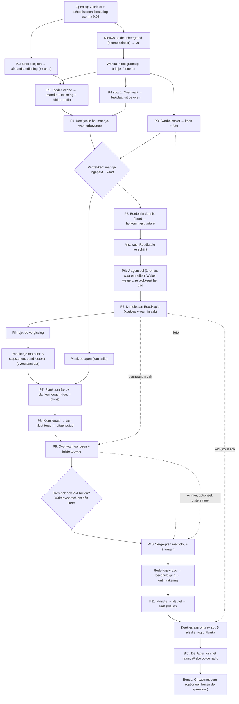

# Fairly Odd Tales

**Fairly Odd Tales** is een point & click avonturenspel in de stijl van klassiekers als *Return to Monkey Island*. Je speelt bekende sprookjes, maar net een beetje anders: de "slechterik" blijkt onschuldig, de "held" heeft een eigen plannetje, en niets is wat het lijkt. *Elke slechterik heeft een alibi.*

- **Doelgroep:** kinderen vanaf 8 jaar
- **Speelduur:** ± 15 minuten per sprookje (doel: mediaan ≤ 14:30 bij een eerste speelbeurt, geschat ± 14:15; zie [productie](ontwerp/productie.md#speelduurtoets)). De speelbare bonus na de aftiteling telt niet mee.
- **Toon:** grappig en spannend, nooit eng of bloederig. Niemand raakt gewond, niemand wordt vastgebonden. Wat "gevaarlijk" is, gebeurt buiten beeld en wordt met humor gebracht. Slapstick is pijnloos en spaarzaam: als Walter valt, draaien er sokjes rond zijn hoofd, en niets slaat ooit tegen zijn neus of hoofd.

**Andere documenten**
- [`ontwerp/productie.md`](ontwerp/productie.md): technische uitgangspunten (platform, engine, verdienmodel), assetlijst, ingesproken regels en spreeksnelheid, speelduurtoets, schraplijst en scope-lagen (moet / zou / mag), filmpjesbudget, regie van het wauw-moment, art- en audiorichting, planning, systeemschermen en ouderpagina.
- [`ontwerp/seriebijbel.md`](ontwerp/seriebijbel.md): premisse van de reeks, vaste cast, formule per aflevering, boog over de reeks, volgende afleveringen, taalkeuze en woordenlijst, oudertoets en waarden.

---

## Spelmechaniek

Een eenvoudige besturing zoals in *Return to Monkey Island*: geen lijst met werkwoorden, maar slimme klikken.

| Actie (muis) | Actie (tablet) | Wat gebeurt er |
|---|---|---|
| **Linksklik** op de grond | Tik | Walter wandelt erheen |
| **Linksklik** op een object of personage | Tik | De logische actie: oppakken, gebruiken, praten |
| **Rechtsklik** | Lang tikken | Bekijken: Walter zegt er iets grappigs over |
| **Muis over een object** | (vergrootglasknop) | De naam van het object verschijnt |
| **Voorwerp slepen** naar een object of personage | Tik voorwerp, tik doel | Voorwerp gebruiken of geven |
| **Voorwerp op een ander voorwerp** | Tik voorwerp, tik voorwerp | Combineren |
| **Voorwerp op Walter** | Tik voorwerp, tik Walter | Op zichzelf gebruiken (meestal een grap) |

**Altijd, voor iedereen:**
- **Spatiebalk / vergrootglasknop:** alle klikbare plekken lichten even op, mét naam. Namen verklappen nooit een oplossing ("Voeten", niet "Rode schoentjes van Roodkapje").
- **Detectiveboekje:** een **plaatjes-checklist** van de open doelen, die zichzelf afvinkt. Klik op een doel voor een ingesproken hint op drie niveaus: vage tip → duidelijke tip (met de plek gemarkeerd) → de oplossing. Het boekje bewaart ook alles wat je moet onthouden (klopsignaal, foto van Grootmoeder, sokkenteller). Een kind hoeft nooit iets uit het hoofd te kennen.
- Nieuwe doelen verschijnen pas als Walter ze **zelf ontdekt** (bv. "iets om de koekjes in te doen"). Het spel somt niets op voorhand op.
- Je kan niet doodgaan en niet vastlopen (zie *Softlock-preventie*).
- Alles wordt ingesproken. Ondertitels staan altijd aan; het gesproken woord licht op. Elk filmpje is per zin wegklikbaar.

### Hulpniveaus: Speurneus en Meesterdetective

Bij de start vraagt Walter: *"Ben jij een speurneus of een meesterdetective?"* Twee grote plaatjes: een **pet** (Speurneus, standaard) en een **detectivehoed** (Meesterdetective). Wisselen kan altijd in het pauzemenu, zonder gevolgen. We zeggen nooit "makkelijk" of "moeilijk": de **puzzels zijn in beide niveaus gelijk**, alleen het voorzeggen verschilt.

| Hulp | Speurneus | Meesterdetective |
|---|---|---|
| Hotspots oplichten, voorlezen, foto in beeld (P10) | ja | ja *(toegankelijkheid)* |
| Feedback per stap (schijven, lantaarntjes, planken) | ja | ja *(eerlijkheid: geen gokpuzzels)* |
| Boekje wiebelt bij stilstand (gaat nooit vanzelf open) | na 60 s | na 3 min |
| Juiste voorwerp wiebelt in de inventaris bij een personage | ja | nee |
| Hints | niveau 1–3 meteen | niveau 1 meteen, 2 na 30 s, 3 na nog 60 s |
| Losse plank op het kruispunt | glinstert zodra de mist weg is | geen glinster |
| Fout tochtje bij P5 | pictogram van dat pad blijft in de mist hangen | alleen de grap |
| Wanda aan de voordeur als er iets ontbreekt | noemt wat ontbreekt | *"Walter. Kijk eens in je boekje."* Pas bij de 2e poging noemt ze het. |
| Roodkapje kijkt naar het mandje (P11) | kijken + *ting* | alleen kijken |
| Sokkenteller | toont in welke scène er nog een sok ligt | alleen "3/5" |
| Sok-waarschuwing aan oma's deur (P9) | noemt de scène: *"Bij de beek, denk ik."* | *"Ik voel het in mijn tenen."* |
| Kietelveer wiebelt bij De Jager (bonus-museum) | na 20 s | na 40 s |

**Beloning:** wie geen enkele niveau-3-hint gebruikt, krijgt op het einde de **Detectivehoed-sticker** in het boekje (op beide niveaus).

### Het geheimpje: vijf verdwaalde sokken

Er ligt één sok van Walter per scène. Ze zijn nooit nodig om verder te raken. De eerste komt vanzelf mee uit de zetel en leert de teller aan: *"Die zoek ik al sinds Kerstmis. ...Waar zijn de andere?"* Wie er een mist, hoort hoogstens: *"Ergens ligt nog een sok. Ik voel het in mijn tenen."* Wie alle vijf heeft, krijgt in het slot een **sokkencape** van Grootmoeder (zie *Slot*).

**Geen sok is ongemerkt te missen.** Sok 1 komt vanzelf mee (P1), dus het hol mag achter je dicht. Sok 2 tot 4 liggen in scènes die vrij bereikbaar blijven tot je oma's kamer binnengaat, en vlak vóór die drempel waarschuwt Walter één keer als er nog een sok buiten ligt (zie P9). Wie dan bewust voor de deur kiest, laat die sokken achter: dat is een eigen keuze, geen ongeluk. Sok 5 krijg je gegarandeerd vóór het slot: vind je hem niet zelf onder het bed, dan reikt Grootmoeder hem aan bij de koekjes. Zo kan de autosave nooit ongemerkt een sok onbereikbaar maken.

**Sok nr. 6** bestaat alleen in de bonus na de aftiteling (zie *Het Griezelmuseum*). Het is een sticker in het boekje en telt niet mee voor de cape.

### Slapstick: Walter valt (pijnloos, slim gedoseerd)

Walter is een grappige valler, maar hij valt **niet om de haverklap**. Lotte (9): *"De eerste keren is het grappig, maar daarna denk ik: ja, ja, weer."* Mats (8): *"Een knop om Walter te laten vallen. Wanneer ik wil."* Daarom zijn er **weinig verplichte vallen**, elk van een ander soort, en kan het kind Walter **zelf** laten struikelen wanneer het wil (zie *De pantoffels* hieronder). Er is **één valsysteem** met drie bewegingen en één "bijna":

| # | Val | Wat je ziet | Duur |
|---|---|---|---|
| V1 | **Struikelen** | Walter haakt achter zijn pantoffel, maait met zijn armen en belandt op zijn zitvlak | 1,5 s |
| V2 | **Buikschuiver** | Hij glijdt zacht op zijn buik als een slee, armen vooruit, kin omhoog (niets raakt neus of hoofd); *zoeffff*, een stofwolkje, en hij staat meteen weer recht (variant: duik in een breimand) | 2,5 s |
| V3 | **Plons** | Hij valt in het water, drijft drie tellen mee als een badeend en klautert terug op **dezelfde** oever, met natte pantoffels | 3 s (daarna 1,5 s) |
| — | **Bijna!** | Walter wankelt (het begin van V1), vangt zich op en kijkt trots: *"Ha. Niet deze keer."* De verrassing is dat hij níét valt. | 1 s (hergebruik, geen nieuwe animatie) |

- **Pijnloos en vriendelijk:** er draaien **sokjes** rond zijn hoofd in plaats van sterretjes. Geen pijnzin (nooit *"au"*: hoogstens *"oef"*, *"hé"* of *"oei"*), geen traan. **Niets slaat tegen zijn neus of hoofd**, en niemand duwt hem: hij valt altijd over zijn eigen pantoffels, een gladde steen of een plank die niet past. Walter staat meteen recht, een beetje beschaamd.
- **Zetelscore van de grond:** de eerste V1 of V2 in een scène krijgt de vaste zin van die scène, daarna zijn er alleen nog geluiden (*oef*, *wah*). Hol: *"Zetelscore van de grond: drie."* · Kruispunt: *"Zetelscore van de mist: twee."* · Beek: *"Zetelscore van deze oever: één. Te glad."* · Huisje: *"Zetelscore van het tuinpad: vier. Rozengeur inbegrepen."* · Oma's kamer: *"Zetelscore van oma's kamer: acht. Alles is zacht."*
- **Elk soort hoogstens een paar keer, en vaak gebeurt er iets slims in de plaats.** Waar vroeger een bonk tegen zijn neus zat, reageert nu iemand anders of ontdekt Walter iets:

| Waar | Aanleiding | Wat er gebeurt | Wat het kind leert |
|---|---|---|---|
| Opening | einde van het nieuws (*"kans op zakdoeken"*) | **V2** (de enige verplichte val van het spel) | het valsysteem, en dat die pantoffels iets kunnen |
| P3 | aan de lade trekken met een foute code | **geen val:** de lade rammelt *klak-klak*, en Wanda telt zonder op te kijken: *"Eén."* · *"Twee."* · *"Walter. Familie."* | Walter noemt de eerste foute plek in pootjes: *"Twee pootjes. Wie had er twee pootjes?"* |
| P4 | tweede klik op de hete oven | **geen val:** Walter blaast op zijn poten, en de ovenwant aan het haakje wuift mee in de wind: *"Hé. Die want zwaait naar mij."* | de ovenwant |
| P6 | de waarom-teller van Roodkapje haalt tien | **Bijna!** Walter wankelt en vangt zich aan de wegwijzerpaal | (verrassing: deze keer niet) |
| Beek | op de natte stapstenen klikken (één keer) | **V1** | (grap) |
| P7 | een plank testen die niet past | **V3: plons.** De vis vindt de plons prachtig: hij klapt met zijn vinnen en doet het geluid na (*"Plons! Blub-ha-ha-blub."*) | Bert zegt *te kort* of *te lang*: de richting |
| P8 | een fout klopje | **geen val:** de nep-oma verspreekt zich achter de deur (zie P8) | er bestaat een goed klopje; het briefje speelt het patroon voor |
| Huisje | de brievenbus openen (sok 4) | **geen val:** de sok springt eruit als een koekoek uit een klok | (grap) |
| P10 | derde BOE | **V2-variant:** Walter springt van schrik in de breimand | (grap: zij wint) |
| overal | het kind klikt op Walters pantoffels | V1, V2 of *Bijna!* (zie hieronder) | (zelf gekozen) |

Wie niets kiest, ziet Walter dus één keer vallen (opening), hoogstens één keer *bijna*, en een plons per foute plank. Wie wil, krijgt er via de pantoffels en de stapstenen meer bij.

- **Nooit een straf:** een val verandert nooit een flag of de inventaris, is per klik af te breken en duurt bij herhaling korter. Bij *minder beweging* valt de camera-schok weg.

### Speelse chaos: huilknop, emmer, Ridder-radio en de pantoffels

Mats wil chaos maken, Lotte wil meer Wiebe en de emmer bij iedereen, maar geen extra drukte. Daarom zijn er **drie speelwerktuigen** (geen nieuwe knoppen: de huilknop is het enige chaosknopje, de radio en de emmer zitten in de inventaris) plus **Walters eigen pantoffels**, en een vaste regel tegen spaghetti: **elk werktuig heeft hoogstens één eigen reactie per personage of plek**, daarna volgt de **generieke reactie** van dat werktuig. **Chaos zet nooit een puzzelflag**, neemt nooit een voorwerp weg en eindigt altijd in dezelfde toestand. Er bestaan alleen cosmetische `CHAOS_*`-flags (*deze reactie is al gespeeld*, *pantoffel met hap*, *aantal struikels in deze scène*). De enige uitzondering is een verzamelflag: de emmer bij de vis kan sok 3 geven.

**Wanneer chaos werkt: alleen in vrij spel.** Zolang er een **filmpje, dialoog of keuzescherm** open is, staat alle chaos uit: de huilknop is gedimd (tikken doet niets), voorwerpen kan je niet slepen en de pantoffels reageren niet. Dat geldt voor de vergissing, de ontmaskering, de kast en het slot, voor elk gesprek (Wanda, Wiebe, Bert, Roodkapje, de "grootmoeder"), voor de keuzes (de antwoorden in het vragenspel, 💬 / 😱 in P10, sok / deur op de drempel, het beschuldigingsscherm), voor de close-ups (slot van P3, kaart, klopknoppen van P8, touwtjesdoolhof), voor het Roodkapje-moment en voor de bonus in het museum (Walter is daar niet). **Het nieuws** is wel vrij spel: je speelt al terwijl het loopt. Huil of radio je dan, dan wacht Ursula zoals bij elke zin van Walter (de eerste keer: *"...Ik wacht wel."*).

**1. De huilknop** (een maantje naast het boekje). Walter huilt de wolvenhuil: *"Ahoeoeoe!"* (in het script zo gespeld, zodat het nooit als *"au"* leest). Per scène volgt één reactie; daarna (generiek) hoor je alleen nog het huilen en stopt de krekel even met tjirpen. Tussen twee keer huilen zit 3 s.

| Scène | Reactie |
|---|---|
| Hol | Wiebe huilt mee. **Wanda** (zonder op te kijken): *"Walter. De buren."* |
| Kruispunt | Ver weg blaffen honden en de mist trilt even. Staat Roodkapje er, dan noteert ze: *"Genoteerd: huilt."* |
| Beek | De vis duikt onder. **Bert:** *"Niet huilen, maat. Bouwen."* |
| Huisje | De vogel steekt boos zijn kop uit het vogelhuisje. Hoge oma-stem van achter de deur: *"Dat was de wind, liefje!"* |
| Oma's kamer | Uit de kast: *BONK, klop, klop* (oma klopt terug). Is ze al vrij, dan klopt ze het op de tafel. |
| Museum (bonus) | **Uit.** Walter is er niet; de wolven grommen hun eigen koortje (zie *Het Griezelmuseum*). |

**2. De emmer** (vanaf P9) is het speelvoorwerp voor op hoofden: Bert, de vis, de "grootmoeder", Roodkapje en de kast hebben elk één reactie (zie *Verplichte verkeerde-voorwerp-reacties*, en de luisteremmer in P10). **Generieke reactie** (iemand of iets zonder eigen reactie, of een tweede keer): Walter houdt de emmer even boven het doel, kijkt erin en trekt hem terug: *"Hm. Nee. Hier past geen emmer."* Kruispunt en beek blijven bereikbaar tot oma's kamer, dus wie terugwandelt, kan de emmer aan Bert en de vis geven. De emmer komt altijd terug. *(De emmer al in het hol, voor Wiebe en Wanda, kan niet zonder het hol en P9 open te breken; de knipoog is de radio in de emmer, zie hieronder.)*

**3. De Ridder-radio** (vanaf P2). Wiebe blijft in sprookje 1 veilig thuis, maar je hoort hem overal. Gebruik de radio (of sleep hem naar iemand) en Wiebe antwoordt met één zin. Walter houdt hem tegen zijn oor met de gewone *gebruiken*-animatie. Onderweg verschijnt Wiebe niet in beeld: je hoort alleen zijn stem en een kraakje.

| Waar / op wie | Wat je hoort |
|---|---|
| Hol | **Wiebe:** "Papa, ik sta naast je. ...Over." |
| Kruispunt | **Wiebe:** "Papa, ik hoor mist. Hoe klinkt mist? ...Shhhhhh. Over." |
| Radio → Roodkapje | **Roodkapje:** "Waarom ben jij klein?" **Wiebe:** "Waarom ben JIJ rood?" *(stilte)* **Roodkapje:** "...Goeie." |
| Beek | **Wiebe:** "Papa, ik ben nu Ridder Vergiet. Wat ben jij? Over." **Walter** *(kijkt naar de tekening)*: "...Onderweg. Over." |
| Huisje | **Wiebe:** "Papa, klop je wel zoals mama? Klop, klop, BONK! Over." |
| Radio → kast (vóór `GRANNY_FREE`) | **Oma** (gedempt): "Is dat een kind met een radio? Haal me hier uit!" **Wiebe:** "Papa, de kast praat. Over." |
| Radio → "grootmoeder" (vóór `UNMASKED`) | **"Oma":** "Hallo liefje, met oma!" **Wiebe:** "Jij klinkt niet als een oma." **"Oma":** "...Verkouden." |
| Radio → Roodkapje in bed (na `UNMASKED`) | Ze is nu gewoon Roodkapje: de radio speelt haar reactie van het kruispunt (*"Waarom ben jij klein?"*) als die nog niet gespeeld is, anders de generieke zin. |
| Radio + emmer (combineren) | Walter praat in de emmer. **Wiebe:** "Papa? Zit je in een put? ...Cool. Over." |
| Slot | De radio kraakt vanzelf: Wiebe meldt zich (zie *Slot*). |
| Daarna, of elders (generiek; ook Grootmoeder na `GRANNY_FREE`) | **Wiebe:** "Kssshh... Ik kijk tekenfilms. Over." |

De radio is nooit nodig en verlaat de inventaris nooit. Wie hem nooit gebruikt, hoort Wiebe nog altijd in het slot.

**4. De pantoffels** (Mats' knop, zonder nieuwe knop). Walters pantoffels zijn een gewone hotspot op Walter zelf (naam bij het oplichten: *Pantoffels*). **Bekijken** geeft een korte zin (op het kruispunt: *"Nat. Mist is ook gewoon regen die lui is."*, elders: *"Comfortabel. En een tikje gevaarlijk."*). **Klikken** (tik op zijn voeten) laat Walter struikelen, vanaf de val na het nieuws (`NEWS_DONE`): daar leert de opening het aan, want na *"kans op zakdoeken"* wiebelen de pantoffels één keer.
- Per scène hoogstens **drie** struikels, in vaste volgorde: **V1**, dan **V2**, dan **Bijna!** De eerste val in een scène krijgt de zetelscore van die scène (als die nog niet gespeeld is). Tussen twee struikels zit 3 s.
- Daarna (generiek): Walter kijkt naar zijn voeten: *"Nee. Mijn pantoffels hebben pauze."* (één keer per spel; daarna schudt hij alleen zijn hoofd). In de volgende scène kan het weer.
- Een voorwerp dat je op Walter sleept, gaat altijd naar Walter, nooit naar zijn pantoffels. Wandelen blijft gewoon: een tik náást Walter is een tik op de grond.
- Niet in het Roodkapje-moment en niet in het museum (Walter is er niet).

---

# Sprookje 1: Roodkapje
## *De Zaak van de Rode Zakdoek*

### Het verhaal in het kort

Er is iets raars aan de hand in het Donkere Woud: wolven verdwijnen. Op elke plek vindt de politie maar één spoor: **een rode zakdoek**. En getuigen hoorden... heel hard niezen.

Walter Wolf, een rustige wolf met pantoffels en een leesbril, ziet het nieuws op tv. Zijn vrouw Wanda vertelt hem een geheim: diep in het bos woont **Grootmoeder**, een gepensioneerde spionne die alles weet. Walter moet de informatie bij haar gaan halen.

Op een kruispunt in de mist komt hij een meisje met een rode kap tegen dat ontzettend veel vragen stelt. Hij laat haar nadrukkelijk níét meegaan, maar per ongeluk flapt hij eruit waar hij naartoe gaat. Naar Grootmoeder. *Haar* grootmoeder. Wat moet een wolf bij haar oma? Roodkapje rent vooruit...

> **De twist:** Roodkapje is een amateur-detective. Sinds die rode zakdoek kijkt iedereen raar naar háár kap. Ze wil de zaak zelf oplossen, maar oma wou haar niks vertellen ("Te gevaarlijk voor kinderen!"). Als ze hoort dat er een wolf komt, rent ze naar oma, laat oma zich verstoppen in de kast en draait de sleutel om, "voor haar eigen veiligheid". Dan verkleedt ze zich als oma om de wolf uit te horen. Maar de wolf komt juist informatie *halen*... Twee detectives die elkaar proberen uit te horen, en geen van beiden weet iets!

> **De dader (nooit eng):** De Jager vangt geen wolven om ze kwaad te doen. Hij **verzamelt** ze voor zijn **Griezelmuseum**. Daar zitten ze veilig achter een fluwelen koord, maar ze moeten de hele dag grommen voor toeristen en vervelen zich suf. De Jager is **allergisch voor wolvenhaar**: hij niest en verliest overal zijn rode zakdoek. *"HATSJOE!"* Op het einde zie je hem één keer: een reusachtig silhouet met een piepklein hoofdje.

### Personages

| Personage | Wie | Wil | Grappige eigenschap / running gag |
|---|---|---|---|
| **Walter Wolf** | De speler. Groot, harig, lief, beetje onhandig. Pantoffels en cardigan. | Terug naar zijn zetel (en, zonder het te weten, een held zijn) | Geeft alles een **zetelscore**: *"Twee op tien. Er zit een mier in."* Valt pijnloos en scoort dan de grond: *"Zetelscore van de grond: drie."* |
| **Wanda Wolf** | Walters vrouw. Slim en kordaat, de echte baas in huis. | Het wolvennetwerk beschermen | Zegt alles in zo weinig mogelijk woorden. |
| **Wiebe** | Hun welpje. | Tekenfilms kijken, ridder zijn | Draagt het mandje als helm (later een vergiet). Vraagt of papa een held is. Praat via de **Ridder-radio**, ook in het slot. Houdt van scheetkussengrappen. (In sprookje 2 gaat hij echt mee, met Wanda: zie de [seriebijbel](ontwerp/seriebijbel.md#volgende-aflevering-hans-en-grietje-schets).) |
| **Uil Ursula** | Nieuwslezeres op Wolf-TV. Heel serieus. | Serieus nieuws brengen | Knipoogt met één oog; het weerbericht klopt altijd, maar raar. |
| **Inspecteur Das** | Politie, in het nieuws. | Iets ontdekken | Verdenkt steeds de verkeerde. |
| **Roodkapje** | Klein, slim, nieuwsgierig. Notitieboekje en potlood. | De zaak oplossen, en niet zelf verdacht zijn | Stelt alleen vragen: *"Waarom?"* en schrijft alles op. |
| **Bever Bert** | Bouwt een dam en praat als een bouwvakker. | Zijn dam afwerken, lekker hout knagen | Proeft alles als een chef: *"Dat smaakt naar..."* |
| **Grootmoeder** | Gepensioneerde spionne. Zit het grootste deel van het spel in de kast. | Haar geheimen bewaren | Breit geheime boodschappen in sjaals (H… HE… HELP). |
| **De Jager** | De dader. Alleen als silhouet aan het raam en van achteren in het museum na de aftiteling. | Zijn Griezelmuseum vullen | *"HATSJOE!"* + een rode zakdoek zo groot als een tafellaken |
| **De sok** | Walters oude sok (eigenlijk vijf). | ? | Duikt overal op. Verzamelobject (zie *Het geheimpje*). |
| *Bijfiguren* | Vis, vogel, krekel, uil, kikker, eend, slak | | Eén grap per stuk. De krekel stopt altijd met tjirpen als iemand iets doms zegt. |

**Walters boog:** begin *"Ik ben een zetel-expert"* → midden (de beek): twijfel, Wiebes tekening "Papa de held" en *"Wanda had gelijk"* → einde: hij kiest zelf om verder te gaan.

**Taal:** Nederlands met Vlaamse woordkeuze, geen dialect. Ingesproken zinnen maximaal ± 12 woorden, één idee per zin. Details en de woordenlijst voor een Nederlandse versie: zie de [seriebijbel](ontwerp/seriebijbel.md#taalkeuze).

### Overzicht van de scènes

| # | Scène | Doel-speeltijd | Puzzels | Moeilijkheid (1–4) |
|---|---|---|---|---|
| 1 | Het Wolvenhol (woonkamer + keuken) | 3:45 | P1, P2, P3, P4 | 1 · 1 · 2 · 2 |
| 2 | Het Kruispunt in de mist (+ Roodkapje-moment) | 3:15 | P5, P6 | 3 · 2 |
| 3 | De Beek | 1:30 | P7 | 2 |
| 4 | Voor het huisje van Grootmoeder | 1:55 | P8, P9 | 2 · 2 |
| 5 | Binnen bij Grootmoeder (finale) | 3:50 | P10, P11 | **4** · 2 |
| | **Totaal** | **± 14:15** (doel ≤ 14:30; snelle speler ± 10:45, rondklikker ± 19) | **11 puzzels** | |
| + | *Bonus: Het Griezelmuseum (na de aftiteling)* | *1:00–1:30, buiten de speelduur* | *3 plaatjesdoelen* | *1* |

Eén denkpiek per scène, met P10 als hoogtepunt en P11 als ontspannen afronding. De opbouw van deze tijden en wat we schrappen als de speeltest uitloopt, staan in [productie.md](ontwerp/productie.md#speelduurtoets).

---

## Scène 1: Het Wolvenhol

**Decor:** Een gezellige woonkamer met houten balken. Een versleten groene **zetel** met een zichtbare bobbel, een ouderwetse **tv** waarop net het nieuws begint, een **bureau** met een lade, een **familiefoto** in een houten kader, een **open keuken** met een **oven** en vlak ernaast een **ovenwant** aan een haakje. Op tafel ligt een stuk **kaas**. Welpje **Wiebe** speelt op het tapijt met het **mandje** op zijn hoofd. **Wanda** zit te breien bij het raam, met haar **breimand** naast zich.

**Opening (in-engine, 0:08):**
> *Walter ploft met een kop thee in de zetel.* **PRRRRT.** *Achter de zetel giechelt Wiebe, met een scheetkussen.*
> **Walter:** "Dat was de zetel. Ik heb een alibi."
> **Wanda** *(zonder op te kijken, steekt haar hand uit)*: "Wiebe." *(Het kussen verdwijnt in haar breimand.)*
> **Walter** *(schuift heen en weer)*: "...Hé. En er zit iets in mijn rug."

Dit is de enige scheetgrap van het spel: een speelgoedgrap van Wiebe. Het geluid komt uit een kussen, nooit uit een personage, en niemand wordt uitgelachen. Daarna is het kussen weg. *Terugvaloptie:* een kapotte **zetelveer** die *BOIIING* doet, met dezelfde timing en dezelfde zinnen. **Wie beslist:** de PO, uiterlijk op het einde van week 7 (na de ouderreacties uit het papieren prototype en de store-richtlijnen voor de kindercategorie). Beide geluiden worden gemaakt en de zinnen zijn dezelfde, dus wisselen kan nog tot de store-indiening zonder nieuwe opname.

**Besturing aan na ± 0:08.** Het nieuws loopt op de achtergrond terwijl je al klikt:
> **Ursula:** "Goedenavond. Weer een wolf verdwenen. De vijfde al."
> **Das** *(houdt een rode zakdoek omhoog, zo groot als een tafellaken; hij valt over hem heen)*: "Ons enige spoor. Getuigen hoorden niezen. HEEL hard niezen."
> **Ursula:** "Wolven, blijf binnen. Het weer: mist, met kans op zakdoeken." *(knipoogt met één oog)*

- Praat Walter terwijl het nieuws loopt, dan wacht Ursula en kijkt ze opzij. De eerste keer: *"...Ik wacht wel."*
- Tijdens het nieuws kan je de zetel (P1) en alle bekijk-grappen al doen. Klik je op Wanda, Wiebe, de lade, de oven of de deur, dan springt het nieuws meteen naar zijn laatste zin. Zo mist niemand waarom Walter op pad gaat, en niemand moet wachten.
- **Na "kans op zakdoeken"** (besturing ± 0:04 uit): *"Zakdoeken?!"* Walter draait zich naar de tv, struikelt over zijn pantoffel en maakt een buikschuiver over het tapijt (V2, zie *Slapstick*). *"Zetelscore van de grond: drie."* Zijn pantoffels wiebelen één keer na: vanaf nu kan het kind er zelf op klikken (zie *De pantoffels*).

**Wanda (in-engine, 0:18, telegramstijl):** *"Walter."* Hij wandelt vanzelf naar haar toe. *(Twee maten van het spionnenthema.)*
> **Wanda:** "Grootmoeder. Spionne. Weet alles."
> **Walter:** "Een spion? Met een rollator?"
> **Wanda:** "Wil koekjes. Kaart: lade. Mijn code."
> **Wanda** *(klopt op de tafel)*: "En klop zó." *Klop. Klop. BONK.* *(Bij de BONK wipt Walters theekopje op en landt het weer.)*
> **Walter** *(vangt zijn kopje)*: "Onthouden." *(Hij krijgt het **briefje**: ● ● ⬤)*

**Besturing aan.** In het boekje staan twee doelen: 🍪 **Koekjes voor oma** en 🗺️ **De kaart**. Het doel 📺 **Tekenfilms voor Wiebe** verschijnt pas als Walter met Wiebe praat (of als het subdoel 🧺 opduikt). Verder staat er het klopsignaal **● ● ⬤** (klein, klein, GROOT; het briefje toont ook het antwoord van oma: **⬤ ● ●**, *"Een echte Grootmoeder klopt altijd terug"*). Wie opnieuw met Wanda praat, krijgt per open doel één korte zin (= hint niveau 1 van dat doel).

**Tempo:** de eerste klik valt na ± 0:08 (ronde 3: 0:45). Een mediane speler staat na ± 3:45 in het bos (ronde 3: 4:15).

Scène 1 bestaat uit **drie kettingen** die in elke volgorde kunnen: Wiebe en zijn helm (P1 → P2), de hete koekjes (P4, die het mandje van P2 nodig heeft) en Wanda's code (P3).

### Puzzel 1: Iets in mijn rug *(tutorial bekijken)*
- Klik op de **zetel**: *"Hier zit iets in mijn rug. Ik moet eerst eens goed kijken."* Eén keer verschijnt een oog-icoon met uitleg (rechtsklik / lang tikken).
- **Bekijk** de zetel: *"Die zetel ziet er... bobbelig uit."* Pas nu kan Walter graven. Hij vindt de **afstandsbediening**, een kruimel en **sok 1/5**.
- Afstandsbediening op de tv: *"Breien, breien, nog meer breien. Wiebe wil tekenfilms."* (Niet nodig, wel een grap.)

### Puzzel 2: Ridder Wiebe
- Wiebe: *"Mijn helm krijg je niet! Behalve... als ik tekenfilms mag kijken."*
- **Oplossing:** geef de **afstandsbediening** aan Wiebe (in het spel, 0:08):
  > **Wiebe** *(tikt met de afstandsbediening op Walters schouders)*: "Ik sla u tot Ridder Pantoffel! Ben jij een held?"
  > **Walter:** "Nee jongen. Zetel-expert."
  > **Wiebe** *(geeft een tekening en een speelgoedwalkie)*: "Voor als je het vergeet. En de Ridder-radio. Ik heb er twee. Over!"
- Walter krijgt het **mandje**, de **tekening van Wiebe** ("Papa de held", met cape) en de **Ridder-radio**. De tekening steekt hij in zijn cardigan. Wiebe zet een vergiet op als nieuwe helm en kijkt tekenfilms. Klik op de tv: *"NIET AANKOMEN!"*

### Puzzel 3: De lade met het symbolenslot
- De lade zit op slot met **drie draaischijven in een houten kadertje**, hetzelfde kader als de familiefoto. Op elke schijf: 🌙 maan, 🦴 bot, 🌲 boom, 🧀 kaas, ⭐ ster, 🪶 veer. Boven de schijven staan **1, 2 en 3 pootafdrukjes**. Onder de schijven zit de **handgreep** van de lade.
- Bekijk het slot: *"Dat kadertje lijkt op dat van onze familiefoto. Wanda kiest altijd iets met de familie."*
- **De familiefoto:** drie wolven op een rij, onder elke wolf een bordje met 1, 2 of 3 pootjes (tellen, geen cijfers lezen). Opa (1) huilt met de **maan** achter zich, Wanda (2) draagt een **ster**-medaille ("beste kok"), baby Wiebe (3) kauwt op een **bot**.
- De **kaas** op tafel is een afleider: wie kaas kiest, kijkt niet naar *wie* iets vasthoudt.
- **Oplossing:** 🌙 ⭐ 🦴. Tik op een schijf om hem te draaien. Staat een schijf juist, dan gloeit dat stukje kader op (eerlijkheid: geen gokpuzzel). Staan ze alle drie juist, dan springt de lade vanzelf open.
- **Fout = grap met informatie.** Trek je aan de handgreep terwijl de code nog fout is, dan rammelt de lade *klak-klak* en blijft dicht. Walter noemt de **eerste foute plek in pootjes**, nooit het antwoord: *"Twee pootjes. Wie had er twee pootjes?"* Staat er kaas: *"Kaas? Wie op de foto houdt er kaas vast? ...Niemand."* Ondertussen telt **Wanda** mee, zonder op te kijken van haar breiwerk: *"Eén."* · *"Twee."* · bij de derde keer: *"Walter. Familie."* (de hint om naar de familiefoto te kijken). Daarna is een fout alleen nog een *klak* (0,5 s), zodat wie blijft trekken de speelduur niet opblaast.
- De lade gaat open: de **kaart van het bos** en een **foto van Grootmoeder**. Wanda: *"Voor als je twijfelt."* De foto komt in het boekje: grijze krullen, **geen** bril, **grote** handen met breinaalden, **grote** voeten in sloffen.

### Puzzel 4: Hete koekjes
- Klik op de **oven**: Walter steekt zijn poot uit, voelt de hitte en trekt hem snel terug: *"Oei oei oei! Heet heet heet! ...Niet voor blote poten."* Klik je nog eens, dan blaast Walter op zijn poten, en de **ovenwant** aan het haakje ernaast wuift mee in de wind: *"Hé. Die want zwaait naar mij."* De want blijft hangen: oppakken doe je zelf. Elke volgende klik geeft alleen nog *"Oei!"*.
- **Stap 1:** pak de **ovenwant** van het haakje en gebruik hem op de oven. Walter zet de **bakplaat met koekjes** op het aanrecht.
- **Heeft Walter het mandje al**, dan pakt hij meteen in: *"Daar heb ik net iets voor."* De koekjes (3) gaan in het mandje en de **ovenwant erbovenop**: *"Een dekentje. Zo blijven ze warm."*
- **Heeft hij het mandje nog niet:** *"Ik kan toch geen bakplaat meesleuren door het bos?"* Nu pas verschijnt in het boekje een nieuw doel: 🧺 **Iets om de koekjes in te doen.** **Stap 2:** gebruik het **mandje** op de bakplaat; Walter pakt in zoals hierboven.
- In de inventaris staat daarna één voorwerp: **mandje met koekjes**.

Zo heeft elk voorwerp een reden: de want is nodig voor de oven en gaat mee als warmhouder; het mandje is nodig omdat je geen bakplaat meesleurt. Niemand hoeft het lijstje op te sommen.

**Vertrekken:** klik op de voordeur. Ontbreekt er iets, dan houdt Wanda Walter tegen (zie *Hulpniveaus* voor wat ze zegt). Is het mandje ingepakt en heeft Walter de kaart:
> **Wanda:** "Wees voorzichtig. En vertel aan niemand waar je naartoe gaat!"
> **Walter:** "Natuurlijk niet. Ik praat nooit met vreemden."

*(Dit gaat dus helemaal mislopen.)* Na vertrek is het hol niet meer bereikbaar; er is daar niets meer nodig.

**Optionele bekijk-grappen (6):** Wanda's breiwerk (*"Weer een sjaal met rare patroontjes"*), Wanda's breimand (*"Daar zit het bewijs. Ik zeg niks."*), de zetel na P1 (*"Negen op tien. Mijn beste werk."*), Wiebe met de vergiet, het raam, het tv-kastje.

---

## Scène 2: Het Kruispunt in de mist

**Decor:** Een open plek in dikke mist (het weerbericht had gelijk). Een kale **wegwijzerpaal** met **drie lantaarntjes** die uit zijn. Op de grond liggen **drie borden** die eraf gewaaid zijn: 🌾 **Molen**, 🌸 **Bloemenveld**, 🏠 **Grootmoeder**. Naast de paal ligt zichtbaar een vierde, gebroken stuk: de **losse plank**, vol uitgesneden letters. Een **boomstronk** en enkele **paddenstoelen**.

Bij het begin van elk pad staat een **herkenningspunt**, groot en vlakbij, dus zichtbaar in de mist:
- 🌳 een **holle boom** met een uilengat (molenpad, links)
- 🪨 de **Koekjessteen**, een ronde platte steen met stippen (Grootmoederpad, rechtdoor)
- 🍄 een **paddenstoelenkring** (bloemenpad, rechts)

In de verte zie je niets, tot de mist optrekt: dan worden een molenwiek, een bloemenveld en een rookpluim uit een schoorsteen scherp.

### Puzzel 5: Borden in de mist
- Bekijk de paal: *"De borden zijn eraf gewaaid. Elk pad begint bij iets. Wat stond er ook weer op mijn kaart?"*
- **De kaart** (tik in de inventaris of gebruik op de paal): een close-up met drie paden. **Aan het begin** van elk pad staat het herkenningspunt getekend, **aan het einde** de bestemming: holle boom → molen, Koekjessteen → beek → huisje met rookpluim, paddenstoelen → bloemen. Je leest het als een strip: "waar begin je, waar kom je uit". Er is geen links of rechts nodig en niets moet gedraaid worden.
- **Het sluippad staat ook op de kaart:** een dun **stippellijntje** van het bloemenveld naar de stapstenen in de beek, met kleine voetjes erbij. Het begint niet bij een herkenningspunt, dus het krijgt geen bord en is nooit een antwoord. Bekijk het: *"Een stippellijntje. Een sluippad voor kinderpootjes. Geen bord nodig."* Zo klopt later alles: Roodkapje blijft op een pad, en een kind dat de kaart heeft leren lezen, ziet waarom ze eerder bij oma is.
- **Tik een bord, tik een herkenningspunt.** Walter hangt het bord daar en wandelt twee stappen het pad in om te kijken (± 3 s).
  - **Juist:** het bord klikt vast, **een lantaarntje gaat aan** en de mist op dat pad wordt dunner. Molen: *"Klopt. Ik hoor de wieken kraken."* Bloemen: *"Klopt. Het ruikt hier naar lente."* Grootmoeder: *"Klopt. Ik hoor een beek. Net als op de kaart."*
  - **Fout:** Walter komt terug met een bewijsstuk van het pad waar hij wél was. Het bord valt terug.

| Walter liep in het... | Gevolg | Zin |
|---|---|---|
| Molenpad | Helemaal wit van het meel | *"Ik ben een spookwolf. Dit is dus het molenpad."* |
| Bloemenpad | Stuifmeel op zijn neus, hij niest | *"HATSJOE! ...Oei. Nu ben ik zelf verdacht. Hier liggen bloemen."* |
| Grootmoederpad | Natte pantoffels | *"Daar stroomt een beek. Op de kaart loopt het oma-pad over de beek."* |

- **Niet gokbaar:** wie de kaart leest, lost het in drie tikken op. Wie gokt, leert bij elke fout welk pad het wél is, dus na hoogstens twee foute tochtjes weet je alles. Gokken is geen manier om de puzzel te ontwijken, wel een tweede manier van zoeken (met extra grappen).
- **Wauw van de scène:** als alle drie de lantaarntjes branden, trekt de mist in één zachte beweging op (geen flits). De silhouetten worden scherp, er valt zonlicht in.
- **De plank:** Walter raapt hem zelf op, nu of later (*"Een stukje wegwijzer. Vol letters. Dat kan altijd van pas komen."*). Op Speurneus glinstert hij zodra de mist weg is.
- **Sok 2/5:** na de mist kan je op het uilengat klikken. De uil gooit een sok naar buiten: *"Hoe-hoe-hoe vies."*

### Puzzel 6: Roodkapje en haar vragen
Zodra de mist weg is, springt **Roodkapje** achter de boomstronk vandaan.

**Het omgekeerde vragenspel, met de waarom-teller.** In het originele sprookje stelt de wolf de vragen. Hier vuurt Roodkapje ze af. In de hoek van haar notitieboekje staat een **turfje** dat bij elke "waarom" hoorbaar *tik* doet. Het staat al op zeven als ze verschijnt (*"Vandaag al zeven."*). De speler kiest één keer een antwoord:

> **Roodkapje:** "Hallo! Wie ben jij? Waarom pantoffels? Waarom ruikt je mandje naar koekjes?" *(tik, tik: negen)*
>
> 1. *"Ik wandel gewoon."* → "Waarom? Wolven rennen toch?"
> 2. *"Ze zijn comfortabel."* → "Waarom comfort? Verberg je iets?"
> 3. *"Mag ik ook iets vragen?"* → "Nee. Waarom?"

Elk antwoord levert de tiende *tik* op: er komt een confettipuffje uit haar potlood. **Roodkapje:** *"Tien! Record."* Walter wankelt van al die vragen, iedereen verwacht dat hij valt... en hij vangt zich op aan de wegwijzerpaal (*Bijna!*): *"Ha. Niet deze keer."* Zo wordt het "waarom-waarom-waarom" zelf de grap, en duurt het maar één ronde. Daarna tikt het turfje gewoon verder, zonder gevolg.

Daarna plant ze haar motief en wil ze mee. **Walter weigert duidelijk**, en Roodkapje trekt zelf de conclusie:
> **Roodkapje:** "Sinds die rode zakdoek kijkt iedereen raar naar mijn kap. Ik ga met je mee!"
> **Walter:** "Nee. Jij kent mij niet. Ik ben een vreemde."
> **Roodkapje:** "Je hebt pantoffels aan."
> **Walter:** "Vreemden hebben ook pantoffels."
> **Roodkapje** *(schrijft)*: "Vreemden. Ook met pantoffels. Niet mee. ...Dat zegt mijn mama ook. Dan blijf ik hier staan. In de weg."

Ze plant zich voor de **Koekjessteen** en loopt **niet** mee. Klik je op het Grootmoederpad: *"Waar ga je naartoe? Waarom loop je zo snel?"*

- **Doel:** Roodkapje iets beters te doen geven.
- **Bekijk** Roodkapje: *"Ze kijkt steeds naar dat bloemenveld."* Daarna kan je haar vragen: *"Waarom kijk je steeds naar die bloemen?"*
  → *"Mama zei: pluk bloemen voor oma, maar blijf op het pad. Het bloemenpad ís een pad. En het sluippadje ook. Maar ik heb niks om ze in te doen."*
  Het idee komt dus van haarzelf, en ze blijft op een pad (het stippellijntje op Walters kaart).
- **Oplossing:** geef het **mandje** aan Roodkapje. Walter haalt eerst de koekjes en de ovenwant eruit en propt ze in zijn cardigan: *"Die zijn voor oma. En die... je weet maar nooit."* Vanaf nu hangt de duim van de ovenwant zichtbaar uit zijn zak.
  > **Roodkapje:** "Van een vreemde krijg ik niks. ...Maar lenen mag. Ik schrijf het op." *(schrijft)* "Geleend: één mandje. Terug te geven."

  Zo blijft het consistent met de koekjes (die weigert ze, zie *Verkeerde-voorwerp-reacties*): een cadeau neemt ze niet aan, iets lenen schrijft ze op en geeft ze terug (P11).
- Geef je het mandje vóór de bloemenvraag: *"Een mandje? Is dit omkoperij? Ik schrijf het op. ...Oh! Voor bloemen voor oma! Dan leen ik het."* Dat telt ook als oplossing.

**De vergissing (in-engine, 0:20):**
> **Roodkapje:** "Dankjewel! En jij? Waar ga jij naartoe met die koekjes?"
> **Walter** *(zonder nadenken)*: "Naar Grootmoeder, in het huisje midden in het bos!"
> *(De krekel tjirpt. De krekel stopt.)*
> **Roodkapje:** "...MIJN grootmoeder?"
> **Walter:** "Nee. Een andere. Het bos ligt er vol mee."
> **Roodkapje:** "Een wolf. Bij mijn oma. Niet als ik het kan tegenhouden!" *(ze zoeft het bloemenpad op en grist al rennend bloemen mee)*
> **Walter:** "Oh nee. Wanda laat me een maand de afwas doen."

### Ondertussen, op het sluippad... *(speelbaar Roodkapje-moment, ± 0:45, met één klein denkstapje)*
- Titelkaartje. Je speelt even **Roodkapje**, bij de beek van de andere kant gezien (hergebruik van het beekdecor, andere uitsnede). Ze komt via het stippellijntje van de kaart.
- Ze moet over **drie stapstenen**. Op elke steen zit een dier: een **kikker**, een **slak** en een **eend**. Tik op het dier en Roodkapje doet wat ze het best kan: vragen stellen.
  > **Roodkapje:** "Waarom zit jij op mijn steen? Waarom ben je groen? Waarom—" **Kikker:** "Ik ga al. Ik ga al!" *(plons)*
  > **Slak** *(heel traag)*: "Ik... ga... ook..." **Roodkapje:** "Waarom zo traag?" *(de slak gaat sneller, uit pure schaamte)*
- **Het slimme moment: de eend slaapt.** Ze zit op de laatste steen met haar kop onder haar vleugel. Vragen werken niet:
  > **Roodkapje:** "Waarom slaap je? Waarom nu? Waarom—" **Eend:** *"Zzzz... kwak... zzzz."*
  > **Roodkapje:** "Vragen werken niet als je slaapt. Genoteerd. Wat heb ik nog meer?"

  Onderaan staat één voorwerpvakje: het **mandje met bloemen**. Tik het mandje, tik de eend: Roodkapje kietelt de eend met een bloem onder haar snavel. *"Ha... ha... HATSJOE!"* De eend niest zichzelf van de steen en vliegt verontwaardigd weg. Roodkapje: *"Een eend die niest. Net als de dader! ...Nee. Te klein."*
  - De denkstap: haar vaste truc (vragen) werkt hier niet, dus het kind moet iets anders proberen. Wie de foute bloemenpad-tocht van Walter zag (stuifmeel, hatsjoe), heeft de aanwijzing al.
  - Niet faalbaar: elke extra vraag geeft een ander snurkgeluid. Na twee vergeefse vragen (of 20 s) wiebelt het mandje, op beide hulpniveaus.
- **Einde:** ze rent naar het huisje, de achterdeur zwaait open en we horen alleen: *"Oma! Er komt een wolf! ...Ik heb een plan."* De deur gaat dicht. Terug naar Walter op het kruispunt.
- Niet faalbaar, geen timing, overslaanbaar zoals een filmpje. **We tonen de kast, de sleutel en de verkleedpartij niet:** dat blijft de verrassing van P10.
- Op de schraplijst staat het niet meer bovenaan: eerst gaat het eend-stapje eruit (de eend vliegt dan weg op de eerste vraag), pas helemaal op het einde het hele moment.
- *Wordt het geschrapt,* dan eindigt het vergissingsfilmpje met een sprint van 0:05.

Na de vergissing kan je het molenpad (*"Kat met laarzen. Nee dank je."*) en het bloemenpad (*"Daar is zij langs. Ik moet naar Grootmoeder."*) niet meer in; het Grootmoederpad is open.

**Het spoorkaartje** (bovenaan het scherm, uitzetbaar): geen race die je verliest, maar een kaartje met een rode kap die al bij het huisje staat en een wolvenkop die opschuift na elke opgeloste puzzel. Bij aankomst aan het huisje verdwijnt het met: *"Ze is er al. Goed. Dan is oma niet alleen."*

**Optionele bekijk-grappen (4):** paddenstoelen (*"Rood met witte stippen. Die zien er eng gezond uit."*), boomstronk (*"Twee op tien. Er zit een mier in."*), Walters pantoffels (*"Nat. Mist is ook gewoon regen die lui is."*), de Koekjessteen (*"Die eet je beter niet. Geloof me."*).

---

## Scène 3: De Beek

**Decor:** Een snelstromende beek. De **brug** heeft geen planken meer, alleen drie open gaten tussen de palen. **Bever Bert** bouwt een **dam** met... de planken van de brug. Stroomopwaarts liggen piepkleine **stapstenen** met verse bloemblaadjes erop (*"Ze is hier al voorbij."*). Een **vis** kijkt Walter aan.

**Bij aankomst (in het spel, 0:10):**
> **Walter** *(doet zichzelf na)*: "'Naar Grootmoeder, in het huisje midden in het bos!' ...Tegen een vreemde. Met een notitieboekje."
> **Walter:** "Wanda had gelijk. Zoals altijd."
> **Walter:** "Ik kan nog terug. Mijn zetel is nog warm."
> *(Hij haalt Wiebes tekening uit zijn cardigan. "Papa de held". Met cape.)*
> **Walter:** "...Ach. Die cape staat me eigenlijk wel."

### Puzzel 7: De brug van Bever Bert
- Praat met Bert:
  > **Bert:** "Sorry maat, die planken zijn voor m'n dam. En ik moet knagen. Al dagen alleen maar brug. Brug smaakt naar voeten."
  > **Bert:** "Breng me iets lekkers. Hout met letters erin, dat is het beste."
- Heeft Walter de plank niet bij zich: op Speurneus zegt hij *"Had ik niet ergens een stuk hout met letters gezien?"* Terugwandelen naar het kruispunt kan altijd.
- **Stap 1:** geef de **losse plank** aan Bert.
  > **Bert:** "Ooooh! Wegwijzerhout! Deal, maat." *(duwt vier planken naar de oever)* "Maar leggen doe je zelf. Ik ben bever, geen timmerman."
- **Stap 2 (legpuzzel):** vier planken van verschillende lengte, drie gaten die steeds breder worden. Tik een plank, tik een gat. Walter zet er eerst een voet op om te testen. Past hij, dan klikt hij vast en blijft hij liggen.
  - **Past hij niet: plons** (V3). De plank kantelt, Walter drijft drie tellen weg op zijn rug, met zijn pantoffels als zeiltjes. De **vis vindt de plons prachtig**: hij klapt met zijn vinnen en doet het geluid na in bubbels (*"Plons! Blub-ha-ha-blub."*). Hij lacht om het geluid, niet om Walter. Hij klautert terug op dezelfde oever en de plank drijft terug naar de stapel.
  - **Bert zegt welke kant het op moet** (dat is de informatie, op beide hulpniveaus): *"Te kort, maat. Probeer 'm bij een smaller gat."* of *"Te lang, maat. Die is voor een breder gat."* Lengtes vergelijken doet het kind zelf.
  - Eén plank is te kort voor alles. Na zijn eerste plons zegt Bert: *"Die is te kort voor alles, maat. Die is voor mij."* en hij gaat er uit protest op knagen.
  - Walter na de eerste plons: *"Nat. Tot in mijn ziel."* Na de tweede: *"Ik leer zwemmen. Tegen mijn zin."* Daarna alleen *blub*. De eerste plons duurt 3 s, elke volgende 1,5 s.
  - Duurt, met één plons, ± 0:45.
- Walter steekt over.

**Sok 3/5:** klik drie keer op de vis: *"Hij oordeelt." ... "Hij oordeelt nog steeds." ... "Hij spuugt een sok uit!"* (Wie later met de emmer terugkomt, kan sok 3 ook zo krijgen; zie *Verplichte verkeerde-voorwerp-reacties*.)

**De natte stapstenen:** klik erop (één keer) en Walter probeert ze: *"Glad. Gladder. GLADST."* V1. *"Zetelscore van deze oever: één. Te glad."* (de zetelscore van de beek; struikelde hij hier al via zijn pantoffels, dan alleen *oef*).

**Bert en de pantoffel:** praat na de brug nog eens met Bert. Hij snuffelt aan Walters voet: *"Is dat vilt? Smaakt naar... dinsdag."* *Knaag.* Vanaf nu zit er een hap uit Walters linkerpantoffel (een overlay, tot het einde van het spel). Walter: *"Mijn pantoffel! ...Zetelscore nog altijd negen. Nu met airco."*

**Optionele bekijk-grappen (4):** de dam (*"Is dat... een brugleuning?"*), de stapstenen (*"Voor kinderpootjes. Niet voor wolvenpantoffels."*), Bert (*"Zetelscore van die dam: zeven. Beetje nat."*), de brug zonder planken (*"Een brug zonder planken. Dat is gewoon een hek dat ligt."*).

---

## Scène 4: Voor het huisje van Grootmoeder

**Decor:** Een schattig huisje met een rieten dak, een **voordeur** met een klinkje, een grote **rozenstruik** naast de deur, een **raam** met gesloten gordijnen, een **brievenbus** en een hekje opzij met een bordje *"Achterom: alleen familie"*. Door een kier in het gordijn zie je een **mandje vol bloemen** op tafel. Roodkapje is hier dus al.

Bekijk het mandje door de kier: *"Hé... dat lijkt op MIJN mandje."*

### Puzzel 8: Het geheime klopsignaal
- Klik op de deur: Walter klopt gewoon. Een héél hoge oma-stem: *"Er is niemand thuis! ...Behalve oma. Dat ben ik. Ga weg, liefje."* Walter: *"Hmm. Wanda klopte op een speciale manier. Op de tafel."*
- **Oplossing:** gebruik het **briefje** op de deur (of klik op de deur nadat je het briefje bekeken hebt). Twee grote knoppen verschijnen: een **kleine poot** (klop) en een **grote poot** (BONK). Bovenaan staat het patroon **● ● ⬤**. Het gaat om de **volgorde**, niet om tempo of kracht.
  - Elke klop geeft een visuele golf (en een trilling op tablet).
  - **Fout = grap met informatie (een slim moment, geen val):** de nep-oma verspreekt zich van achter de deur: *"Dat klopje ken ik niet, liefje! ...Euh. Er is niemand thuis."* Walter: *"Ze kent dat klopje niet? Dan bestaat er een goed."* Het briefje in de hoek licht op en speelt het patroon voor (*klop, klop, BONK*). Vanaf de tweede fout zegt ze alleen nog *"Niemand thuis, liefje!"* en speelt het briefje het patroon. Opnieuw kan altijd.
- **Na het juiste signaal (in het spel, 0:10):** stilte. Dan, gedempt en van dieper in het huis: **⬤ ● ●** (*BONK, klop, klop*), met één basnoot van het spionnenthema. Dat is de echte oma, vanuit de kast. Walter: *"Dat klopje kwam niet van achter de deur. Raar."*
  > **"Grootmoeder"** *(heel gretig)*: "Een geheim klopje...! Kom maar binnen, liefje! Trek maar aan het touwtje!"

  Roodkapje nodigt hem uit omdat ze nu weet dat de wolf een geheim met oma deelt, en dat wil ze uithoren.

### Puzzel 9: Welk touwtje?
- Uit de **rozenstruik** komen **drie verstrikte touwtjes**: één naar een emmer op het dak, één naar een vogelhuisje en één naar het klinkje van de deur. Ze zijn al jaren overgroeid (iedereen gebruikt de achterdeur).
- Vóór de uitnodiging: *"Ik ga niet zomaar binnen. Ik ben een beleefde wolf."*
- Klik op de touwtjes zonder want: Walter trekt zijn poot net op tijd terug: *"Oei! Doornen. Eerst al de oven en nu dit."* De duim van de ovenwant wiebelt uit Walters zak. (Dat is meteen de hint.)
- **Stap 1:** gebruik de **ovenwant** op de rozenstruik. Walter kan nu bij de touwtjes.
- **Stap 2:** volg het juiste touwtje (een eenvoudig lijntjesdoolhof; **gestreept** naar de emmer, **gestippeld** naar het vogelhuisje, **effen** naar het klinkje) en tik op het uiteinde.
  - Emmer: zakt aan het touw zachtjes over Walters hoofd, als een hoed (geen bonk). *"Ik zie niks. Wel gezellig."* Tweede keer: *"Nog altijd gezellig."* Derde keer zet hij hem zelf op: *"Ridder Emmer. Die neem ik mee."* Vanaf dan zit de **emmer** in de inventaris (optioneel; zie *Speelse chaos*, de luisteremmer in P10 en *Verkeerde-voorwerp-reacties*). Trek je daarna nog eens: *"Geen emmer meer. Het dak is opgelucht."*
  - Vogelhuisje: een vogel kijkt boos naar buiten. *"Sorry. Verkeerde bel."*
  - Klinkje: de deur gaat krakend open.

**De drempel (sok-waarschuwing).** Binnen bij oma kan Walter niet meer terug. Ligt er buiten nog een sok (sok 2, 3 of 4), dan stopt hij één keer op de drempel: *"Wacht. Ergens buiten ligt nog een sok."* (Speurneus: *"Bij de beek, denk ik."* · Meesterdetective: *"Ik voel het in mijn tenen."*) *"Niet nodig voor oma. Wel voor mijn tenen."* Twee grote plaatjes: een **sok** (nog even zoeken, Walter stapt terug) en de **deur** (naar binnen). Daarna vraagt hij het niet meer. Wie alle sokken buiten heeft, merkt hier niets.

**Sok 4/5:** in de brievenbus. Walter tilt de klep op en de sok springt eruit als een koekoek uit een klok: *"MIJN sok. Hoe?!"*, samen met een folder: *"Kastenverkoop. Nu met slot!"*

**Optionele bekijk-grappen (4):** het hekje (*"Alleen familie. Ik ben eerder... een collega."*), het rieten dak, de rozen (*"Rozen zijn mooi. Maar ze hebben het humeur van een egel."*), de deurmat (*"Welkom. Eindelijk iemand die het meent."*).

---

## Scène 5: Binnen bij Grootmoeder *(finale)*

**Decor:** Een knusse kamer. Een groot **bed** met daarin "Grootmoeder": Roodkapje in vermomming. In de hoek een grote **houten kast**, op tafel het **mandje met bloemen**, naast het bed oma's **sloffen**, op een stoel een **breiwerk** met een grote **breimand** ernaast. Een boekenkast vol spionagethrillers en een draaitelefoon met een antenne.

**Optionele bekijk-grappen (4, naast de P10-details):** de boekenkast (*"'De Zaak van de Breinaald'. Deel één tot veertig."*), de draaitelefoon (*"Een telefoon met een antenne. Oma belt naar de maan."*), de breimand (*"Daar past een wolf in. Denk ik."*), het raam (*"Buiten is alles rustig. Te rustig."*).

**Ontwerpregel voor P10:** elke aanwijzing is **vanaf binnenkomst in beeld**, zonder camerabeweging en met hoog contrast. Walter benoemt alleen wat het kind zelf kan zien. Het kostuum is daarom zo gemaakt:
- een **dikke bril** die haar ogen twee keer zo groot maakt;
- een grijze **pruik** met krullen en een veel te grote **nachtmuts**; haar kap zit gefrommeld onder de muts en het **rode puntje met kwastje** hangt eruit;
- een nachtjapon met slappe, te lange mouwen; uit één mouw steekt een **piepklein handje met een potlood** (ze kan het schrijven niet laten);
- het deken is te kort: haar **kleine voeten** steken onderaan uit het bed, met de **rode schoentjes mét strikje** aan.

Bij binnenkomst haalt Walter vanzelf de **foto van Grootmoeder** boven: *"Even kijken of ze op de foto lijkt."* De foto blijft de hele puzzel als kadertje in een hoek van het scherm staan.

### Puzzel 10: "Grootmoeder, wat heb jij...!"
Het omgekeerde van de beroemde scène. Deze keer stelt de **wolf** de vragen, en hij moet de "grootmoeder" ontmaskeren door haar te vergelijken met de foto. Ondertussen probeert zij hem uit te horen:
> **"Grootmoeder":** "Kom maar dichterbij, lieve wolf. Wat weet jij over die verdwenen wolven? Heb jij een alibi?"
> **Walter:** "Een ali-wat?"
> **"Grootmoeder":** "Waar je was! Dat weet toch iedereen!"
> **Walter:** "Ik kom juist bij u om informatie te halen!"
> **"Grootmoeder":** "...Oh. Dat is vervelend."

**Klik op de kast** (kan altijd): je hoort breinaalden tikken en een oma die luid en verstaanbaar moppert, boos en niet bang: *"Deze kast ruikt naar mottenballen!"* "Grootmoeder": *"Dat zijn de muizen. Hele grote muizen. Met een sjaal."* Uit de kast: *"Muizen?! Ik ben geen muis!"* Bij elke volgende keer komt er een langer stuk sjaal onder de deur uit (H… HE… HEL… **HELP**) en een nieuwe mopperzin (*"Ik zit op mijn bolletje wol."* / *"Een kwartier, zei ze. Ik tel mee!"*). Walter: *"Hij breit. De kast breit."* De kast noemt nooit de naam van het meisje: dat zou de ontmaskering verklappen.

**De vergelijking.** Bekijk een detail. Verschilt het met de foto, dan stelt Walter meteen de vraag en antwoordt zij in één zin. Klopt het wél met de foto, dan knikt Walter kort (zo leert het kind dat niet elk detail bewijs is).

| Detail (bekijken) | Wat je in beeld ziet | Op de foto | Walter vraagt | "Grootmoeder" antwoordt |
|---|---|---|---|---|
| **Bril** | dikke glazen, ogen 2× zo groot | geen bril | *"Grootmoeder, wat heb jij grote ogen!"* | "Om jou beter te zien! ...Wazig." |
| **Handje** | piepklein handje met potlood uit een slappe mouw | grote handen met breinaalden | *"Grootmoeder, wat heb jij kleine handjes!"* | "Om kleine koekjes vast te houden!" |
| **Voeten** | kleine voetjes onder het deken uit, rode schoentjes met strikje aan | grote voeten in sloffen | *"Grootmoeder, wat heb jij kleine voetjes!"* | "Om... sneller te breien?" |
| **Mandje** | Walters eigen mandje, vol bloemen | — (Walter herkent het) | *"Grootmoeder, wat heb jij een bekend mandje!"* | "Er zijn heel veel mandjes." *(Walters eigen smoes!)* |
| Pruik | grijze krullen | grijze krullen | — | *"Klopt."* |
| Sloffen naast het bed | oma's sloffen, leeg | sloffen | — | *"Oma's sloffen. Klopt. Zetelscore voor sloffen: negen."* |
| Breiwerk | breinaalden | breinaalden | — | *"Klopt."* |
| **Rood puntje** | rood puntje met kwastje onder de muts | geen kap | *"Grootmoeder, wat heb jij een... rood puntje met een kwastje onder je muts!"* | *"Dat is... mode."* *(start de beschuldiging)* |

- De vier eerste vragen mogen in elke volgorde.
- De **rode-kap-vraag** komt pas na **minstens twee** gestelde vragen. Bekijk je het puntje eerder: *"Rood. Met een kwastje. Waar heb ik dat nog gezien?"* De vraag wordt dan klaargezet en Walter stelt ze vanzelf zodra er twee andere gesteld zijn.

**De vermomming valt beetje bij beetje uit elkaar.** Elk gevonden verschil krijgt een kleine slapstick-reactie, tegelijk met haar antwoord (dus zonder extra tijd). Zo zie je je vooruitgang zonder balkje:
- Bril: ze duwt hem omhoog; hij schuift meteen weer van haar neus.
- Handje: het potlood valt; ze vist het terug met haar voet (de rode schoentjes waren al in beeld, er komt niets nieuws bij).
- Voeten: ze trekt het deken naar beneden; nu staat haar nachtmuts scheef.
- Mandje: ze ploft er een kussen op. *"Welk mandje?"*

Op het einde ligt er een slordige vogelverschrikker in bed. De nachtmuts blijft altijd op haar hoofd: het rode puntje komt nooit verder uit dan bij binnenkomst.

**BOE! (optioneel, zelf gekozen).** Klik je op "Grootmoeder", dan kies je tussen 💬 (praten) en 😱 **BOE!**. BOE telt nooit als vraag, zet geen enkele puzzelflag en kost de Detectivehoed-sticker niet.
1. **Eerste BOE:** ze schrikt op. Haar grijze krullen wippen omhoog als een dekseltje en landen achterstevoren; de nachtmuts blijft zitten, dus er komt niets nieuws in beeld. Ze gilt met haar **eigen kinderstem**: *"WAAROM?!"* Dan, weer met de oma-stem: *"...Ahum. Mijn krullen zitten... mode."* Walter: *"Die stem klonk... jong."* Dat is een echte aanwijzing (wie zegt er altijd "waarom"?), maar de link moet het kind zelf leggen.
2. **Tweede BOE:** een verschil dat je nog niet gevonden hebt, beweegt even: de voetjes trekken in, de bril wipt op of het potlood tikt. Walter stelt de vraag niet: het kind moet het detail nog zelf bekijken. Is alles al gevonden, dan beweegt er niets: *"Oma's schrikken nooit twee keer, liefje."*
3. **Derde BOE:** zij roept het eerst. *"BOE!"* Walter springt in de breimand (V2-variant). **"Grootmoeder":** *"Wolf. Schrikt van oma's. Genoteerd."* Daarna: *"Ik schrik niet meer, liefje."*

Het is een spel van allebei: zij wint de derde ronde, niemand wordt gepest. BOE wijst nooit naar het rode puntje en laat de pruik nooit los, zodat de ontmaskering voor de beschuldiging blijft.

**De luisteremmer (optioneel, alleen met de emmer uit P9).** Kinderen kennen het trucje met een glas tegen de muur. Gebruik de **emmer op de kast**: Walter drukt zijn oor ertegen, en oma's gemopper noemt een verschil dat je nog niet gevonden hebt. Ze noemt nooit een naam:
- *"Een bril? Ik heb arendsogen!"* (bril)
- *"Met mijn grote handen pas ik niet eens door dit sleutelgat."* (handjes)
- *"Mijn grote voeten hebben het koud. Mijn sloffen staan buiten de kast."* (voeten)
- Alles al gevonden: *"Wie zet er een emmer tegen mijn kast? ...Slim."*

Het kind moet het detail daarna nog zelf bekijken. Voor het mandje is er geen zin: oma kent Walters mandje niet.

**De beschuldiging:** een scherm *"Wie ben jij echt?"* met vier portretten. Elk portret past bij **een deel** van het bewijs, maar maar één past bij **alles**:
- **Uil Ursula:** grote ogen (net als achter die bril).
- **Een muis:** kleine handjes en kleine voetjes (en "hele grote muizen" in de kast).
- **Inspecteur Das:** schrijft alles op met een potlood, en heeft een rode zakdoek.
- **Roodkapje:** klein handje met potlood, kleine voetjes met rode schoentjes, en een rood puntje met kwastje.

Fout kiezen is een grap die meteen het bewijs nakijkt: wat klopt, en wat niet. *"Ursula heeft wel grote ogen. Maar vleugels, geen handjes."* / *"Kleine voetjes, ja. Maar een muis met rode schoentjes? Met een strikje?"* / *"Das schrijft ook alles op. Maar Das heeft geen kwastje. En hij zit op tv."* Je kiest opnieuw. Zo is het geen "duh"-keuze, maar een kleine afweging: wie past bij alle details samen?

**De ontmaskering (in-engine, 0:25; begin van het wauw-moment, shotlist in [productie.md](ontwerp/productie.md#wauw-moment)):**
> **Walter:** "Jij bent... ROODKAPJE!"
> **Roodkapje** *(springt rechtop, trekt muts en pruik af, de kap ploept open)*: "Oké! Ik ben het!"
> **Walter:** "Waar is je oma?"
> **Roodkapje:** "In veiligheid. In de kast."
> **Walter:** "IN DE KAST?!"
> **Roodkapje:** "Ik dacht dat jij de dader was. Iedereen denkt dat ik het ben."
> **Walter:** "Ik ben de dader niet. Ik ben gewoon Walter. Ik heb pantoffels aan."
> **Roodkapje:** "...Dat is eigenlijk een heel goed alibi."
> *(Uit de kast, luid en duidelijk:)* "Roodkapje! Ik zei toch dat die wolf oké is! En deze kast ruikt naar mottenballen!"
> **Walter:** "Waar is de sleutel?"
> **Roodkapje:** "Wie zegt dat er een sleutel is? Wat is een sleutel eigenlijk?"

### Puzzel 11: Grootmoeder bevrijden
- Roodkapje kijkt de hele tijd "toevallig" naar het **mandje** (op Speurneus met een klein *ting*).
- **Stap 1:** klik op het **mandje**. Walter haalt de bloemen eruit en vindt de **sleutel** tussen de stelen. *"Dat is MIJN mandje trouwens."* Roodkapje: *"Geleend! Het staat in mijn boekje. Hier, terug."* Ze streept het door. *"En de sleutel moest ergens. Mijn kap heeft geen zakken."* (Vóór de ontmaskering: *"Afblijven! Dat zijn... oma-bloemen."*)
- **Stap 2:** gebruik de **sleutel** op de **kast**. Het wauw-moment (0:10): de sjaal wordt de kast in gezogen, het slot klikt drie keer in het ritme ⬤ ● ●, de deuren zwaaien open in een wolk breiwol, en Grootmoeder stapt eruit in spionnenpose, met zonnebril, terwijl de sjaal H-E-L-P over het hele scherm ontrolt.
  > **Grootmoeder:** "Een kwartier. Ik zit al een KWARTIER in een kast."
  > **Grootmoeder:** "Verstoppen was mijn idee. Opsluiten niet."
  > **Roodkapje** *(bladert in haar boekje, klein stemmetje)*: "...Als je bang bent, haal je een grote mens. Je steekt de grote mens niet in de kast. Sorry, oma."
  > **Walter:** "En de wolven?" **Grootmoeder:** "Spionnengeheim. ...Tenzij er koekjes zijn."

  Eén sorry, geen excuses-ronde en geen preek: Roodkapje vindt de regel zelf terug in haar eigen boekje, en oma's droge zin maakt het verschil tussen verstoppen en opsluiten duidelijk. Over de wolven zwijgt Grootmoeder als een kussen, tot de koekjes er zijn.
- **Afsluiter:** geef Grootmoeder de **koekjes**.
  > **Grootmoeder:** "...Zijn die van Wanda? *Smak.* Oké, ik praat."

  Heeft Walter sok 5 nog niet, dan haalt Grootmoeder hem hier onder het bed vandaan, nog kauwend: *"En neem die sok mee. Die lag daar al sinds mijn laatste missie."* (Zo is sok 5 gegarandeerd vóór het slot.)

**Sok 5/5:** na de ontmaskering kan je zelf onder het bed kijken. Grootmoeder: *"Die lag daar al toen ik terugkwam van mijn laatste missie."* Zit ze op dat moment nog in de kast, dan komt dezelfde zin gedempt uit de kast. Wie niet onder het bed kijkt, krijgt de sok van oma bij de koekjes (zie hierboven). Sok 5 is dus nooit te missen.

**Emmer na de ontmaskering:** geef je de emmer aan Roodkapje, dan zet ze hem op: *"Waarom is het hier donker?"* Ze stapt met de emmer tegen de kast. *Bonk* (de emmer, niet haar hoofd). Zit oma er nog in: *"Wie bonkt er op mijn kast?!"* Roodkapje: *"Genoteerd: kast."* Ze geeft hem terug.

### Slot (in-engine, 0:40)
*(Korter en strakker dan in ronde 4: geen partnervakjes, geen stempel, geen duik. Mats: "Gewoon: hatsjoe, hoed weg, Wiebe, klaar." Gemeten aan de echte zinnen: 9 ingesproken regels plus De Jager, ± 0:38 op normale spreeksnelheid.)*
> **Grootmoeder:** "Die zakdoek is van De Jager."
> **Grootmoeder:** "Hij verzamelt wolven. Ze zijn veilig. Ze vervelen zich."
> *(Achter het raam: een reusachtig silhouet. Een hoed zo hoog als een schoorsteen. Het snuift.)*
> **De Jager:** "Ha... ha... HAAA-TSJOE!"
> *(De hoed vliegt weg. Eronder: een piepklein kaal hoofdje met een snorretje. Hij zet de hoed snel terug en stapt weg, hatsjoe bij elke stap. Een rode zakdoek dwarrelt op de vensterbank. Erop geborduurd: een peperkoekmannetje.)*
> **Grootmoeder:** "Hij woont voorbij het peperkoekhuisje."
> *(De Ridder-radio kraakt. In een inzetje: Wiebe, met zijn vergiet op, in papa's zetel.)*
> **Wiebe:** "Papa! Ben je al een held? Over!"
> **Walter** *(kijkt naar Wiebes tekening)*: "Bijna. Eerlijk is eerlijk: ik praatte met een vreemde. Over."
> **Wiebe:** "Mama weet het al. Over en uit."
> **Roodkapje:** "Partners? ...Oma, mag het?"
> **Grootmoeder:** "Toegestaan. Om vijf uur thuis."
> **Walter:** "...Oké. Eén sprookje."
>
> **WORDT VERVOLGD...** *(naar het peperkoekhuisje: Hans en Grietje)*

Roodkapje vraagt de toestemming nu zelf aan haar oma: korter, en de regel ("vraag het aan een grote mens") zit in wat ze doet. Walter is uit zichzelf eerlijk tegen Wiebe, en Wanda weet het natuurlijk al.

**Alle vijf sokken?** Net vóór "Partners?" geeft Walter de sokken aan Grootmoeder, en zij breit er in drie tellen een **cape** van, net als op Wiebes tekening: *"Een held heeft een cape nodig, Walter."* (+0:08, alleen voor verzamelaars.)

Er is iets gewonnen vóór de cliffhanger: oma is vrij (en heeft koekjes), Roodkapje is vrijgepleit, en Walter weet **wie** het is en dat de wolven **veilig** zijn. Alleen *waar* en *hoe* blijft open.

### Na de aftiteling: Het Griezelmuseum *(bonus, speelbaar, 60–90 s, buiten de speelduur)*

**Openingsbeeld (0:10, voor iedereen):** vijf wolven op krukjes achter een fluwelen koord. Een toerist komt binnen. Alle vijf, doodsaai: *"Grrr."* De toerist gaat weg. Eén wolf leest de krant, één breit, één kijkt op zijn horloge: *"Nog vier uur grommen."* In de hoek, op een sokkel met een spotje: een sok. Bordje: *"Sok nr. 6. Zeldzaam. Zeer eng."* Ernaast staat De Jager, van achteren, de wacht te houden. Twee grote knoppen: **Sluip binnen** of **Klaar**.

**Speelbord:** Walter is er **niet**: geen wandelanimaties, geen stem van Walter, geen huilknop. Het kind kijkt mee als onzichtbare bezoeker. Zo blijft de canon kloppen: Walter weet na sprookje 1 alleen **wie** en dat de wolven **veilig** zijn, niet **waar** het museum ligt (dat verklapt de spiegel pas in sprookje 4). De cursor is een **kietelveer**. Drie plaatjesdoelen staan in de hoek, in elke volgorde te doen:

1. **Kietel de vijf wolven.** Elke wolf gromt op zijn eigen rare manier en proest het dan uit:
   - Krantenwolf: *"Grrr-hihi-rrr."* De kop van zijn krant: *"WOLF IN PANTOFFELS GESPOT"*.
   - Breiwolf: gromt in morse, *grr. grr. GRRRR.* (● ● ⬤, het klopje!)
   - Horlogewolf: *"Nog drie uur negenenvijftig. ...Hihi."*
   - Kleine wolf: gromt als een kat. *"Grmiauw."*
   - Dikke wolf: gromt zo laag dat het bordje van zijn kruk trilt en van de muur valt. *Klonk.*

   Lachen ze alle vijf, dan grommen ze samen het spionnenthema als een koortje. Opnieuw kietelen kan altijd, zo vaak je wil (alleen het proesten, zonder nieuwe zin).
2. **Klik de hoed van De Jager weg.** De hoed vliegt op: het piepkleine kale hoofdje met het snorretje (van achteren), en hij zet de hoed snel terug. Dat kan steeds opnieuw. Na de derde keer: *"Het tocht hier."*
3. **Sok nr. 6.** Klik je op de sok terwijl De Jager ernaast staat, dan bonkt het bordje *"Niet aanraken"* en zegt De Jager: *"Hm?"* **Het denkstapje:** na het kietelen zit er wolvenhaar aan de veer, en De Jager is allergisch voor wolvenhaar (dat weet je uit het slot). Kietel De Jager met een schone veer en hij snuift alleen: *"Snif. ...Ik dacht even dat ik wolf rook."* Kietel hem met de harige veer: *"Ha... ha... HAAA-TSJOE!"* Zijn hoed vliegt de zaal door en hij loopt erachteraan. De sokkel is vrij, **zonder tijdsdruk**: hij komt pas terug als je de sok hebt. Op Speurneus wiebelt de veer na 20 s bij De Jager, op Meesterdetective na 40 s.

**Afsluiter (0:05):** de sok zweeft naar de hoek van het scherm en landt als sticker **Sok nr. 6** in het boekje (zonder stem). De Jager komt terug met zijn hoed, niest, en de vijf wolven waaien van hun krukje en klimmen er terug op. *"Grrr."* Zwart.

- Niet faalbaar, altijd te stoppen met **Klaar**, opnieuw te spelen via het boekje. Er gaat geen state naar een volgende aflevering. Sok nr. 6 telt niet mee voor de cape.
- De huilknop en de pantoffels staan uit: Walter is er niet (zie *Speelse chaos*).
- Valt de bonus weg (scope-laag *mag*), dan blijft het openingsbeeld als filmpje van 0:15, met De Jager die van achteren voorbijloopt en niest.

---

## Overzicht: inventaris

| Voorwerp | Bron | Gebruikt bij | Verlaat inventaris? |
|---|---|---|---|
| Briefje met klopsignaal | Wanda (na het nieuws) | Voordeur (P8) | Nooit |
| Afstandsbediening | Zetel (P1) | Wiebe (P2) | Ja, bij Wiebe (blijft in het hol) |
| Tekening van Wiebe | Wiebe (P2) | Verhaal: beek en slot (geen puzzel) | Nooit |
| Ridder-radio (optioneel) | Wiebe (P2) | Alleen grappen en Wiebe-zinnen (ook in de emmer); in het slot kraakt hij vanzelf | Nooit |
| Mandje | Wiebe (P2) | Koekjes inpakken (P4), Roodkapje (P6, geleend), eend (Roodkapje-moment); terug in P11 | Bij P6 uitgeleend aan Roodkapje; terug bij P11 |
| Ovenwant | Haakje in de keuken (P4) | Oven (P4), rozenstruik (P9) | Nooit: eerst los, dan in het mandje (P4), vanaf P6 in Walters zak |
| Koekjes (3) | Oven (P4) | Grootmoeder (P11) | Pas bij Grootmoeder; Wiebe eet er hoogstens één |
| Kaart van het bos | Lade (P3) | Herkenningspunten (P5) | Nooit |
| Foto van Grootmoeder | Lade (P3), in het boekje | Vergelijken (P10) | Nooit |
| Losse plank | Kruispunt, zelf oprapen | Bert (P7) | Ja, bij Bert |
| Sleutel | Mandje met bloemen (P11) | Kast (P11) | Ja, in het slot |
| Sokken (0–5) | Eén per scène (sok 5 gegarandeerd, zie P11) | Sokkencape in het slot (optioneel) | Pas in het slot |
| Emmer (optioneel) | Derde keer het emmer-touwtje (P9) | Grappen (Walter, Bert, vis, "grootmoeder", Roodkapje, radio in de emmer), luisteremmer op de kast (P10, optionele hint), tweede weg naar sok 3 (vis) | Nooit: iedereen geeft hem terug |

Sok nr. 6 is geen voorwerp: het is een sticker uit de bonus. De pantoffels zijn ook geen voorwerp: ze zijn een hotspot op Walter (zie *De pantoffels*).

## Puzzelafhankelijkheden

In scène 1 lopen de drie kettingen (P1 → P2, P3, P4) in elke volgorde; P1 kan al tijdens het nieuws, de rest start na Wanda (een klik op Wiebe, de lade of de oven spoelt het nieuws door). P4 wacht alleen op het mandje. In scène 5 mogen de vragen van P10 in elke volgorde. Chaos (huilknop, emmer, radio, pantoffels, vallen) staat bewust niet in de graaf: er hangt niets van af.

## Flags en state

Het boekje leest rechtstreeks van deze flags: elk doel is een `goal` met een conditie en drie hintteksten (die per toestand kunnen verschillen). Zo raken hints nooit uit sync met het spel. Elke flag krijgt in testbuilds een timestamp, zodat de speeltest de tijd per doel meet. Voorwerpen hebben een **plaats** (enum) in plaats van losse `HAS_`-flags waar ze van eigenaar wisselen.

| Flag / state | Gezet bij | Gelezen door |
|---|---|---|
| **Algemeen** | | |
| `HELP_LEVEL` ∈ {SPEURNEUS, MEESTER} | startscherm, pauzemenu | hinttimers, wiebelen, Wanda aan de deur, plankglinster, P5-pictogram, P11-ting, sokkenteller, museumveer |
| `HINT3_USED` | eerste niveau-3-hint | einde: Detectivehoed-sticker |
| `SOCK_1..5` → `SOCKS` (0–5) | zetel (P1), uilengat, vis (drie klikken of emmer), brievenbus, onder het bed; `SOCK_5` ook automatisch bij `FINALE` | boekjesteller, drempel, slot (cape bij 5) |
| `TRACKER_ON` (instelling) | menu | spoorkaartje |
| `CHAOS_<plek>_<ding>` | eerste keer van een chaosreactie: huilknop per scène, radio per plek, emmer per doel, radio in de emmer, zetelscore-van-de-grond per scène, stapstenen, Bert-pantoffel | alleen de chaosreactie zelf (daarna de generieke reactie); `CHAOS_BEEK_PANTOFFEL` ook de pantoffel-overlay. **Nooit gelezen door een puzzel, doel of hint.** |
| `TRIPS_<scène>` (0–3), `TRIP_PAUSE_SAID` | klik op Walters pantoffels | volgorde V1 → V2 → *Bijna!*; daarna *"Mijn pantoffels hebben pauze."* (één keer per spel) of hoofdschudden. Cosmetisch, net als `CHAOS_*`. |
| `FREE_PLAY` (runtime, niet opgeslagen) | onwaar zolang een filmpje, dialoog, keuzescherm of close-up open is | huilknop (gedimd), slepen, pantoffels: chaos werkt alleen bij `FREE_PLAY` |
| **Scène 1** | | |
| `NEWS_DONE` | laatste nieuwszin, of doorspoelen (klik op Wanda, Wiebe, lade, oven of deur) | val na het nieuws (+ pantoffels wiebelen), Wanda-gesprek, tv → breiprogramma |
| `INTRO_DONE` | einde Wanda-gesprek | doelen KOEKJES, KAART; `NOTE` = WALTER; Wiebe, lade en oven reageren normaal (daarvóór spoelen ze het nieuws door) |
| `WIEBE_ASKED` | eerste keer praten met Wiebe, of subdoel MANDJE verschijnt | doel WIEBE in het boekje |
| `NOTE` ∈ {—, WALTER} | `INTRO_DONE` | P8 (briefje op deur), boekje |
| `SOFA_LOOKED` | zetel bekijken | graven mogelijk |
| `REMOTE` ∈ {ZETEL, WALTER, WIEBE} | graven / geven | P2, tv-staat (tekenfilm als WIEBE) |
| `BASKET` ∈ {WIEBE, WALTER, RK} | P2 → WALTER; P6 → RK (geleend); P11 → WALTER | P4, P6, Roodkapje-moment, P10 (mandje-detail), P11 |
| `HAS_DRAWING`, `HAS_RADIO` | P2 | aankomst beek, slot / radioreacties, radio-inzetje in het slot |
| `MITT` ∈ {HAAK, WALTER, MANDJE, ZAK} | oppakken; inpakken (P4); P6 → ZAK | oven (P4), ovenklik 2, rozen (P9), zak-sprite |
| `OVEN_CLICKS` (0–2) | klik op de oven | 1: *"Oei oei oei! Heet heet heet!"*; 2: de want wuift naar Walter (alleen als `MITT`=HAAK); daarna alleen *"Oei!"* |
| `TRAY_OUT` | ovenwant op oven (vereist `MITT`=WALTER) | subdoel "iets om ze in te doen" (als `BASKET`≠WALTER), automatisch inpakken (als `BASKET`=WALTER) |
| `BASKET_PACKED` | automatisch bij `TRAY_OUT` als `BASKET`=WALTER, anders mandje op bakplaat → `COOKIES`=3, `MITT`=MANDJE | vertrek, P6 (uitpakken), Wiebe-koekje |
| `COOKIES` (0–3) | inpakken = 3; Wiebe −1 | koekjes aan oma (vereist ≥ 1; kan niet onder 2 zakken) |
| `WIEBE_ATE` | mandje → Wiebe (eenmalig) | tweede keer: *"Mama kijkt."* |
| `DRAWER_DISCS` (0–3) | schijven | gloeien per schijf, `DRAWER_OPEN`, foutzin bij trekken (eerste foute plek) |
| `DRAWER_PULLS` (0–3) | aan de lade trekken met een foute code | foutzin van Walter (pootjes) + Wanda telt (*"Eén."*, *"Twee."*); bij 3: Wanda *"Walter. Familie."*; daarna alleen *klak* |
| `DRAWER_OPEN` → `HAS_MAP`, `HAS_PHOTO` | 3 schijven juist | vertrek; P5 (kaart-close-up); P10 (hoekkader) |
| `LEAVE_TRIES` (0–2) | voordeur met iets te weinig | Wanda's zin per hulpniveau |
| `CAN_LEAVE_DEN` = `BASKET_PACKED` & `HAS_MAP` | afgeleid | voordeur |
| **Scène 2** | | |
| `SIGN_MILL` / `SIGN_FIELD` / `SIGN_GRANNY` | bord op het juiste herkenningspunt | lantaarntje, mistlaag, `SIGNPOST_SOLVED` |
| `PATH_KNOWN_MILL` / `_FIELD` / `_GRANNY` | fout tochtje op dat pad | pictogram in de mist (Speurneus), bekijk-zin van dat herkenningspunt, hint 2 |
| `SIGNPOST_SOLVED` → `MIST_GONE` | alle drie `SIGN_*` | Roodkapje verschijnt, uilengat (sok 2), plankglinster |
| `HAS_PLANK` | plank oprapen | P7 stap 1, Walters zin bij Bert |
| `WHY_COUNT` (start 7) | elke "waarom" van Roodkapje | confettipuf en *Bijna!* bij 10 (alleen cosmetisch) |
| `RK_BLOCKING` | einde vragenspel | Grootmoederpad dicht, mandje geven mogelijk |
| `RK_LOOKED` | Roodkapje bekijken | dialoogoptie "bloemen", hint 2 |
| `BASKET_GIVEN_RK` | mandje → Roodkapje (vereist `RK_BLOCKING` & `BASKET_PACKED`) → `BASKET`=RK, `MITT`=ZAK | vergissingsfilmpje |
| `PATH_GRANNY_OPEN` | einde vergissing | pad naar de beek, molen- en bloemenpad dicht, spoorkaartje aan |
| `RK_STONES` (0–3) → `RK_MOMENT_DONE` | Roodkapje-moment (of overslaan); steen 3 = mandje op de eend | terug naar Walter |
| `DUCK_ASKS` (0–2) | vraag aan de slapende eend | mandje wiebelt bij 2 (of na 20 s) |
| **Scène 3** | | |
| `DOUBT_SEEN` | aankomst beek | eenmalig twijfelmoment |
| `FISH_CLICKS` (0–3) | vis aanklikken | sok 3 bij 3 |
| `PLANK_GIVEN_BERT` | plank → Bert (vereist `HAS_PLANK`) → `HAS_PLANK`=false | planken leggen |
| `PLANK_SPLASHES` (0–n) | een plank testen die niet past | plonszin (1, 2, daarna geluid), plonsduur, Berts zin bij de te korte plank |
| `PLANKS_PLACED` (0–3) → `BRIDGE_FIXED` | legpuzzel (een plons verandert dit nooit) | pad naar het huisje |
| **Scène 4** | | |
| `KNOCK_FAILS` (0–n) | fout klopje | 1: nep-oma verspreekt zich + Walters zin; daarna *"Niemand thuis, liefje!"*; altijd: het briefje speelt het patroon |
| `INVITED` | juist klopsignaal (+ terugklopje) | touwtjes trekken mogelijk |
| `ROSES_OPEN` | ovenwant op rozen (vereist `MITT`=ZAK) | touwtjesdoolhof |
| `BUCKET_FALLS` (0–4) → `HAS_BUCKET` | emmer-touwtje; bij 3 neemt Walter hem mee; 4 en verder = leeg dak | emmer-grapvarianten, *"Geen emmer meer"*, emmer-reacties |
| `DOOR_OPEN` | effen touwtje (vereist `INVITED` & `ROSES_OPEN`) | drempel |
| `SOCK_WARNED` | eerste klik op de open deur terwijl `SOCK_2..4` niet allemaal gevonden zijn | drempelkeuze sok / deur (één keer) |
| **Scène 5** | | |
| `ASKED_GLASSES` / `_HAND` / `_FEET` / `_BASKET` → `Q_ASKED` (0–4) | detail bekijken = vraag gesteld | rode-kap-vraag; luisteremmer en tweede BOE kiezen een verschil dat nog open is |
| `SEEN_TASSEL` | rood puntje bekijken | rode-kap-vraag |
| `ASKED_CAP` | automatisch als `SEEN_TASSEL` & `Q_ASKED` ≥ 2 | beschuldigingsscherm |
| `BOE_COUNT` (0–3) | BOE kiezen | BOE-variant (zet nooit `ASKED_*`) |
| `UNMASKED` | juiste portret | ontmaskeringsfilmpje, mandje doorzoekbaar, sok 5 onder het bed, emmer → Roodkapje, radio → Roodkapje (in plaats van → "grootmoeder") |
| `CLOSET_LOOKS` (0–4) | kast aanklikken | lengte HELP-sjaal |
| `HAS_KEY` | mandje doorzoeken (vereist `UNMASKED`) → `BASKET`=WALTER | kast |
| `GRANNY_FREE` | sleutel op kast → `HAS_KEY`=false | wauw-moment, oudertoets-regels, koekjes geven, sok-5-zin (gedempt of niet), huilknop-reactie (tafel i.p.v. kast), radio → kast vervalt (generiek) |
| `FINALE` | koekjes → oma (vereist `GRANNY_FREE` & `COOKIES` ≥ 1); zet `SOCK_5` als die nog ontbrak | slot |
| **Bonus: museum** (eigen kleine state; alleen `SOCK6` wordt bewaard; `FREE_PLAY` is hier altijd onwaar voor huilknop en pantoffels) | | |
| `MUS_TICKLED` (0–5), `FEATHER_HAIRY` | een wolf kietelen | koortje bij 5; harige veer |
| `MUS_HAT` (0–3) | hoed wegklikken | *"Het tocht hier."* bij 3 |
| `JAGER_AWAY` | harige veer op De Jager | sok pakbaar |
| `SOCK6` | sok gepakt | sticker in het boekje (telt niet mee in `SOCKS`) |

**Boekje-doelen (16):** KOEKJES (+ subdoel MANDJE), KAART, WIEBE (verschijnt bij `WIEBE_ASKED`), VERTREK · BORDEN, ROODKAPJE, HOUT (verschijnt bij Bert) · BRUG · KLOPPEN, TOUWTJE · VERGELIJKEN, WIE_BEN_JIJ, SLEUTEL, KAST, KOEKJES_OMA. Bij de start staan er alleen KOEKJES en KAART; de rest verschijnt pas na ontdekking. Het Roodkapje-moment heeft geen boekje-doel (het helpt zichzelf: het mandje wiebelt). De bonus heeft zijn eigen drie plaatjesdoelen in de hoek van het scherm.

## Softlock-preventie

| Situatie | Risico | Regel |
|---|---|---|
| Klikken tijdens het nieuws | iets missen of moeten wachten | Een klik op Wanda, Wiebe, de lade, de oven of de deur spoelt het nieuws door naar zijn laatste zin; daarna komt Wanda. |
| Vertrekken met iets te weinig | vast in het bos | Wanda houdt Walter tegen (zin per hulpniveau). |
| Bakplaat uit de oven, nog geen mandje | koekjes onbereikbaar | De bakplaat blijft op het aanrecht staan; het subdoel "iets om ze in te doen" verschijnt. |
| Ovenwant weggeven | geen want voor P4 of P9 | Iedereen geeft hem meteen terug. Na P6 zit hij vast in Walters zak. |
| Mandje aan Roodkapje | koekjes en want weg | Walter pakt ze altijd eerst uit, automatisch. |
| Plank vergeten | vast aan de beek | Kruispunt, beek en huisje zijn vrij heen en weer te bewandelen; de plank blijft liggen. |
| Plank in het water (plons) | plank kwijt | De plank drijft terug naar Berts stapel; juiste planken blijven liggen. |
| Gokken bij P5 | eindeloos proberen | Elke fout legt dat pad vast (hoogstens 2 foute tochtjes). |
| Blijven trekken aan de lade (P3) | speelduur ontploft | Na drie foutzinnen (en Wanda's *"Familie."*) alleen nog een *klak* van 0,5 s. |
| Mandje geven vóór de bloemenvraag | verwarring | Grap, en het telt als oplossing. |
| Roodkapje-moment niet willen spelen | vervelen | Overslaanbaar zoals een filmpje. |
| Koekjes weggeven | geen koekjes voor oma | Iedereen weigert; Wiebe eet er hoogstens één. Er blijven er altijd ≥ 2. |
| Touwtjes vóór het klopsignaal | binnen zonder uitnodiging | *"Ik ben een beleefde wolf."* |
| Emmer-touwtje na de derde keer | geen reactie | *"Geen emmer meer. Het dak is opgelucht."* |
| Rode puntje als eerste bekeken | finale te vroeg voorbij | De vraag wordt alleen klaargezet; komt na ≥ 2 andere vragen. |
| BOE of luisteremmer | finale verklapt of overgeslagen | Zetten nooit `ASKED_*`, noemen nooit een naam; de muts en het puntje bewegen nooit. |
| Mandje aanklikken vóór de ontmaskering | sleutel te vroeg | *"Afblijven! Oma-bloemen."* Bekijken telt wel als aanwijzing. |
| Weggaan uit oma's kamer | P10 onderbroken | *"Ik ga niet weg zonder antwoorden."* Niets buiten is nog nodig. |
| Sok 2–4 nog buiten bij het binnengaan | verzamelaar mist de cape | Eén waarschuwing op de drempel met de keuze sok / deur (zie P9). |
| Sok 5 onder het bed terwijl oma nog in de kast zit | rare zin | Dezelfde zin komt gedempt uit de kast. |
| Koekjes geven vóór sok 5 | cape onbereikbaar | Oma reikt sok 5 zelf aan bij de koekjes. |
| Emmer naar de vis terwijl sok 3 al gevonden is | dubbele sok | Alleen de grap; sok 3 bestaat één keer. |
| Eend in het Roodkapje-moment | kind blijft vragen stellen | Na 2 vragen of 20 s wiebelt het mandje (beide hulpniveaus). |
| Vallen, huilknop, radio, emmer, pantoffels | chaos breekt het spel | Chaos zet nooit een puzzelflag en neemt niets weg; de emmer komt altijd terug; elke reactie eindigt in dezelfde toestand en is per klik af te breken. Elk werktuig heeft een generieke reactie. |
| Chaos tijdens een filmpje, dialoog of keuze | zinnen door elkaar, een keuze die verspringt | Chaos werkt alleen in vrij spel (`FREE_PLAY`): huilknop gedimd, niet slepen, pantoffels doof tijdens filmpjes, gesprekken, keuzeschermen (vragenspel, 💬/😱, drempel, beschuldiging), close-ups, het Roodkapje-moment en het museum. Tijdens het nieuws mag het wel; Ursula wacht. |
| Pantoffels blijven aanklikken | speelduur ontploft | Hoogstens 3 struikels per scène, 3 s ertussen; daarna één keer *"Mijn pantoffels hebben pauze."* en verder hoofdschudden (0,5 s). |
| Fout portret, klopje, touwtje, schijf, plank | frustratie | Grap, onbeperkt opnieuw, geen straf. |
| Bonus-museum | vastzitten of vervelen | Altijd te stoppen met *Klaar*, niet faalbaar, geen tijdsdruk: De Jager komt pas terug als je de sok hebt. |

Het hol is na vertrek niet meer bereikbaar: briefje, kaart, foto, tekening, radio, mandje met koekjes, ovenwant én sok 1 zijn dan zeker mee.

**Opslaan en sokken:** de autosave (na elke puzzel en scènewissel) kan nooit ongemerkt een sok onbereikbaar maken. Sok 1 komt automatisch, sok 2–4 blijven bereikbaar tot de drempel van oma's kamer (en daar waarschuwt Walter vóór de scènewissel wordt opgeslagen), sok 5 is gegarandeerd. De keuze op de drempel wordt pas opgeslagen nadat het kind gekozen heeft. `CHAOS_*`-flags worden mee opgeslagen, zodat een eenmalige grap na het hervatten niet terugkomt.

## Verplichte verkeerde-voorwerp-reacties

Elk voorwerp en personage heeft een standaardzin (*"Dat gaat 'm niet worden."*); de emmer heeft zijn eigen generieke zin (*"Hm. Nee. Hier past geen emmer."*). Deze combinaties proberen kinderen gegarandeerd, dus die krijgen een eigen reactie (de radio staat bij *Speelse chaos*):

| Voorwerp → doel | Reactie |
|---|---|
| Afstandsbediening → oven / Wanda / deur | *"Volgende zender... Nee, nog altijd een oven."* |
| Mandje met koekjes → Wiebe | Hij pikt er één. *"Nog twee. Niet aan mama zeggen."* (één keer) |
| Mandje met koekjes → Wanda | *"Mooi ingepakt, Walter."* |
| Ovenwant → Wiebe | *"Ik ben de want-ridder!"* Geeft terug. |
| Ovenwant → Walter | Kokshoedje. *"Chef Walter. Zetelscore: acht."* |
| Ovenwant → Bert | Hoedje, proeft hem: *"Smaakt naar koekjes. Staat me niet, maat."* Geeft terug. |
| Ovenwant → kast | *"Die is niet heet. Alleen boos."* |
| Koekjes → Roodkapje | *"Van een vreemde wolf? Mama zegt: nooit. Genoteerd: niet aannemen."* |
| Koekjes → vis | De vis duwt het terug. *"Zelfs de vis vindt dat dit voor oma is."* |
| Koekjes → Bert | *"Ik ben een bever, geen kabouter. Ik wil HOUT."* |
| Koekjes → "grootmoeder" (vóór ontmaskering) | *"Mmm! ...Dank je, liefje. Waar zijn de wolven?"* De koekjes blijven. |
| Koekjes + ovenwant (combineren) | *"Ze zijn al afgekoeld, Walter."* |
| Kaart → Roodkapje | *"Een kaart! Waar is de schat? Waarom is er geen schat?"* |
| Kaart → Bert | *"Ik heb geen kaart nodig, maat. Ik ben de kaart."* |
| Plank → beek / brug | *"Eén plank. Ik ben een wolf, geen koorddanser."* |
| Plank → Roodkapje | *"Een plank? Waarom? Ben ik een brug?"* *(schrijft)* *"Wolf. Deelt planken uit. Raar."* |
| Briefje → Roodkapje | Walter verstopt het: *"Euh. Boodschappenlijstje."* |
| Briefje → Bert | Bert klopt het op de dam: *"Lekkere beat, maat."* |
| Tekening → iemand | *"Die geef ik aan niemand."* Bekijken in een latere scène: telkens een andere zin (*"Die cape is echt mijn kleur."*). |
| Sleutel → Roodkapje | *"Nooit gezien. Wat is een sleutel?"* |
| Emmer → Walter | *"Ridder Emmer, meldt zich."* (hergebruik van de emmer-op-hoofd-animatie) |
| Emmer → Bert | Hij zet hem op als bouwhelm: *"Veilig werken, maat."* Geeft hem terug. |
| Emmer → vis | De vis springt erin en kijkt over de rand. Walter: *"Draagbaar oordeel."* Heb je sok 3 nog niet, dan spuugt hij die uit. De vis springt terug. *Plons.* |
| Emmer + radio (combineren) | Walter praat in de emmer: Wiebe *"Papa? Zit je in een put? ...Cool. Over."* (zie *Speelse chaos*) |
| Emmer → iemand anders, of een tweede keer | Generiek: *"Hm. Nee. Hier past geen emmer."* |
| Emmer → "grootmoeder" (vóór de ontmaskering) | Ze kijkt erin, dan naar Walter: *"Een emmer? Voor oma? Waarom?"* *(schrijft)* *"Wolf. Deelt emmers uit. Héél verdacht."* Ze geeft hem terug. |
| Emmer → Roodkapje (na de ontmaskering) | Zie P11: *"Waarom is het hier donker?"* De emmer bonkt tegen de kast. *"Genoteerd: kast."* |
| Emmer → kast | De luisteremmer (zie P10). |
| Touwtjes zonder want | *"Oei! Doornen. Eerst al de oven en nu dit."* (hint) |

## Hints op drie niveaus (de lastigste doelen)

Elk doel heeft drie hints; hier de lastigste. Niveau 2 toont in het boekje een plaatje met de plek gemarkeerd. Niveau 3 laat het juiste antwoord oplichten. Waar een doel meerdere stappen heeft, past de hint zich aan de toestand aan. Optionele hints in de wereld (de radio bij het huisje, BOE, de luisteremmer) tellen nooit als hint en kosten de sticker niet.

| Doel | 1. Vaag | 2. Duidelijk | 3. Oplossing |
|---|---|---|---|
| **P1–P2** Wiebe | *"Wiebe wil tekenfilms. Waar is die afstandsbediening?"* | *"Ik zat op iets hards. Eens goed naar de zetel kijken."* (zetel gemarkeerd) | *"Zetel bekijken, graven, afstandsbediening aan Wiebe."* |
| **P3** slot | *"Wanda kiest altijd iets met de familie. Waar zie ik de hele familie samen?"* | *"De familiefoto! Elke wolf houdt iets vast. En die pootjes staan ook op het slot."* | *"Eén pootje: opa met de maan. Twee: Wanda met de ster. Drie: Wiebe met het bot."* |
| **P4** koekjes | Vóór `TRAY_OUT`: *"De oven is heet. Wat beschermt mijn poten?"* · Erna: *"Wie heeft hier iets om koekjes in te doen?"* | *"Naast de oven hangt een ovenwant."* · *"Wiebe draagt een mandje op zijn hoofd."* | *"Ovenwant op de oven. Dan het mandje op de bakplaat."* |
| **P5** borden | *"Elk pad begint bij iets. Mijn kaart weet bij wat."* | *"Op de kaart staat aan het begin van elk pad een tekeningetje. Een holle boom, een steen, paddenstoelen. Zie ik die hier ook?"* (herkenningspunten lichten op, op de kaart én in het decor) | *"Molen bij de holle boom. Grootmoeder bij de Koekjessteen. Bloemen bij de paddenstoelen."* (bord en plek pinken per paar) |
| **P6** Roodkapje | *"Ze wil iets. Waar kijkt ze steeds naar?"* | *"Dat bloemenveld! Ze wil bloemen voor haar oma. Waar moet ze ze in doen?"* | *"Ik geef haar mijn mandje. De koekjes hou ik."* |
| **P8** klopsignaal | *"Wanda klopte op de tafel. Hoe ging dat ook weer?"* | *"Twee kleine klopjes en één grote. Kleine poot, grote poot."* | *"Klein, klein, GROOT."* (de knoppen lichten in volgorde op) |
| **P9** touwtje | *"Trek maar aan het touwtje, zei ze. Maar die rozen prikken."* | *"Wat beschermt mijn poten? Het zit in mijn zak."* · Na de want: *"Welk touwtje gaat naar de deur?"* | *"Ovenwant op de rozen. Dan het effen touwtje naar het klinkje."* |
| **P10** vergelijken | *"Deze grootmoeder ziet er... anders uit. Had ik geen foto?"* | *"Wat is anders dan op de foto? Kijk naar haar ogen, haar handjes, haar voeten."* (het hoekkader licht op bij ogen, handen en voeten) | *"Een dikke bril, een piepklein handje, rode schoentjes. En MIJN mandje!"* (details pinken) |
| **P10** wie ben jij | *"Wie past bij álles? Kleine handjes, kleine voetjes, en dat rode puntje?"* | *"Een rood puntje met een kwastje, een potlood... Dat meisje van het kruispunt?"* | *"Dat is Roodkapje!"* (portret licht op) |

## Toegankelijkheid

| Voor wie | Maatregel |
|---|---|
| **Niet-lezers / dyslexie** | Alles ingesproken; tekst licht op tijdens het voorlezen. Dyslexievriendelijk lettertype, korte zinnen. Boekje als plaatjes-checklist. Borden met pictogrammen en een kaart als strip (P5), symbolen en pootjes tellen (P3), klopsignaal als patroon ● ● ⬤ (P8). Nooit een oplossing die alleen in tekst staat. |
| **Ruimtelijk inzicht** | Geen links/rechts-puzzel: P5 koppelt plaatjes aan herkenningspunten. P7 zegt *te kort* of *te lang*. |
| **Kleurenblindheid** | Elk rood bewijsstuk heeft een eigen vorm: zakdoek met witte stippen, kap met puntje en kwastje, schoentjes met strikje. Het rode puntje steekt ook in helderheid af tegen de grijze pruik. Walter noemt de kleur altijd hardop. Geen aanwijzing steunt op rood tegen groen. P3-symbolen en P9-touwtjes zijn herkenbaar zonder kleur (silhouet, patroon). Testen met een daltonisme-simulator. |
| **Motoriek / tablet** | Tik-tik als alternatief voor slepen. Tikzones minstens ± 1,5 cm, ook de huilknop en Walters pantoffels. P8 zonder timing of drukkracht. Borden (P5), schijven (P3) en planken (P7) werken met tikken. P9: tik op het uiteinde volstaat. In de bonus is kietelen gewoon tikken, zonder timing. |
| **Gehoor** | Ondertitels altijd aan, grootte instelbaar. Klop- en kastgeluiden, de huilknop en de radio krijgen een visuele golf; de gedimde huilknop toont dat chaos even pauzeert; trilling op tablet. Het terugklopje van oma (P8) verschijnt ook als patroon op het scherm. De waarom-teller is ook een turfje in beeld. Bij de eerste BOE staat in de ondertitel *(met een kinderstemmetje)*, zodat de aanwijzing niet alleen in de stem zit. |
| **Werkgeheugen** | Het boekje bewaart klopsignaal, foto, open doelen en sokken. De foto staat in P10 permanent in beeld. De ovenwant is vanaf P6 zichtbaar in Walters zak. |
| **Tempo en prikkels** | Spreeksnelheid instelbaar (langzaam / normaal / vlot): langere of kortere pauzes tussen de zinnen, de stemmen zelf worden nooit versneld of vertraagd (zie [productie](ontwerp/productie.md#spreeksnelheid)). Geen flitsende effecten: de mist trekt geleidelijk op, het wauw-moment heeft geen lichtflits, vallen zijn kort, zeldzaam en per klik af te breken. Optie "minder beweging" zet camera-schok (ook bij vallen) en snelle push-ins uit. Spoorkaartje uitzetbaar, zodat de race geen stress geeft. |

## Ontwerpregels voor de puzzels (8 jaar)

- **Eén denkpiek per scène, de grootste op het einde.** P10 is de climax; P11 is een rustige afronding. Scène 1 houdt zijn denkpiek (P3, alle drie de schijven).
- **Klein houden:** een puzzel heeft hoogstens twee stappen (P4, P7, P9 en P11 hebben er twee, met een tussenbeloning na stap 1). De uitzondering is P10, die na elk detail meteen feedback geeft.
- **Geen boodschappenlijstje:** het spel noemt alleen het echte doel (koekjes, kaart). Wat je daarvoor nodig hebt, ontdekt Walter in de wereld.
- **Niets vergeten:** wat later nodig is, wordt bij gebruik hardop vermeld (*"Eerst al de oven en nu dit"*), is zichtbaar (ovenwant in de zak) of staat in het boekje.
- **Logisch in de wereld:** elke oplossing heeft een (grappige) reden die een kind kan volgen, en die klopt met de tijdlijn.
- **Fouten zijn grappig én informatief:** een fout levert een grap op (een reactie van iemand anders, een ontdekking, of soms een pijnloze val) die minstens evenveel vertelt als een gewone foutzin: pootjes en Wanda's tellen bij P3, de wuivende want bij P4, het bewijsstuk bij P5, *te kort / te lang* bij P7, de nep-oma die zich verspreekt bij P8. Opnieuw proberen kan altijd.
- **Vallen zijn gedoseerd:** één verplichte val (de opening), elk valtype hoogstens een paar keer, nooit iets tegen neus of hoofd. Wie meer wil, klikt zelf op de pantoffels.
- **Chaos is plezier, geen puzzel:** huilknop, emmer, radio en pantoffels hebben één reactie per personage of plek en daarna een generieke, zetten nooit een puzzelflag, nemen nooit iets weg en werken alleen in vrij spel.
- **Feedback per stap:** schijven, lantaarntjes en planken laten meteen zien of ze juist staan. Gokken loont nooit meer dan nadenken.
- **Lezen is geen voorwaarde:** symbolen, pootjes tellen, pictogrammen, patronen, en alles wordt voorgelezen.
- **Wat je moet zien, staat in beeld:** in P10 benoemt Walter alleen wat het kind zelf kan zien. Optionele hints (BOE, luisteremmer) wijzen naar een plek, nooit naar het antwoord.
- **Bekijken wordt aangeleerd** in P1, omdat P3, P6 en P10 erop steunen.
- **Hergebruik beloont opletten:** afstandsbediening, ovenwant, mandje en emmer komen telkens terug.
- **Optioneel = plezier:** elke scène heeft minstens vier bekijk-grappen (drie als schrapknop 1 nodig is) en één sok, die nooit nodig zijn om verder te raken.
- **Voorzeggen is een keuze:** wiebelen, glinsteren en opsommen zitten alleen in Speurneus.

---

## Wijzigingslog ronde 5 (polijstronde: slimmer vallen, oudertoets, canon, tijd)

Doel: Lottes wensen (9/10) voorop (*"Ik geef een 9, omdat ik slim zijn leuker vind dan vallen"*), Mats (8/10) op 8+ houden en de PO-punten (8/10) oplossen. Geen nieuwe scènes, puzzels of knoppen. Mediaan geschat op **± 14:15** (realistisch herrekend; marge 0:15 tot 14:30, plus de schraplijst van ± 2:05).

**1. Slapstick slimmer, niet meer** *(Lotte: "wel tien keer", "ja, ja, weer"; Mats: "een knop om Walter te laten vallen")*
- Van ± 10 vallen naar **één verplichte val** (de opening) plus een plons per foute plank. **V4 (bonk tegen neus of hoofd) is geschrapt**, net als Walters duik in het slot.
- In de plaats komen slimme of grappige reacties van anderen: bij P3 telt **Wanda** mee zonder op te kijken (*"Eén." "Twee." "Walter. Familie."*); bij P4 **wuift de ovenwant** naar Walter; bij P8 **verspreekt de nep-oma zich** (*"Dat klopje ken ik niet, liefje! ...Euh."*, en Walter besluit: *"Dan bestaat er een goed."*); de brievenbus-sok springt eruit als een **koekoek**; de waarom-teller geeft een **Bijna!** (hij valt níét: Lottes "verrassing").
- **De plons blijft** (Lottes en Mats' favoriet), nu met een vis die de plons prachtig vindt en applaudisseert.
- **De pantoffels** (Mats' knop, zonder nieuwe knop): klik op Walters pantoffels en hij struikelt, wanneer het kind wil. Hoogstens drie keer per scène (V1, V2, *Bijna!*), met een zetelscore per scène, daarna *"Mijn pantoffels hebben pauze."* Geen nieuwe animaties.
- Elke scène heeft nu een eigen zetelscore van de grond (huisje en oma's kamer zijn nieuw).

**2. Oudertoets** *(PO 1, 8)*
- Geen enkele pijnzin meer: *"Au"* → *"Hé"*, *"Oei"* (opening, oven, rozen); de huilknop wordt *"Ahoeoeoe!"* gespeld.
- **Wanda klopt op de tafel** (het theekopje wipt op), niet op Walters hoofd. De klopknoppen van P8 zijn een kleine en een grote **poot**, geen vuist. De emmer **zakt** als een hoed over Walters hoofd.
- **De vis lacht om de plons**, niet om Walter. Roodkapje stapt *met de emmer* tegen de kast.
- *"Wil je me slaan?"* → *"Een plank? Waarom? Ben ik een brug? ...Wolf. Deelt planken uit. Raar."*
- De ouderpagina beschrijft eerlijk wat er gebeurt (één vanzelf-val, plons, pantoffels op vraag van het kind, geen "au").

**3. Canon in het museum** *(PO 2)*
- **Walter is niet in het museum:** geen stem (*"Snif. Peperkoek?"* is weg), geen huilknop, geen pantoffels. Het kind kijkt als onzichtbare bezoeker. Dat klopt met het slot (alleen *waar* blijft open) en met sprookje 4. Het meehuilen van de museumwolven vervalt (−1 animatie). Kietelen kan nu onbeperkt (Mats).

**4. Speelduur realistisch** *(PO 3; Mats: "partners, vakjes, stempel, vijf uur" en "iedereen zegt sorry")*
- Herrekend: Wanda 0:12 → 0:18, finale-chaos 0:05 → 0:20 (mediaan), slot gemeten aan de zinnen.
- **Slot 0:55 (realistisch) → 0:40:** geen partnervakjes, geen stempel, geen duik, geen *"Hoed: groot"*; Wiebe in drie zinnen (*"Mama weet het al. Over en uit."*); Roodkapje vraagt oma zelf om toestemming.
- **Kast 0:30 → 0:25:** één sorry, geen *"Ik was bang"* en *"Genoteerd? Onderstreept."*; oma: *"Verstoppen was mijn idee. Opsluiten niet."*
- Totaal ± 14:15 (snel ± 10:45, rondklikker ± 18:55). Slot, Wanda en finale-chaos worden in het papieren prototype apart gemeten (nieuwe criteria: slot ≤ 0:45, finale-chaos ≤ 0:25).

**5. Chaos tijdens dialogen** *(PO 4)*
- **Regel:** chaos werkt alleen in vrij spel (`FREE_PLAY`). Tijdens filmpjes, gesprekken, keuzeschermen (vragenspel, 💬/😱, drempel, beschuldiging), close-ups, het Roodkapje-moment en het museum is de huilknop gedimd, kan je niet slepen en reageren de pantoffels niet. Het nieuws is vrij spel (Ursula wacht).
- **Generieke emmerzin:** *"Hm. Nee. Hier past geen emmer."* Radio → "grootmoeder" na `UNMASKED` = radio → Roodkapje; radio → kast vervalt na `GRANNY_FREE`.

**6. Planning en kleine punten** *(PO 5, 6, 7)*
- **± 7,5 maanden** (was 7): +2 weken QA voor de chaosroute en het valsysteem. **De laag *mag* start pas na de greybox-meting** (go/no-go door de PO, einde week 7).
- **Scheetkussen:** de PO beslist op het einde van week 7 (ouderreacties uit het prototype + store-richtlijnen); beide geluiden worden gemaakt, wisselen kan tot de store-indiening.
- Studiodagen overal ± 5 per taal. Elke scène heeft minstens vier bekijk-grappen (beek, huisje en oma's kamer kregen er bij), drie na schrapknop 1. Walter: **21 animaties** = 18 (ronde 3) + V1, V2, V3 (*moet*) + huilen (*zou*) − de aparte duik; totaal **74 + 10 overlays**. VO **± 566** (netto +11).

**7. Wiebe en de emmer** *(Lotte, Mats)*
- In de seriebijbel: **Wiebe gaat in Hans en Grietje echt mee**, met zijn vergiet, met toestemming en met **Wanda erbij** (de bakster is haar vriendin); hij is nooit alleen en nooit bij vreemden.
- De emmer al bij Wiebe en Wanda kan niet zonder extra scope (hol en P9 openbreken, nieuwe animaties). Wel: **radio + emmer** (*"Papa? Zit je in een put? ...Cool. Over."*, één regel, laag *zou*). In sprookje 2 werkt het speelvoorwerp (Wiebes vergiet) vanaf de eerste scène, ook op Wanda.

**Bewust NIET gedaan:** de emmer vroeger in het spel (scope, zie hierboven); meer valplekken als verplichte vallen (Mats: mist, Berts hout): die kan hij nu zelf maken met de pantoffels; huilen bij Roodkapje (Mats): dat zou een tweede huilbron worden; het slot interactief maken (De Jagers hoed wegklikken blijft in het museum).

**Na de PO-controle van ronde 5:** V2 "plat op de snuit" wordt een **buikschuiver** (niets raakt neus of hoofd, zoals de regel belooft); P8-zin wordt *"Dat klopje ken ik niet, liefje!"* (Roodkapje kent de code niet); de seriebijbel citeert de nieuwe zin van Walter tegen Wiebe. Nog open, te meten in het papieren prototype: het slot van 0:40 (realistisch ± 0:45), en of Roodkapjes extra opnamesessie binnen de 5 studiodagen valt.

## Wijzigingslog ronde 4 (grappiger, sneller, meer Wiebe)

Doel: Lottes wensen (9/10) respecteren, Mats (8 jaar, nieuw, 6/10: *"minder praten en meer vallen"*) laten lachen, en de PO (9/10) een geloofwaardige speelduur en een beheersbare scope geven. Mediaan geschat op **± 13:55** (doel ≤ 14:30, de marge van 0:35 is voor P10 en voor chaosklikkers). Filmpjes van 2:45 naar **± 2:15**. Alles nieuws ligt naast het kritieke pad en is ingedeeld in de scope-lagen *moet / zou / mag* ([productie](ontwerp/productie.md#scope-lagen)).

**Beslissingen bij tegenstrijdige voorstellen**
- **Snellere start: P3 blijft thuis en blijft volledig.** Overgenomen uit *game-design*: het nieuws loopt op de achtergrond terwijl je al speelt (doorspoelbaar), Wanda praat in telegramstijl, de ridderslag is één zin en de koekjes gaan in één beweging in het mandje. **Niet** overgenomen: de eerste schijf die al juist staat (*game-design*), want die halveert de denkpiek van scène 1 (blijft schrapknop #2). **Niet** overgenomen: de kaartkoker die je onderweg opent (*puzzels*). Die schuift ± 1:25 denkwerk naar scène 2, waar P5 al de piek is en ook het Roodkapje-moment zit; P5 hangt dan af van een puzzel vlak ervoor, en "Papa de held" krijgt een tweede betekenis. Resultaat: eerste klik na ± 0:08 (was 0:45), het bos in na ± 3:40 (was 4:15). P3 wordt grappiger doordat fout trekken een lade-klem geeft die de foute plek in pootjes noemt.
- **Museum: één kort ontwerp (60–90 s)**, gebaseerd op *game-design* (kietelveer, hoed wegklikken, sok 6 als denkstapje) met de rare grommen per wolf en het koortje uit *verhaal*. Het denkstapje is aangepast: De Jager niest van het **wolvenhaar op de veer** (zijn allergie uit het slot), niet op een moment dat je moet afwachten, dus zonder timing. **Niet** gekozen: de poetskar (*puzzels*: vier nieuwe voorwerpen en een tweede scheetkussen) en een sok 6 die je niet mag pakken (*verhaal*: Lotte wil hem pakken).
- **Ridder-radio** (*verhaal*) opgenomen. Dat botst niet met "Wiebe belt in het slot": het gesprek in het slot loopt nu over dezelfde radio, en de draaitelefoon bij oma is alleen nog decor. Verstekeling in het mandje niet (oudertoets). *"Doe eens de wolvenhuil"* via de radio vervalt, zodat huilen één bron heeft (de huilknop).
- **Scheetkussen: één keer**, als speelgoedgrap van Wiebe in de opening; Wanda pakt het meteen af. Geen prrrt-zetel na P1 (*game-design*) en geen scheetkussen in het museum (*puzzels*). De zetelveer *BOIIING* is de terugvaloptie.
- **Slapstick: één systeem** (V1–V4, sokjes in plaats van sterretjes, zetelscore van de grond), opgebouwd uit *game-design*. Per symbool een eigen val in P3 (muizenval, boompje op een veer, *puzzels*) niet: te veel unieke animaties. Eén lade-klem met pootjes-informatie volstaat.
- **Vragenspel:** één ronde met de waarom-teller (*verhaal*). Huilen als vierde antwoord (*game-design*) niet: de teller maakt van het waarom-waarom zelf de grap.
- **Huilknop** (*game-design*): ja, met één reactie per scène, uit tijdens filmpjes. Goedkopere reacties dan voorgesteld (Bert en de vogel vallen niet, ze reageren met bestaande animaties).
- **Emmer als speelvoorwerp** (Bert, vis, Roodkapje, kast) en **luisteremmer** (*puzzels*, optionele hint, het soort slim moment waar Lotte van houdt): ja. **BOE** in de versie van *puzzels* (de kinderstem *"WAAROM?!"* is een echte aanwijzing), met de derde ronde uit *verhaal* (zij wint). De krullen wippen, maar de muts blijft zitten, dus niets verklapt de ontmaskering. De vermomming die uit elkaar valt (*puzzels*): ja, tegelijk met de antwoorden. De hoed wegklikken in het slot (*verhaal*): niet, want dat is interactie in een filmpje; je kan het in het museum.

**Lotte**
- Sneller het bos in (zie hierboven), met haar slimme momenten intact: P3 volledig, de eend, P10. Nieuwe ontdekmomenten: de harige veer in het museum, de luisteremmer, de BOE-stem.
- Iets doen in het museum: kietelen en sok nr. 6 zelf pakken.
- Meer Wiebe: het scheetkussen, de Ridder-radio met een zin op elke plek, het radio-inzetje in het slot.
- De emmer kan naar Bert en de vis (de vis geeft er sok 3 mee, een leuke reden om na de drempel-waarschuwing terug te wandelen).
- Minder praten op het einde: slot van 0:45 naar 0:35; de museumuitleg, *"Mijn zetel loopt niet weg"* en het telefoongesprek zijn weg, het partnerbriefje is beeld.

**Mats**
- Walter valt: in de opening, in de mist (waarom-teller), op de stapstenen, in de beek (P7, met een lachende vis), tegen de lade (P3), de ovenwant (P4), zijn eigen klopje (P8) en de brievenbusklep.
- Scheetkussen, de nep-oma laten schrikken (BOE), de emmer op iedereen, de huilknop, Bert die Walters pantoffel aanvreet, de hoed van De Jager wegklikken en wolven kietelen met rare grommen (museum).
- Minder praten vooraan: de besturing gaat na 8 seconden aan en het vragenspel duurt één ronde.

**PO (resterende punten ronde 3)**
1. Speelduur: marge van 0:35 onder 14:30; P10 en de beschuldiging worden apart gemeten (≤ 2:30 samen). 2. "Nooit *ongemerkt* te missen" (README, seriebijbel). 3. VO-tabel is netto (vervallen regels al afgetrokken); "telefoon" bij Wanda is weg. 4. Spreeksnelheid herschreven: de pauze geldt binnen een regel én tussen sprekers, *vlot* heeft gewoon een korte pauze, en *langzaam* is herrekend (± +1:05). 5. Sok 5 vóór de kast open is: dezelfde zin, gedempt uit de kast. 6. Emmer-touwtje na de derde keer: *"Geen emmer meer. Het dak is opgelucht."* 7. Koekjes → Roodkapje: *"Genoteerd: niet aannemen."* zonder staartje. 8. Personage-ontwerp toegewezen (freelance model sheets week 3–6, eindverantwoordelijk de personage-animator).

**Scope:** animaties van 65 + 6 naar **76 + 10 overlays** (Walter 22), VO van ± 485 naar **± 555** (netto), studio van 4,5 naar **± 5 dagen** per taal. Valt de laag *mag* en daarna *zou* weg, dan blijven alle puzzels gelijk, want er hangt geen enkele flag aan.

**Bewust NIET gedaan:** Wiebe die echt meegaat (oudertoets; hij blijft thuis en praat via de radio); de nep-oma kietelen tot ze niest (dat zou de eend-grap herhalen); een pruik die afvliegt bij BOE (verklapt P10); state van sok nr. 6 naar een volgende aflevering.

## Wijzigingslog ronde 3 (polijstronde)

Doel: de resterende punten van de product owner (8/10) en Lotte (8/10) gericht oplossen, zonder nieuwe scènes of puzzels. Speelduur blijft **± 14:30**.

- **Sokken nooit definitief te missen** *(PO 1):* waarschuwing op de drempel van oma's kamer (keuze sok / deur, één keer); sok 5 reikt oma zelf aan bij de koekjes als je hem niet vond; save-gedrag nagekeken (sok 1 automatisch, de drempelkeuze wordt pas na de keuze opgeslagen).
- **Lenen, geen cadeau** *(PO 2):* Roodkapje weigert de koekjes van een vreemde, maar *leent* het mandje en schrijft het op; in P11 geeft ze het terug en streept het door.
- **Sluippad op de kaart** *(PO 3):* stippellijntje van het bloemenveld naar de stapstenen, zonder herkenningspunt (dus geen antwoord bij P5). "Blijf op het pad" klopt nu met wat het kind ziet.
- **Documenten gelijkgetrokken** *(PO 4):* bij de start twee doelen (WIEBE verschijnt pas bij ontdekking, nieuwe flag `WIEBE_ASKED`); de opening is wél een in-engine scène van 0:25 (log ronde 2 rechtgezet); Walters animaties opnieuw geteld (18 + 6 overlays, met graven, zetelplof, detectivepose en natte pantoffels); de eend kreeg een rol. Verder: de sloffen zijn nu een echte afleider, en "zwijgt als een kussen" gaat alleen nog over de wolven.
- **Spreeksnelheid en techniek** *(PO 5, 6, 7, 9):* opnemen op natuurlijk tempo, instelbare pauzes tussen zinnen, nooit time-stretch. Nieuwe sectie *Technische uitgangspunten* (tablet + pc, Godot 4 als advies met spike, premium zonder advertenties of in-app aankopen, open beslispunten). UI-ontwerp en QA staan nu in team en planning. Sokkencape: geen state over afleveringen heen (seriebijbel).
- **Kast-toon** *(PO 10):* geen "Mmmf!" meer. Oma moppert luid en verstaanbaar (*"Deze kast ruikt naar mottenballen!"*, *"Muizen?! Ik ben geen muis!"*) en je hoort haar breien. Ze is boos, niet bang.
- **Roodkapje-moment met een slim moment** *(Lotte):* de eend slaapt, vragen werken niet, dus kietelt Roodkapje haar met een bloem (*HATSJOE*). +0:05, niet faalbaar. Het moment staat niet meer bovenaan de schraplijst.
- **Minder les, zelfde waarden** *(Lotte, ouders):* de regels komen uit grappige dialoog: Walter is "een vreemde, ook met pantoffels" en Roodkapje trekt zelf de conclusie; aan de beek doet Walter zichzelf na; na de kast vindt Roodkapje de regel terug in haar eigen boekje (*"Je steekt de grote mens niet in de kast"*). Voluit staan de waarden op de ouderpagina.
- **"Wie ben jij echt?" minder voor de hand liggend** *(Lotte):* Ursula (grote ogen), een muis (kleine handjes en voetjes), Das (potlood, rode zakdoek) en Roodkapje passen elk bij een deel van het bewijs; alleen Roodkapje past bij alles. Een foute keuze kijkt het bewijs na. De vraag zegt niet meer letterlijk "rode kap".
- **Emmer** *(Lotte):* na de derde keer neemt Walter de emmer mee; die kan je aan de "grootmoeder" geven (*"Wolf. Deelt emmers uit. Héél verdacht."*).
- **Tijd:** scène 2 +0:05 (eend), finale −0:05 (slot van 0:55 naar 0:45, op Lottes vraag "op het einde praten ze heel lang"). Filmpjes nu 2:45.

**Bewust NIET gedaan:** iets speelbaars in het museum en Wiebe in beeld (Lottes wensen; scope, en ze passen beter in een volgende aflevering); de kast noemt Roodkapje niet bij naam vóór de ontmaskering (dat zou P10 verklappen).

## Wijzigingslog ronde 2

Doel: de feedback van de product owner (7/10) en Lotte, 9 jaar (7/10), overtuigend oplossen.

**Scène 1: sneller en niet meer "opruimerig"** *(Lotte: begin te lang, opruimen; PO: krappe tijd)*
- **Besturing na ± 0:45** in plaats van ± 1:20. Het nieuws staat al op tv (geen apart tv-filmpje en geen "tv aanzetten"-stap; de opening is één korte in-engine scène van 0:25, zie productie.md), Wanda zegt het in zes korte zinnen en klopt het signaal op Walters hoofd.
- **Gekozen: één coherente scène met drie kettingen.** Van *game-design* nemen we de samenvoeging over: Wiebes wens (tekenfilms) is de reden om in de zetel te zoeken, dus P1 en P2 vormen één ketting en de "tv aanzetten"-stap verdwijnt. Van *puzzels* nemen we de keten "hete koekjes → Wiebes helm als mandje" en de twee doelen van Wanda over: het mandje is geen lijstje-item meer maar een behoefte die Walter zelf ontdekt, en de ovenwant gaat logisch mee als warmhouder (Lottes vraag "waarom draagt een wolf een ovenwant mee?"). De nummering P1–P11 blijft, zodat iedereen dezelfde puzzels bedoelt.
- **Niet overgenomen: Wanda's lijstje als tekening van Wiebe** (*verhaal*). Er zou dan een tweede tekening naast "Papa de held" komen. Eén tekening met één betekenis (Walters boog) is sterker, en het boekje is al de plaatjes-checklist. Wel overgenomen: het klopsignaal als gebaar (Wanda klopt op zijn hoofd).
- Flagmodel van scène 1 herschreven met voorwerp-plaatsen (`BASKET`, `MITT`, `REMOTE`) en `CAN_LEAVE_DEN = BASKET_PACKED & HAS_MAP`. `HAS_MITT` (ronde 1 nergens gezet) bestaat niet meer; de ovenwant heeft nu een bron en twee gebruiken.

**P5: "Borden in de mist"** *(Lotte: links/rechts op een kaart is moeilijk, pijlen nodigen uit tot gokken)*
- Overgenomen uit *puzzels*. De kaart toont herkenningspunten aan het begin van elk pad; het kind koppelt plaatjes in plaats van richtingen te lezen. Fouten zijn grappig én leggen dat pad vast, dus gokken loont niet.
- Aangepast: het Grootmoederpad begint bij de **Koekjessteen** (niet bij een boomstam, om verwarring met de boomstronk van Roodkapje te vermijden), en de foute-tochtje-zin daar verwijst naar de **beek op de kaart** in plaats van naar koekjesgeur (de enige koekjes in het verhaal zitten in Walters eigen mandje). Mist uit het weerbericht, kaart uit de lade en de beek op het oma-pad kloppen nu met elkaar.
- De plank wordt **nergens meer automatisch** opgepakt (Lotte: "ik ben geen baby"); op Speurneus glinstert hij.

**P6: oudertoets** *(PO-punt 6)*
- Gekozen voor de versie uit *verhaal*: Walter weigert duidelijk (*"Je gaat nooit mee met vreemden. Ook niet met lieve wolven in pantoffels."*), Roodkapje loopt **niet** mee maar blokkeert het pad vanaf haar plek, en het bloemenidee komt van haarzelf (mét "blijf op het pad"). Walter lokt haar nergens heen. Het meeloop-gedrag uit ronde 1 is volledig geschrapt.
- De vergissing gebeurt nu doordat Roodkapje vraagt waar híj naartoe gaat, wat Wanda's waarschuwing letterlijk maakt. Aan de beek trekt Walter zelf de les; in het slot is hij eerlijk tegen Wiebe. Grootmoeder geeft na de kast één volwassen regel (*"Je sluit nooit iemand op. Als je bang bent, haal je een grote mens."*). Partners mag alleen met oma's toestemming.

**P10: visueel waterdicht** *(PO-punt 3)*
- Kostuum aangepast zodat elke vraag klopt met wat je ziet: rood puntje met kwastje onder de muts (in ronde 3 werd de vraag *"rood puntje met een kwastje onder je muts"*), een piepklein handje met potlood uit de mouw, voeten mét rode schoentjes die onder het te korte deken uitsteken. Pruik, sloffen en breiwerk zijn de afleiders.
- Bekijken stelt nu meteen de vraag (één klik per detail, sneller), `Q_ASKED` telt gestelde vragen.

**Hulp en extra's** *(Lotte: te veel voorzeggen, meer gekke dingen, geheimpje; PO: race geen nederlaag)*
- Twee hulpniveaus (Speurneus / Meesterdetective) met dezelfde puzzels; alleen voorzeggen verschilt. Detectivehoed-sticker zonder niveau-3-hint.
- **De sok zit in de scope** als verzamelobject (5 stuks, één per scène, sokkencape als beloning). Gekke extra's: ovenwant op Walter, koekje aan de vis, Ridder Emmer.
- Race-icoontje wordt een uitzetbaar **spoorkaartje** zonder winnaar of verliezer.

**Verhaal en reeks** *(PO-punt 4, 5; Lotte: De Jager zien, Wiebe terug, museum, Roodkapje spelen)*
- **Roodkapje-moment** (± 0:40, speelbaar, stopt vóór de deur zodat de twist van P10 intact blijft) is opgenomen, maar staat **bovenaan de schraplijst**.
- De Jager verschijnt als silhouet aan het raam (piepklein hoofdje, nooit eng); het Griezelmuseum komt na de aftiteling; Wiebe belt in het slot. De Das-grap op oma's tv is geschrapt.
- **Wauw-moment** benoemd en geregisseerd: ontmaskering + kast, met het spionnenthema dat al in scène 1 en P8 geplant wordt (shotlist in productie.md).
- Nieuw: [seriebijbel](ontwerp/seriebijbel.md) (premisse "Elke slechterik heeft een alibi", vast duo, formule, boog, taalkeuze) en [productiedocument](ontwerp/productie.md) (assets, VO-telling, speelduurtoets, schraplijst, planning, systeemschermen, ouderpagina, art- en audiorichting).

**Speelduur en filmpjes, herrekend** *(PO-punt 2)*
- Filmpjes van 3:25 naar **2:55** (alle in-engine), ondanks De Jager, Wiebe en de oudertoets-regels. Mediaan ± 14:30, met per scène een marge en een schraplijst van ± 2:30 in [productie.md](ontwerp/productie.md#schraplijst).

**Bewust NIET overgenomen**
- Eerste schijf van P3 staat al juist (*game-design*): maakt de denkpiek van scène 1 te klein; staat wel op de schraplijst.
- Wanda's uitleg als tekening van Wiebe (*verhaal*): zie hierboven.
- De plank automatisch oprapen op Speurneus (*puzzels*): botst met Lottes "ik ben geen baby"; glinsteren is genoeg.
- Het Griezelmuseum alleen als beloning voor vijf sokken (*puzzels*): Lotte wil het museum zien, dus iedereen krijgt het na de aftiteling; de verzamelaars krijgen de cape.

## Wijzigingslog ronde 1 (kort)

- De wolven zijn veilig (Griezelmuseum, niesallergie); Roodkapje bindt oma niet vast; "vermoorden", "drie uur" en "zwijgt als het graf" vervangen.
- Walters boog via Wiebes tekening; het einde sluit eerst iets af vóór de cliffhanger; tijdlijngaten gedicht (sluippad, stapstenen, achterdeur, sleutel in het mandje).
- P8: de echte oma klopt terug vanuit de kast; P10: vergelijken met de foto uit de lade; P3, P7 en P9 eerlijker en met een kleine denkstap.
- Toegevoegd: personagetabel, flagmodel, softlock-tabel, verkeerde-voorwerp-reacties, hints op drie niveaus, toegankelijkheid, filmpjesbudget.
