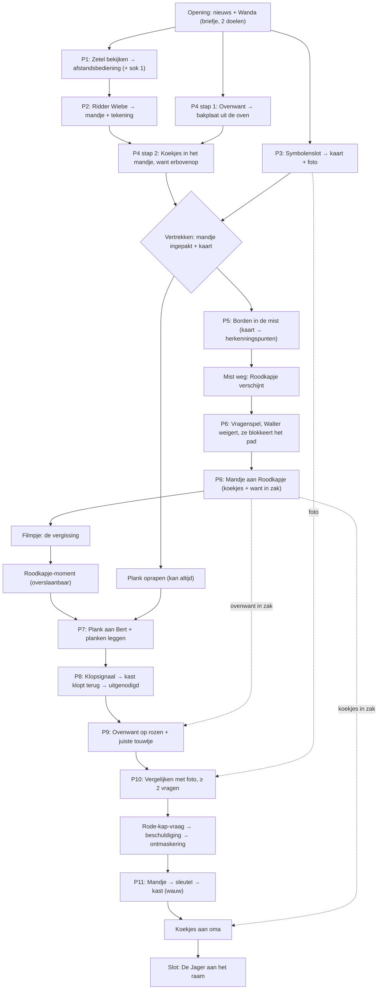

# Fairly Odd Tales

**Fairly Odd Tales** is een point & click avonturenspel in de stijl van klassiekers als *Return to Monkey Island*. Je speelt bekende sprookjes, maar net een beetje anders: de "slechterik" blijkt onschuldig, de "held" heeft een eigen plannetje, en niets is wat het lijkt. *Elke slechterik heeft een alibi.*

- **Doelgroep:** kinderen vanaf 8 jaar
- **Speelduur:** ± 15 minuten per sprookje (doel: mediaan 14:30 bij een eerste speelbeurt; zie [productie](ontwerp/productie.md#speelduurtoets))
- **Toon:** grappig en spannend, nooit eng of bloederig. Niemand raakt gewond, niemand wordt vastgebonden. Wat "gevaarlijk" is, gebeurt buiten beeld en wordt met humor gebracht.

**Andere documenten**
- [`ontwerp/productie.md`](ontwerp/productie.md): assetlijst, ingesproken regels, speelduurtoets en schraplijst, filmpjesbudget, regie van het wauw-moment, art- en audiorichting, planning, systeemschermen en ouderpagina.
- [`ontwerp/seriebijbel.md`](ontwerp/seriebijbel.md): premisse van de reeks, vaste cast, formule per aflevering, boog over de reeks, volgende afleveringen, taalkeuze en woordenlijst, oudertoets en waarden.

---

## Spelmechaniek

Een eenvoudige besturing zoals in *Return to Monkey Island*: geen lijst met werkwoorden, maar slimme klikken.

| Actie (muis) | Actie (tablet) | Wat gebeurt er |
|---|---|---|
| **Linksklik** op de grond | Tik | Walter wandelt erheen |
| **Linksklik** op een object of personage | Tik | De logische actie: oppakken, gebruiken, praten |
| **Rechtsklik** | Lang tikken | Bekijken: Walter zegt er iets grappigs over |
| **Muis over een object** | (vergrootglasknop) | De naam van het object verschijnt |
| **Voorwerp slepen** naar een object of personage | Tik voorwerp, tik doel | Voorwerp gebruiken of geven |
| **Voorwerp op een ander voorwerp** | Tik voorwerp, tik voorwerp | Combineren |
| **Voorwerp op Walter** | Tik voorwerp, tik Walter | Op zichzelf gebruiken (meestal een grap) |

**Altijd, voor iedereen:**
- **Spatiebalk / vergrootglasknop:** alle klikbare plekken lichten even op, mét naam. Namen verklappen nooit een oplossing ("Voeten", niet "Rode schoentjes van Roodkapje").
- **Detectiveboekje:** een **plaatjes-checklist** van de open doelen, die zichzelf afvinkt. Klik op een doel voor een ingesproken hint op drie niveaus: vage tip → duidelijke tip (met de plek gemarkeerd) → de oplossing. Het boekje bewaart ook alles wat je moet onthouden (klopsignaal, foto van Grootmoeder, sokkenteller). Een kind hoeft nooit iets uit het hoofd te kennen.
- Nieuwe doelen verschijnen pas als Walter ze **zelf ontdekt** (bv. "iets om de koekjes in te doen"). Het spel somt niets op voorhand op.
- Je kan niet doodgaan en niet vastlopen (zie *Softlock-preventie*).
- Alles wordt ingesproken. Ondertitels staan altijd aan; het gesproken woord licht op. Elk filmpje is per zin wegklikbaar.

### Hulpniveaus: Speurneus en Meesterdetective

Bij de start vraagt Walter: *"Ben jij een speurneus of een meesterdetective?"* Twee grote plaatjes: een **pet** (Speurneus, standaard) en een **detectivehoed** (Meesterdetective). Wisselen kan altijd in het pauzemenu, zonder gevolgen. We zeggen nooit "makkelijk" of "moeilijk": de **puzzels zijn in beide niveaus gelijk**, alleen het voorzeggen verschilt.

| Hulp | Speurneus | Meesterdetective |
|---|---|---|
| Hotspots oplichten, voorlezen, foto in beeld (P10) | ja | ja *(toegankelijkheid)* |
| Feedback per stap (schijven, lantaarntjes, planken) | ja | ja *(eerlijkheid: geen gokpuzzels)* |
| Boekje wiebelt bij stilstand (gaat nooit vanzelf open) | na 60 s | na 3 min |
| Juiste voorwerp wiebelt in de inventaris bij een personage | ja | nee |
| Hints | niveau 1–3 meteen | niveau 1 meteen, 2 na 30 s, 3 na nog 60 s |
| Losse plank op het kruispunt | glinstert zodra de mist weg is | geen glinster |
| Fout tochtje bij P5 | pictogram van dat pad blijft in de mist hangen | alleen de grap |
| Wanda aan de voordeur als er iets ontbreekt | noemt wat ontbreekt | *"Walter. Kijk eens in je boekje."* Pas bij de 2e poging noemt ze het. |
| Roodkapje kijkt naar het mandje (P11) | kijken + *ting* | alleen kijken |
| Sokkenteller | toont in welke scène er nog een sok ligt | alleen "3/5" |

**Beloning:** wie geen enkele niveau-3-hint gebruikt, krijgt op het einde de **Detectivehoed-sticker** in het boekje (op beide niveaus).

### Het geheimpje: vijf verdwaalde sokken

Er ligt één sok van Walter per scène. Ze zijn nooit nodig om verder te raken. De eerste komt vanzelf mee uit de zetel en leert de teller aan: *"Die zoek ik al sinds Kerstmis. ...Waar zijn de andere?"* Wie er een mist, hoort hoogstens: *"Ergens ligt nog een sok. Ik voel het in mijn tenen."* Wie alle vijf heeft, krijgt in het slot een **sokkencape** van Grootmoeder (zie *Slot*).

---

# Sprookje 1: Roodkapje
## *De Zaak van de Rode Zakdoek*

### Het verhaal in het kort

Er is iets raars aan de hand in het Donkere Woud: wolven verdwijnen. Op elke plek vindt de politie maar één spoor: **een rode zakdoek**. En getuigen hoorden... heel hard niezen.

Walter Wolf, een rustige wolf met pantoffels en een leesbril, ziet het nieuws op tv. Zijn vrouw Wanda vertelt hem een geheim: diep in het bos woont **Grootmoeder**, een gepensioneerde spionne die alles weet. Walter moet de informatie bij haar gaan halen.

Op een kruispunt in de mist komt hij een meisje met een rode kap tegen dat ontzettend veel vragen stelt. Hij laat haar nadrukkelijk níét meegaan, maar per ongeluk flapt hij eruit waar hij naartoe gaat. Naar Grootmoeder. *Haar* grootmoeder. Wat moet een wolf bij haar oma? Roodkapje rent vooruit...

> **De twist:** Roodkapje is een amateur-detective. Sinds die rode zakdoek kijkt iedereen raar naar háár kap. Ze wil de zaak zelf oplossen, maar oma wou haar niks vertellen ("Te gevaarlijk voor kinderen!"). Als ze hoort dat er een wolf komt, rent ze naar oma, laat oma zich verstoppen in de kast en draait de sleutel om, "voor haar eigen veiligheid". Dan verkleedt ze zich als oma om de wolf uit te horen. Maar de wolf komt juist informatie *halen*... Twee detectives die elkaar proberen uit te horen, en geen van beiden weet iets!

> **De dader (nooit eng):** De Jager vangt geen wolven om ze kwaad te doen. Hij **verzamelt** ze voor zijn **Griezelmuseum**. Daar zitten ze veilig achter een fluwelen koord, maar ze moeten de hele dag grommen voor toeristen en vervelen zich suf. De Jager is **allergisch voor wolvenhaar**: hij niest en verliest overal zijn rode zakdoek. *"HATSJOE!"* Op het einde zie je hem één keer: een reusachtig silhouet met een piepklein hoofdje.

### Personages

| Personage | Wie | Wil | Grappige eigenschap / running gag |
|---|---|---|---|
| **Walter Wolf** | De speler. Groot, harig, lief, beetje onhandig. Pantoffels en cardigan. | Terug naar zijn zetel (en, zonder het te weten, een held zijn) | Geeft alles een **zetelscore**: *"Twee op tien. Er zit een mier in."* |
| **Wanda Wolf** | Walters vrouw. Slim en kordaat, de echte baas in huis. | Het wolvennetwerk beschermen | Zegt alles in zo weinig mogelijk woorden. |
| **Wiebe** | Hun welpje. | Tekenfilms kijken, ridder zijn | Draagt het mandje als helm. Vraagt of papa een held is. Belt in het slot. |
| **Uil Ursula** | Nieuwslezeres op Wolf-TV. Heel serieus. | Serieus nieuws brengen | Knipoogt met één oog; het weerbericht klopt altijd, maar raar. |
| **Inspecteur Das** | Politie, in het nieuws. | Iets ontdekken | Verdenkt steeds de verkeerde. |
| **Roodkapje** | Klein, slim, nieuwsgierig. Notitieboekje en potlood. | De zaak oplossen, en niet zelf verdacht zijn | Stelt alleen vragen: *"Waarom?"* en schrijft alles op. |
| **Bever Bert** | Bouwt een dam en praat als een bouwvakker. | Zijn dam afwerken, lekker hout knagen | Proeft alles als een chef: *"Dat smaakt naar..."* |
| **Grootmoeder** | Gepensioneerde spionne. Zit het grootste deel van het spel in de kast. | Haar geheimen bewaren | Breit geheime boodschappen in sjaals (H… HE… HELP). |
| **De Jager** | De dader. Alleen als silhouet aan het raam en van achteren na de aftiteling. | Zijn Griezelmuseum vullen | *"HATSJOE!"* + een rode zakdoek zo groot als een tafellaken |
| **De sok** | Walters oude sok (eigenlijk vijf). | ? | Duikt overal op. Verzamelobject (zie *Het geheimpje*). |
| *Bijfiguren* | Vis, vogel, krekel, uil, kikker, eend, slak | | Eén grap per stuk. De krekel stopt altijd met tjirpen als iemand iets doms zegt. |

**Walters boog:** begin *"Ik ben een zetel-expert"* → midden (de beek): twijfel, Wiebes tekening "Papa de held" en *"Wanda had gelijk"* → einde: hij kiest zelf om verder te gaan.

**Taal:** Nederlands met Vlaamse woordkeuze, geen dialect. Ingesproken zinnen maximaal ± 12 woorden, één idee per zin. Details en de woordenlijst voor een Nederlandse versie: zie de [seriebijbel](ontwerp/seriebijbel.md#taalkeuze).

### Overzicht van de scènes

| # | Scène | Doel-speeltijd | Puzzels | Moeilijkheid (1–4) |
|---|---|---|---|---|
| 1 | Het Wolvenhol (woonkamer + keuken) | 4:15 | P1, P2, P3, P4 | 1 · 1 · 2 · 2 |
| 2 | Het Kruispunt in de mist (+ Roodkapje-moment) | 3:10 | P5, P6 | 3 · 2 |
| 3 | De Beek | 1:20 | P7 | 2 |
| 4 | Voor het huisje van Grootmoeder | 1:50 | P8, P9 | 2 · 2 |
| 5 | Binnen bij Grootmoeder (finale) | 3:55 | P10, P11 | **4** · 2 |
| | **Totaal** | **± 14:30** (snelle speler ± 11, rondklikker ± 18) | **11 puzzels** | |

Eén denkpiek per scène, met P10 als hoogtepunt en P11 als ontspannen afronding. De opbouw van deze tijden en wat we schrappen als de speeltest uitloopt, staan in [productie.md](ontwerp/productie.md#speelduurtoets).

---

## Scène 1: Het Wolvenhol

**Decor:** Een gezellige woonkamer met houten balken. Een versleten groene **zetel** met een zichtbare bobbel, een ouderwetse **tv** die al aanstaat, een **bureau** met een lade, een **familiefoto** in een houten kader, een **open keuken** met een **oven** en vlak ernaast een **ovenwant** aan een haakje. Op tafel ligt een stuk **kaas**. Welpje **Wiebe** speelt op het tapijt met het **mandje** op zijn hoofd. **Wanda** zit te breien bij het raam.

**Opening (in-engine, 0:25):** Walter ploft in de zetel met een kop thee. *"Aaah. Rust."* Het nieuws is al bezig.
> **Ursula:** "Goedenavond. Weer een wolf verdwenen. De vijfde al."
> **Das** *(houdt een rode zakdoek omhoog)*: "Ons enige spoor. En getuigen hoorden niezen. HEEL hard niezen."
> **Ursula:** "Wolven, blijf binnen. Het weer: mist, met kans op zakdoeken." *(knipoogt met één oog)*

Walter laat zijn thee vallen.

**Wanda (in-engine, 0:20):** *(Twee maten van het spionnenthema.)*
> **Wanda:** "Walter. Diep in het bos woont Grootmoeder. Een geheime spionne."
> **Walter:** "Een spion? Met een rollator?"
> **Wanda:** "Zij weet waar die wolven zijn. Breng haar koekjes, anders praat ze niet."
> **Wanda:** "De kaart ligt in de lade. Met mijn code."
> **Wanda** *(klopt op zijn hoofd)*: "En je klopt zó." *Klop. Klop. BONK.*
> **Walter:** "Au. Onthouden." *(Hij krijgt het **briefje**: ● ● ⬤)*
> **Walter** *(schuift heen en weer)*: "Au. En hier zit iets in mijn rug."
> **Wiebe:** "Papa! Ik wil tekenfilms! Waar is de afstandsbediening?"

**Besturing aan.** In het boekje staan twee doelen: 🍪 **Koekjes voor oma** en 🗺️ **De kaart**, plus het klopsignaal **● ● ⬤** (klein, klein, GROOT; het briefje toont ook het antwoord van oma: **⬤ ● ●**, *"Een echte Grootmoeder klopt altijd terug"*). Wie opnieuw met Wanda praat, krijgt per open doel één korte zin (= hint niveau 1 van dat doel).

Scène 1 bestaat uit **drie kettingen** die in elke volgorde kunnen: Wiebe en zijn helm (P1 → P2), de hete koekjes (P4, die het mandje van P2 nodig heeft) en Wanda's code (P3).

### Puzzel 1: Iets in mijn rug *(tutorial bekijken)*
- Klik op de **zetel**: *"Hier zit iets in mijn rug. Ik moet eerst eens goed kijken."* Eén keer verschijnt een oog-icoon met uitleg (rechtsklik / lang tikken).
- **Bekijk** de zetel: *"Die zetel ziet er... bobbelig uit."* Pas nu kan Walter graven. Hij vindt de **afstandsbediening**, een kruimel en **sok 1/5**.
- Afstandsbediening op de tv: *"Breien, breien, nog meer breien. Wiebe wil tekenfilms."* (Niet nodig, wel een grap.)

### Puzzel 2: Ridder Wiebe
- Wiebe: *"Mijn helm krijg je niet! Behalve... als ik tekenfilms mag kijken."*
- **Oplossing:** geef de **afstandsbediening** aan Wiebe. Hij tikt ermee op Walters schouders (in het spel, 0:10): *"Ik sla u tot... Ridder Pantoffel!"*
  > **Wiebe:** "Papa, ga je op avontuur? Ben jij een held?"
  > **Walter:** "Nee jongen. Ik ben een zetel-expert."
  > **Wiebe** *(geeft een tekening)*: "Voor als je het vergeet."
- Walter krijgt het **mandje** en de **tekening van Wiebe** ("Papa de held", met cape) en steekt de tekening in zijn cardigan. Wiebe zet een vergiet op als nieuwe helm en kijkt tekenfilms. Klik op de tv: *"NIET AANKOMEN!"*

### Puzzel 3: De lade met het symbolenslot
- De lade zit op slot met **drie draaischijven in een houten kadertje**, hetzelfde kader als de familiefoto. Op elke schijf: 🌙 maan, 🦴 bot, 🌲 boom, 🧀 kaas, ⭐ ster, 🪶 veer. Boven de schijven staan **1, 2 en 3 pootafdrukjes**.
- Bekijk het slot: *"Dat kadertje lijkt op dat van onze familiefoto. Wanda kiest altijd iets met de familie."*
- **De familiefoto:** drie wolven op een rij, onder elke wolf een bordje met 1, 2 of 3 pootjes (tellen, geen cijfers lezen). Opa (1) huilt met de **maan** achter zich, Wanda (2) draagt een **ster**-medaille ("beste kok"), baby Wiebe (3) kauwt op een **bot**.
- De **kaas** op tafel is een afleider: wie kaas kiest, kijkt niet naar *wie* iets vasthoudt.
- **Oplossing:** 🌙 ⭐ 🦴. Tik op een schijf om hem te draaien. Staat een schijf juist, dan gloeit dat stukje kader op. Fout: *"Tsjoeng! Misschien moet ik eens naar de familie kijken."*
- De lade gaat open: de **kaart van het bos** en een **foto van Grootmoeder**. Wanda: *"Voor als je twijfelt."* De foto komt in het boekje: grijze krullen, **geen** bril, **grote** handen met breinaalden, **grote** voeten in sloffen.

### Puzzel 4: Hete koekjes
- Klik op de **oven**: *"AU AU AU! Heet heet heet!"*
- **Stap 1:** pak de **ovenwant** van het haakje en gebruik hem op de oven. Walter zet de **bakplaat met koekjes** op het aanrecht.
- Klik op de bakplaat: *"Ik kan toch geen bakplaat meesleuren door het bos?"* Nu pas verschijnt in het boekje een nieuw doel: 🧺 **Iets om de koekjes in te doen.** (Heeft Walter het mandje al, dan zegt hij: *"Daar heb ik net iets voor."*)
- **Stap 2:** gebruik het **mandje** op de bakplaat. De koekjes (3) gaan erin en Walter legt de **ovenwant erbovenop**: *"Een dekentje. Zo blijven ze warm."* In de inventaris staat nu één voorwerp: **mandje met koekjes**.

Zo heeft elk voorwerp een reden: de want is nodig voor de oven en gaat mee als warmhouder; het mandje is nodig omdat je geen bakplaat meesleurt. Niemand hoeft het lijstje op te sommen.

**Vertrekken:** klik op de voordeur. Ontbreekt er iets, dan houdt Wanda Walter tegen (zie *Hulpniveaus* voor wat ze zegt). Is het mandje ingepakt en heeft Walter de kaart:
> **Wanda:** "Wees voorzichtig. En vertel aan niemand waar je naartoe gaat!"
> **Walter:** "Natuurlijk niet. Ik praat nooit met vreemden."

*(Dit gaat dus helemaal mislopen.)* Na vertrek is het hol niet meer bereikbaar; er is daar niets meer nodig.

**Optionele bekijk-grappen:** Wanda's breiwerk (*"Weer een sjaal met rare patroontjes"*), de zetel na P1 (*"Negen op tien. Mijn beste werk."*), Wiebe met de vergiet, het raam, het tv-kastje.

---

## Scène 2: Het Kruispunt in de mist

**Decor:** Een open plek in dikke mist (het weerbericht had gelijk). Een kale **wegwijzerpaal** met **drie lantaarntjes** die uit zijn. Op de grond liggen **drie borden** die eraf gewaaid zijn: 🌾 **Molen**, 🌸 **Bloemenveld**, 🏠 **Grootmoeder**. Naast de paal ligt zichtbaar een vierde, gebroken stuk: de **losse plank**, vol uitgesneden letters. Een **boomstronk** en enkele **paddenstoelen**.

Bij het begin van elk pad staat een **herkenningspunt**, groot en vlakbij, dus zichtbaar in de mist:
- 🌳 een **holle boom** met een uilengat (molenpad, links)
- 🪨 de **Koekjessteen**, een ronde platte steen met stippen (Grootmoederpad, rechtdoor)
- 🍄 een **paddenstoelenkring** (bloemenpad, rechts)

In de verte zie je niets, tot de mist optrekt: dan worden een molenwiek, een bloemenveld en een rookpluim uit een schoorsteen scherp.

### Puzzel 5: Borden in de mist
- Bekijk de paal: *"De borden zijn eraf gewaaid. Elk pad begint bij iets. Wat stond er ook weer op mijn kaart?"*
- **De kaart** (tik in de inventaris of gebruik op de paal): een close-up met drie paden. **Aan het begin** van elk pad staat het herkenningspunt getekend, **aan het einde** de bestemming: holle boom → molen, Koekjessteen → beek → huisje met rookpluim, paddenstoelen → bloemen. Je leest het als een strip: "waar begin je, waar kom je uit". Er is geen links of rechts nodig en niets moet gedraaid worden.
- **Tik een bord, tik een herkenningspunt.** Walter hangt het bord daar en wandelt twee stappen het pad in om te kijken (± 3 s).
  - **Juist:** het bord klikt vast, **een lantaarntje gaat aan** en de mist op dat pad wordt dunner. Molen: *"Klopt. Ik hoor de wieken kraken."* Bloemen: *"Klopt. Het ruikt hier naar lente."* Grootmoeder: *"Klopt. Ik hoor een beek. Net als op de kaart."*
  - **Fout:** Walter komt terug met een bewijsstuk van het pad waar hij wél was. Het bord valt terug.

| Walter liep in het... | Gevolg | Zin |
|---|---|---|
| Molenpad | Helemaal wit van het meel | *"Ik ben een spookwolf. Dit is dus het molenpad."* |
| Bloemenpad | Stuifmeel op zijn neus, hij niest | *"HATSJOE! ...Oei. Nu ben ik zelf verdacht. Hier liggen bloemen."* |
| Grootmoederpad | Natte pantoffels | *"Daar stroomt een beek. Op de kaart loopt het oma-pad over de beek."* |

- **Niet gokbaar:** wie de kaart leest, lost het in drie tikken op. Wie gokt, leert bij elke fout welk pad het wél is, dus na hoogstens twee foute tochtjes weet je alles. Gokken is geen manier om de puzzel te ontwijken, wel een tweede manier van zoeken (met extra grappen).
- **Wauw van de scène:** als alle drie de lantaarntjes branden, trekt de mist in één zachte beweging op (geen flits). De silhouetten worden scherp, er valt zonlicht in.
- **De plank:** Walter raapt hem zelf op, nu of later (*"Een stukje wegwijzer. Vol letters. Dat kan altijd van pas komen."*). Op Speurneus glinstert hij zodra de mist weg is.
- **Sok 2/5:** na de mist kan je op het uilengat klikken. De uil gooit een sok naar buiten: *"Hoe-hoe-hoe vies."*

### Puzzel 6: Roodkapje en haar vragen
Zodra de mist weg is, springt **Roodkapje** achter de boomstronk vandaan.

**Het omgekeerde vragenspel.** In het originele sprookje stelt de wolf de vragen. Hier vuurt Roodkapje ze af. De speler kiest twee keer een antwoord; elk antwoord levert een nieuwe vraag op:

> **Roodkapje:** "Hallo! Wie ben jij? Waarom heb je pantoffels aan? Waarom ruikt je mandje naar koekjes?"
>
> 1. *"Ik ben gewoon een wandelende wolf."* → "Waarom wandel je? Wolven rennen toch?"
> 2. *"Mijn pantoffels zijn heel comfortabel."* → "Waarom heb je comfort nodig? Heb je iets te verbergen?"
> 3. *"Mag ik ook eens een vraag stellen?"* → "Nee. Waarom wil je een vraag stellen?"

Daarna plant ze haar motief en wil ze mee. **Walter weigert duidelijk:**
> **Roodkapje:** "Sinds die rode zakdoek kijkt iedereen raar naar mijn kap. Ik ga met je mee!"
> **Walter:** "Nee. Je gaat nooit mee met vreemden. Ook niet met lieve wolven in pantoffels."
> **Roodkapje:** "...Dat zegt mijn mama ook." *(schrijft het op)* "Dan blijf ik hier staan. In de weg."

Ze plant zich voor de **Koekjessteen** en loopt **niet** mee. Klik je op het Grootmoederpad: *"Waar ga je naartoe? Waarom loop je zo snel?"*

- **Doel:** Roodkapje iets beters te doen geven.
- **Bekijk** Roodkapje: *"Ze kijkt steeds naar dat bloemenveld."* Daarna kan je haar vragen: *"Waarom kijk je steeds naar die bloemen?"*
  → *"Mama zei: pluk bloemen voor oma, maar blijf op het pad. Het bloemenpad ís een pad. Maar ik heb niks om ze in te doen."*
  Het idee komt dus van haarzelf, en ze blijft op een pad.
- **Oplossing:** geef het **mandje** aan Roodkapje. Walter haalt eerst de koekjes en de ovenwant eruit en propt ze in zijn cardigan: *"Die zijn voor oma. En die... je weet maar nooit."* Vanaf nu hangt de duim van de ovenwant zichtbaar uit zijn zak. *"Wanda zei koekjes. Niet: mandje."*
- Geef je het mandje vóór de bloemenvraag: *"Een mandje? Is dit omkoperij? Ik schrijf het op. ...Oh! Voor bloemen voor oma!"* Dat telt ook als oplossing.

**De vergissing (in-engine, 0:20):**
> **Roodkapje:** "Dankjewel! En jij? Waar ga jij naartoe met die koekjes?"
> **Walter** *(zonder nadenken)*: "Naar Grootmoeder, in het huisje midden in het bos!"
> *(De krekel tjirpt. De krekel stopt.)*
> **Roodkapje:** "...MIJN grootmoeder?"
> **Walter:** "Nee. Een andere. Het bos ligt er vol mee."
> **Roodkapje:** "Een wolf. Bij mijn oma. Niet als ik het kan tegenhouden!" *(ze zoeft het bloemenpad op en grist al rennend bloemen mee)*
> **Walter:** "Oh nee. Wanda laat me een maand de afwas doen."

### Ondertussen, op het sluippad... *(speelbaar Roodkapje-moment, ± 0:40, staat bovenaan de schraplijst)*
- Titelkaartje. Je speelt even **Roodkapje**, bij de beek van de andere kant gezien (hergebruik van het beekdecor, andere uitsnede).
- Ze moet over **drie stapstenen**. Op elke steen zit een dier: een **kikker**, een **eend** en een **slak**. Tik op het dier en Roodkapje doet wat ze het best kan: vragen stellen.
  > **Roodkapje:** "Waarom zit jij op mijn steen? Waarom ben je groen? Waarom—" **Kikker:** "Ik ga al. Ik ga al!" *(plons)*
  > **Slak** *(heel traag)*: "Ik... ga... ook..." **Roodkapje:** "Waarom zo traag?" *(de slak gaat sneller, uit pure schaamte)*
- Na elk dier noteert ze iets: *"Wolf. Pantoffels. Verdacht."*
- **Einde:** ze rent naar het huisje, de achterdeur zwaait open en we horen alleen: *"Oma! Er komt een wolf! ...Ik heb een plan."* De deur gaat dicht. Terug naar Walter op het kruispunt.
- Niet faalbaar, geen timing, overslaanbaar zoals een filmpje. **We tonen de kast, de sleutel en de verkleedpartij niet:** dat blijft de verrassing van P10.
- *Wordt het geschrapt,* dan eindigt het vergissingsfilmpje met een sprint van 0:05.

Na de vergissing kan je het molenpad (*"Kat met laarzen. Nee dank je."*) en het bloemenpad (*"Daar is zij langs. Ik moet naar Grootmoeder."*) niet meer in; het Grootmoederpad is open.

**Het spoorkaartje** (bovenaan het scherm, uitzetbaar): geen race die je verliest, maar een kaartje met een rode kap die al bij het huisje staat en een wolvenkop die opschuift na elke opgeloste puzzel. Bij aankomst aan het huisje verdwijnt het met: *"Ze is er al. Goed. Dan is oma niet alleen."*

**Optionele bekijk-grappen:** paddenstoelen (*"Rood met witte stippen. Die zien er eng gezond uit."*), boomstronk (*"Twee op tien. Er zit een mier in."*), Walters pantoffels (*"Nat. Mist is ook gewoon regen die lui is."*), de Koekjessteen (*"Die eet je beter niet. Geloof me."*).

---

## Scène 3: De Beek

**Decor:** Een snelstromende beek. De **brug** heeft geen planken meer, alleen drie open gaten tussen de palen. **Bever Bert** bouwt een **dam** met... de planken van de brug. Stroomopwaarts liggen piepkleine **stapstenen** met verse bloemblaadjes erop (*"Ze is hier al voorbij."*). Een **vis** kijkt Walter aan.

**Bij aankomst (in het spel, 0:10):**
> **Walter:** "Wanda had gelijk. Vertel nooit aan vreemden waar je naartoe gaat."
> **Walter:** "Ik kan nog terug. Mijn zetel is nog warm."
> *(Hij haalt Wiebes tekening uit zijn cardigan. "Papa de held". Met cape.)*
> **Walter:** "...Ach. Die cape staat me eigenlijk wel."

### Puzzel 7: De brug van Bever Bert
- Praat met Bert:
  > **Bert:** "Sorry maat, die planken zijn voor m'n dam. En ik moet knagen. Al dagen alleen maar brug. Brug smaakt naar voeten."
  > **Bert:** "Breng me iets lekkers. Hout met letters erin, dat is het beste."
- Heeft Walter de plank niet bij zich: op Speurneus zegt hij *"Had ik niet ergens een stuk hout met letters gezien?"* Terugwandelen naar het kruispunt kan altijd.
- **Stap 1:** geef de **losse plank** aan Bert.
  > **Bert:** "Ooooh! Wegwijzerhout! Deal, maat." *(duwt vier planken naar de oever)* "Maar leggen doe je zelf. Ik ben bever, geen timmerman."
- **Stap 2 (legpuzzel):** vier planken van verschillende lengte, drie gaten die steeds breder worden. Tik een plank, tik een gat. Past hij, dan klikt hij vast. Te kort of te lang: de plank schuift terug (*"Bijna. Net niet."*). Eén plank is te kort voor alles; daar gaat Bert uit protest op knagen. Duurt minder dan een minuut.
- Walter steekt over.

**Sok 3/5:** klik drie keer op de vis: *"Hij oordeelt." ... "Hij oordeelt nog steeds." ... "Hij spuugt een sok uit!"*

**Optionele bekijk-grappen:** de dam (*"Is dat... een brugleuning?"*), de stapstenen (*"Voor kinderpootjes. Niet voor wolvenpantoffels."*), Bert (*"Zetelscore van die dam: zeven. Beetje nat."*).

---

## Scène 4: Voor het huisje van Grootmoeder

**Decor:** Een schattig huisje met een rieten dak, een **voordeur** met een klinkje, een grote **rozenstruik** naast de deur, een **raam** met gesloten gordijnen, een **brievenbus** en een hekje opzij met een bordje *"Achterom: alleen familie"*. Door een kier in het gordijn zie je een **mandje vol bloemen** op tafel. Roodkapje is hier dus al.

Bekijk het mandje door de kier: *"Hé... dat lijkt op MIJN mandje."*

### Puzzel 8: Het geheime klopsignaal
- Klik op de deur: Walter klopt gewoon. Een héél hoge oma-stem: *"Er is niemand thuis! ...Behalve oma. Dat ben ik. Ga weg, liefje."* Walter: *"Hmm. Wanda klopte op een speciale manier. Op mijn hoofd."*
- **Oplossing:** gebruik het **briefje** op de deur (of klik op de deur nadat je het briefje bekeken hebt). Twee grote knoppen verschijnen: een **kleine poot** (klop) en een **grote vuist** (BONK). Bovenaan staat het patroon **● ● ⬤**. Het gaat om de **volgorde**, niet om tempo of kracht.
  - Elke klop geeft een visuele golf (en een trilling op tablet).
  - Fout: *"Wie klopt er als een specht?"* Opnieuw kan altijd. Tik op het briefje en het patroon wordt voorgespeeld.
- **Na het juiste signaal (in het spel, 0:10):** stilte. Dan, gedempt en van dieper in het huis: **⬤ ● ●** (*BONK, klop, klop*), met één basnoot van het spionnenthema. Dat is de echte oma, vanuit de kast. Walter: *"Dat klopje kwam niet van achter de deur. Raar."*
  > **"Grootmoeder"** *(heel gretig)*: "Een geheim klopje...! Kom maar binnen, liefje! Trek maar aan het touwtje!"

  Roodkapje nodigt hem uit omdat ze nu weet dat de wolf een geheim met oma deelt, en dat wil ze uithoren.

### Puzzel 9: Welk touwtje?
- Uit de **rozenstruik** komen **drie verstrikte touwtjes**: één naar een emmer op het dak, één naar een vogelhuisje en één naar het klinkje van de deur. Ze zijn al jaren overgroeid (iedereen gebruikt de achterdeur).
- Vóór de uitnodiging: *"Ik ga niet zomaar binnen. Ik ben een beleefde wolf."*
- Klik op de touwtjes zonder want: *"Auw! Doornen! Eerst al de oven en nu dit."* De duim van de ovenwant wiebelt uit Walters zak. (Dat is meteen de hint.)
- **Stap 1:** gebruik de **ovenwant** op de rozenstruik. Walter kan nu bij de touwtjes.
- **Stap 2:** volg het juiste touwtje (een eenvoudig lijntjesdoolhof; **gestreept** naar de emmer, **gestippeld** naar het vogelhuisje, **effen** naar het klinkje) en tik op het uiteinde.
  - Emmer: valt op Walters hoofd. *"Ik zie niks. Wel gezellig."* Tweede keer: *"Nog altijd gezellig."* Derde keer zet hij hem zelf op: *"Ridder Emmer."*
  - Vogelhuisje: een vogel kijkt boos naar buiten. *"Sorry. Verkeerde bel."*
  - Klinkje: de deur gaat krakend open.

**Sok 4/5:** in de brievenbus (*"MIJN sok. Hoe?!"*), samen met een folder: *"Kastenverkoop. Nu met slot!"*

**Optionele bekijk-grappen:** het hekje (*"Alleen familie. Ik ben eerder... een collega."*), het rieten dak, de rozen (*"Rozen zijn mooi. Maar ze hebben het humeur van een egel."*).

---

## Scène 5: Binnen bij Grootmoeder *(finale)*

**Decor:** Een knusse kamer. Een groot **bed** met daarin "Grootmoeder": Roodkapje in vermomming. In de hoek een grote **houten kast**, op tafel het **mandje met bloemen**, naast het bed oma's **sloffen**, op een stoel een **breiwerk**. Een boekenkast vol spionagethrillers en een draaitelefoon met een antenne.

**Ontwerpregel voor P10:** elke aanwijzing is **vanaf binnenkomst in beeld**, zonder camerabeweging en met hoog contrast. Walter benoemt alleen wat het kind zelf kan zien. Het kostuum is daarom zo gemaakt:
- een **dikke bril** die haar ogen twee keer zo groot maakt;
- een grijze **pruik** met krullen en een veel te grote **nachtmuts**; haar kap zit gefrommeld onder de muts en het **rode puntje met kwastje** hangt eruit;
- een nachtjapon met slappe, te lange mouwen; uit één mouw steekt een **piepklein handje met een potlood** (ze kan het schrijven niet laten);
- het deken is te kort: haar **kleine voeten** steken onderaan uit het bed, met de **rode schoentjes mét strikje** aan.

Bij binnenkomst haalt Walter vanzelf de **foto van Grootmoeder** boven: *"Even kijken of ze op de foto lijkt."* De foto blijft de hele puzzel als kadertje in een hoek van het scherm staan.

### Puzzel 10: "Grootmoeder, wat heb jij...!"
Het omgekeerde van de beroemde scène. Deze keer stelt de **wolf** de vragen, en hij moet de "grootmoeder" ontmaskeren door haar te vergelijken met de foto. Ondertussen probeert zij hem uit te horen:
> **"Grootmoeder":** "Kom maar dichterbij, lieve wolf. Wat weet jij over die verdwenen wolven? Heb jij een alibi?"
> **Walter:** "Een ali-wat?"
> **"Grootmoeder":** "Waar je was! Dat weet toch iedereen!"
> **Walter:** "Ik kom juist bij u om informatie te halen!"
> **"Grootmoeder":** "...Oh. Dat is vervelend."

**Klik op de kast** (kan altijd): de kast rommelt (*BONK BONK, "Mmmf!"*). "Grootmoeder": *"Dat zijn de muizen. Hele grote muizen. Met een sjaal."* Bij elke volgende keer komt er een langer stuk sjaal onder de deur uit: H… HE… HEL… **HELP**. Walter: *"Hij breit. De kast breit."*

**De vergelijking.** Bekijk een detail. Verschilt het met de foto, dan stelt Walter meteen de vraag en antwoordt zij in één zin. Klopt het wél met de foto, dan zegt Walter dat (zo leert het kind dat niet elk detail bewijs is).

| Detail (bekijken) | Wat je in beeld ziet | Op de foto | Walter vraagt | "Grootmoeder" antwoordt |
|---|---|---|---|---|
| **Bril** | dikke glazen, ogen 2× zo groot | geen bril | *"Grootmoeder, wat heb jij grote ogen!"* | "Om jou beter te zien! ...Wazig." |
| **Handje** | piepklein handje met potlood uit een slappe mouw | grote handen met breinaalden | *"Grootmoeder, wat heb jij kleine handjes!"* | "Om kleine koekjes vast te houden!" |
| **Voeten** | kleine voetjes onder het deken uit, rode schoentjes met strikje aan | grote voeten in sloffen | *"Grootmoeder, wat heb jij kleine voetjes!"* | "Om... sneller te breien?" |
| **Mandje** | Walters eigen mandje, vol bloemen | — (Walter herkent het) | *"Grootmoeder, wat heb jij een bekend mandje!"* | "Er zijn heel veel mandjes." *(Walters eigen smoes!)* |
| Pruik | grijze krullen | grijze krullen | — | *"Klopt met de foto... denk ik."* |
| Sloffen naast het bed | oma's sloffen, leeg | sloffen | — | *"Oma's sloffen. Kloppen. Maar waarom draagt ze ze niet?"* |
| Breiwerk | breinaalden | breinaalden | — | *"Klopt met de foto."* |
| **Rood puntje** | rood puntje met kwastje onder de muts | geen kap | *"Grootmoeder, wat heb jij een... RODE KAP onder je muts!"* | *(start de beschuldiging)* |

- De vier eerste vragen mogen in elke volgorde.
- De **rode-kap-vraag** komt pas na **minstens twee** gestelde vragen. Bekijk je het puntje eerder: *"Rood. Met een kwastje. Waar heb ik dat nog gezien?"* De vraag wordt dan klaargezet en Walter stelt ze vanzelf zodra er twee andere gesteld zijn.
- **De beschuldiging:** een scherm *"Wie ben jij echt?"* met vier portretten: Roodkapje, Bever Bert, Inspecteur Das en een muis. Fout kiezen is een grap (*"Bert? Die heeft geen nachtmuts. Denk ik."* / *"Das? Die weet niet eens wat een zakdoek is."* / *"Een muis? ...Met een sjaal?"*) en je kiest opnieuw.

**De ontmaskering (in-engine, 0:25; begin van het wauw-moment, shotlist in [productie.md](ontwerp/productie.md#wauw-moment)):**
> **Walter:** "Jij bent... ROODKAPJE!"
> **Roodkapje** *(springt rechtop, trekt muts en pruik af, de kap ploept open)*: "Oké! Ik ben het!"
> **Walter:** "Waar is je oma?"
> **Roodkapje:** "In veiligheid. In de kast."
> **Walter:** "IN DE KAST?!"
> **Roodkapje:** "Ik dacht dat jij de dader was. Iedereen denkt dat ik het ben."
> **Walter:** "Ik ben de dader niet. Ik ben gewoon Walter. Ik heb pantoffels aan."
> **Roodkapje:** "...Dat is eigenlijk een heel goed alibi."
> *(Uit de kast: BONK! "Mmmf! Ik zei toch dat die wolf oké is!")*
> **Walter:** "Waar is de sleutel?"
> **Roodkapje:** "Wie zegt dat er een sleutel is? Wat is een sleutel eigenlijk?"

### Puzzel 11: Grootmoeder bevrijden
- Roodkapje kijkt de hele tijd "toevallig" naar het **mandje** (op Speurneus met een klein *ting*).
- **Stap 1:** klik op het **mandje**. Walter haalt de bloemen eruit en vindt de **sleutel** tussen de stelen. *"Dat is MIJN mandje trouwens."* Hij neemt het terug. Roodkapje: *"Ik moest hem ergens verstoppen. Mijn kap heeft geen zakken."* (Vóór de ontmaskering: *"Afblijven! Dat zijn... oma-bloemen."*)
- **Stap 2:** gebruik de **sleutel** op de **kast**. Het wauw-moment (0:10): de sjaal wordt de kast in gezogen, het slot klikt drie keer in het ritme ⬤ ● ●, de deuren zwaaien open in een wolk breiwol, en Grootmoeder stapt eruit in spionnenpose, met zonnebril, terwijl de sjaal H-E-L-P over het hele scherm ontrolt.
  > **Grootmoeder:** "Een kwartier. Ik zit al een KWARTIER in een kast."
  > **Grootmoeder:** "Verstoppen was mijn keuze, kind. De sleutel omdraaien was de jouwe."
  > **Roodkapje:** "Het was voor je eigen bestwil!"
  > **Grootmoeder:** "Je sluit nooit iemand op. Als je bang bent, haal je een grote mens."
  > **Roodkapje** *(schrijft, klein stemmetje)*: "Nooit... iemand... opsluiten. Onderstreept. Sorry oma. Sorry wolf."
- **Afsluiter:** Grootmoeder zwijgt als een kussen. *"Ik praat met niemand."* Geef haar de **koekjes**.
  > **Grootmoeder:** "...Zijn die van Wanda? *Smak.* Sorry is goed. Koekjes zijn beter. Oké, ik praat."

**Sok 5/5:** na de ontmaskering kan je onder het bed kijken. Grootmoeder: *"Die lag daar al toen ik terugkwam van mijn laatste missie."*

### Slot (in-engine, 0:55)
> **Grootmoeder:** "Die zakdoek is niet van jou, kind. Het is een jagerszakdoek."
> **Roodkapje:** "Ik wist het! ...Ik wist het niet. Maar nu wel!"
> **Grootmoeder:** "De Jager is gek op wolven. Hij bouwt een Griezelmuseum."
> **Walter:** "Maar wolven zijn niet eng! Ik heb een cardigan aan!"
> **Grootmoeder:** "Daarom moeten ze daar grommen. Ze zijn veilig. Maar ze vervelen zich suf."
> *(Achter het raam: een reusachtig silhouet. Een hoed zo hoog als een schoorsteen. Het snuift.)*
> **De Jager:** "Ha... ha... HAAA-TSJOE!"
> *(De hoed vliegt weg. Eronder: een piepklein kaal hoofdje met een snorretje. Hij zet de hoed snel terug.)*
> **De Jager** *(verstopte neus)*: "Ik ruik wolvehaar. ...Ach, het is vast mijn neus."
> *(Walter duikt achter de breimand. Roodkapje noteert fluisterend:)* "Hoed: groot. Hoofd: klein. Genoteerd."
> *(Hij stapt weg, hatsjoe bij elke stap. Een rode zakdoek dwarrelt op de vensterbank. Erop geborduurd: een peperkoekmannetje.)*
> **Grootmoeder:** "Hij woont voorbij het peperkoekhuisje."
> **Walter:** "...Ik wil naar mijn zetel."
> *(De draaitelefoon rinkelt. Grootmoeder: "Voor jou.")*
> **Wiebe** *(in een inzetje)*: "Papa! Ben je al een held? Heb je met vreemden gepraat?"
> **Walter:** "Ja. Met één. Het is goed afgelopen." **Wanda** *(achtergrond)*: "En breng de ovenwant terug!"
> **Walter** *(kijkt naar Wiebes tekening)*: "Mijn zetel loopt niet weg. Die vijf wolven wel."
> **Roodkapje:** "Partners?" **Walter:** "Absoluut niet." **Roodkapje:** "Waarom niet?"
> **Walter:** "...Eerst vraag je het aan je oma."
> **Grootmoeder:** "Toegestaan. Als je om vijf uur thuis bent."
> **Walter:** "...Oké. Eén sprookje."
>
> **WORDT VERVOLGD...** *(naar het peperkoekhuisje: Hans en Grietje)*

**Alle vijf sokken?** Net vóór "Partners?" geeft Walter de sokken aan Grootmoeder, en zij breit er in drie tellen een **cape** van, net als op Wiebes tekening: *"Een held heeft een cape nodig, Walter."* (+0:08, alleen voor verzamelaars.)

**Na de aftiteling (0:15): het Griezelmuseum.** Vijf wolven op krukjes achter een fluwelen koord. Een toerist komt binnen. Alle vijf, doodsaai: *"Grrr."* De toerist gaat weg. Eén wolf leest de krant, één breit, één kijkt op zijn horloge: *"Nog vier uur grommen."* In de hoek, op een sokkel met een spotje: een sok. Bordje: *"Sok nr. 6. Zeldzaam. Zeer eng."* De Jager loopt van achteren voorbij en niest.

Er is iets gewonnen vóór de cliffhanger: oma is vrij (en heeft koekjes), Roodkapje is vrijgepleit, en Walter weet **wie** het is en dat de wolven **veilig** zijn. Alleen *waar* en *hoe* blijft open.

---

## Overzicht: inventaris

| Voorwerp | Bron | Gebruikt bij | Verlaat inventaris? |
|---|---|---|---|
| Briefje met klopsignaal | Wanda (opening) | Voordeur (P8) | Nooit |
| Afstandsbediening | Zetel (P1) | Wiebe (P2) | Ja, bij Wiebe (blijft in het hol) |
| Tekening van Wiebe | Wiebe (P2) | Verhaal: beek en slot (geen puzzel) | Nooit |
| Mandje | Wiebe (P2) | Koekjes inpakken (P4), Roodkapje (P6); terug in P11 | Bij P6 naar Roodkapje; terug bij P11 |
| Ovenwant | Haakje in de keuken (P4) | Oven (P4), rozenstruik (P9) | Nooit: eerst los, dan in het mandje (P4), vanaf P6 in Walters zak |
| Koekjes (3) | Oven (P4) | Grootmoeder (P11) | Pas bij Grootmoeder; Wiebe eet er hoogstens één |
| Kaart van het bos | Lade (P3) | Herkenningspunten (P5) | Nooit |
| Foto van Grootmoeder | Lade (P3), in het boekje | Vergelijken (P10) | Nooit |
| Losse plank | Kruispunt, zelf oprapen | Bert (P7) | Ja, bij Bert |
| Sleutel | Mandje met bloemen (P11) | Kast (P11) | Ja, in het slot |
| Sokken (0–5) | Eén per scène | Sokkencape in het slot (optioneel) | Pas in het slot |

## Puzzelafhankelijkheden

In scène 1 lopen de drie kettingen (P1 → P2, P3, P4) in elke volgorde; P4 stap 2 wacht alleen op het mandje. In scène 5 mogen de vragen van P10 in elke volgorde. Zo voelt het spel vrij aan, maar blijft het overzichtelijk.

## Flags en state

Het boekje leest rechtstreeks van deze flags: elk doel is een `goal` met een conditie en drie hintteksten (die per toestand kunnen verschillen). Zo raken hints nooit uit sync met het spel. Elke flag krijgt een timestamp, zodat de speeltest de tijd per doel meet. Voorwerpen hebben een **plaats** (enum) in plaats van losse `HAS_`-flags waar ze van eigenaar wisselen.

| Flag / state | Gezet bij | Gelezen door |
|---|---|---|
| **Algemeen** | | |
| `HELP_LEVEL` ∈ {SPEURNEUS, MEESTER} | startscherm, pauzemenu | hinttimers, wiebelen, Wanda aan de deur, plankglinster, P5-pictogram, P11-ting, sokkenteller |
| `HINT3_USED` | eerste niveau-3-hint | einde: Detectivehoed-sticker |
| `SOCK_1..5` → `SOCKS` (0–5) | zetel (P1), uilengat, vis, brievenbus, onder het bed | boekjesteller, slot (cape bij 5) |
| `TRACKER_ON` (instelling) | menu | spoorkaartje |
| **Scène 1** | | |
| `INTRO_DONE` | einde opening | besturing aan; doelen KOEKJES, KAART, WIEBE; `NOTE` = WALTER |
| `NOTE` ∈ {—, WALTER} | `INTRO_DONE` | P8 (briefje op deur), boekje |
| `SOFA_LOOKED` | zetel bekijken | graven mogelijk |
| `REMOTE` ∈ {ZETEL, WALTER, WIEBE} | graven / geven | P2, tv-staat (tekenfilm als WIEBE) |
| `BASKET` ∈ {WIEBE, WALTER, RK} | P2 → WALTER; P6 → RK; P11 → WALTER | P4 stap 2, P6, P10 (mandje-detail), P11 |
| `HAS_DRAWING` | P2 | aankomst beek, slot |
| `MITT` ∈ {HAAK, WALTER, MANDJE, ZAK} | oppakken; inpakken (P4); P6 → ZAK | oven (P4), rozen (P9), zak-sprite |
| `TRAY_OUT` | ovenwant op oven (vereist `MITT`=WALTER) | subdoel "iets om ze in te doen" (als `BASKET`≠WALTER), P4 stap 2 |
| `BASKET_PACKED` | mandje op bakplaat (vereist `BASKET`=WALTER & `TRAY_OUT`) → `COOKIES`=3, `MITT`=MANDJE | vertrek, P6 (uitpakken), Wiebe-koekje |
| `COOKIES` (0–3) | inpakken = 3; Wiebe −1 | koekjes aan oma (vereist ≥ 1; kan niet onder 2 zakken) |
| `WIEBE_ATE` | mandje → Wiebe (eenmalig) | tweede keer: *"Mama kijkt."* |
| `DRAWER_DISCS` (0–3) | schijven | `DRAWER_OPEN` |
| `DRAWER_OPEN` → `HAS_MAP`, `HAS_PHOTO` | 3 schijven juist | vertrek; P5 (kaart-close-up); P10 (hoekkader) |
| `LEAVE_TRIES` (0–2) | voordeur met iets te weinig | Wanda's zin per hulpniveau |
| `CAN_LEAVE_DEN` = `BASKET_PACKED` & `HAS_MAP` | afgeleid | voordeur |
| **Scène 2** | | |
| `SIGN_MILL` / `SIGN_FIELD` / `SIGN_GRANNY` | bord op het juiste herkenningspunt | lantaarntje, mistlaag, `SIGNPOST_SOLVED` |
| `PATH_KNOWN_MILL` / `_FIELD` / `_GRANNY` | fout tochtje op dat pad | pictogram in de mist (Speurneus), bekijk-zin van dat herkenningspunt, hint 2 |
| `SIGNPOST_SOLVED` → `MIST_GONE` | alle drie `SIGN_*` | Roodkapje verschijnt, uilengat (sok 2), plankglinster |
| `HAS_PLANK` | plank oprapen | P7 stap 1, Walters zin bij Bert |
| `RK_BLOCKING` | einde vragenspel | Grootmoederpad dicht, mandje geven mogelijk |
| `RK_LOOKED` | Roodkapje bekijken | dialoogoptie "bloemen", hint 2 |
| `BASKET_GIVEN_RK` | mandje → Roodkapje (vereist `RK_BLOCKING` & `BASKET_PACKED`) → `BASKET`=RK, `MITT`=ZAK | vergissingsfilmpje |
| `PATH_GRANNY_OPEN` | einde vergissing | pad naar de beek, molen- en bloemenpad dicht, spoorkaartje aan |
| `RK_STONES` (0–3) → `RK_MOMENT_DONE` | Roodkapje-moment (of overslaan) | terug naar Walter |
| **Scène 3** | | |
| `DOUBT_SEEN` | aankomst beek | eenmalig twijfelmoment |
| `FISH_CLICKS` (0–3) | vis aanklikken | sok 3 bij 3 |
| `PLANK_GIVEN_BERT` | plank → Bert (vereist `HAS_PLANK`) → `HAS_PLANK`=false | planken leggen |
| `PLANKS_PLACED` (0–3) → `BRIDGE_FIXED` | legpuzzel | pad naar het huisje |
| **Scène 4** | | |
| `INVITED` | juist klopsignaal (+ terugklopje) | touwtjes trekken mogelijk |
| `ROSES_OPEN` | ovenwant op rozen (vereist `MITT`=ZAK) | touwtjesdoolhof |
| `BUCKET_FALLS` (0–3) | emmer-touwtje | emmer-grapvarianten |
| `DOOR_OPEN` | effen touwtje (vereist `INVITED` & `ROSES_OPEN`) | binnen |
| **Scène 5** | | |
| `ASKED_GLASSES` / `_HAND` / `_FEET` / `_BASKET` → `Q_ASKED` (0–4) | detail bekijken = vraag gesteld | rode-kap-vraag |
| `SEEN_TASSEL` | rood puntje bekijken | rode-kap-vraag |
| `ASKED_CAP` | automatisch als `SEEN_TASSEL` & `Q_ASKED` ≥ 2 | beschuldigingsscherm |
| `UNMASKED` | juiste portret | ontmaskeringsfilmpje, mandje doorzoekbaar, sok 5 |
| `CLOSET_LOOKS` (0–4) | kast aanklikken | lengte HELP-sjaal |
| `HAS_KEY` | mandje doorzoeken (vereist `UNMASKED`) → `BASKET`=WALTER | kast |
| `GRANNY_FREE` | sleutel op kast → `HAS_KEY`=false | wauw-moment, oudertoets-regels, koekjes geven |
| `FINALE` | koekjes → oma (vereist `GRANNY_FREE` & `COOKIES` ≥ 1) | slot |

**Boekje-doelen (16):** KOEKJES (+ subdoel MANDJE), KAART, WIEBE, VERTREK · BORDEN, ROODKAPJE, HOUT (verschijnt bij Bert) · BRUG · KLOPPEN, TOUWTJE · VERGELIJKEN, WIE_BEN_JIJ, SLEUTEL, KAST, KOEKJES_OMA.

## Softlock-preventie

| Situatie | Risico | Regel |
|---|---|---|
| Vertrekken met iets te weinig | vast in het bos | Wanda houdt Walter tegen (zin per hulpniveau). |
| Bakplaat uit de oven, nog geen mandje | koekjes onbereikbaar | De bakplaat blijft op het aanrecht staan; het subdoel "iets om ze in te doen" verschijnt. |
| Ovenwant weggeven | geen want voor P4 of P9 | Iedereen geeft hem meteen terug. Na P6 zit hij vast in Walters zak. |
| Mandje aan Roodkapje | koekjes en want weg | Walter pakt ze altijd eerst uit, automatisch. |
| Plank vergeten | vast aan de beek | Kruispunt, beek en huisje zijn vrij heen en weer te bewandelen; de plank blijft liggen. |
| Gokken bij P5 | eindeloos proberen | Elke fout legt dat pad vast (hoogstens 2 foute tochtjes). |
| Mandje geven vóór de bloemenvraag | verwarring | Grap, en het telt als oplossing. |
| Roodkapje-moment niet willen spelen | vervelen | Overslaanbaar zoals een filmpje. |
| Koekjes weggeven | geen koekjes voor oma | Iedereen weigert; Wiebe eet er hoogstens één. Er blijven er altijd ≥ 2. |
| Touwtjes vóór het klopsignaal | binnen zonder uitnodiging | *"Ik ben een beleefde wolf."* |
| Rode puntje als eerste bekeken | finale te vroeg voorbij | De vraag wordt alleen klaargezet; komt na ≥ 2 andere vragen. |
| Mandje aanklikken vóór de ontmaskering | sleutel te vroeg | *"Afblijven! Oma-bloemen."* Bekijken telt wel als aanwijzing. |
| Weggaan uit oma's kamer | P10 onderbroken | *"Ik ga niet weg zonder antwoorden."* Niets buiten is nog nodig. |
| Fout portret, klopje, touwtje, schijf, plank | frustratie | Grap, onbeperkt opnieuw, geen straf. |

Het hol is na vertrek niet meer bereikbaar: briefje, kaart, foto, tekening, mandje met koekjes en ovenwant zijn dan zeker mee.

## Verplichte verkeerde-voorwerp-reacties

Elk voorwerp en personage heeft een standaardzin (*"Dat gaat 'm niet worden."*). Deze combinaties proberen kinderen gegarandeerd, dus die krijgen een eigen reactie:

| Voorwerp → doel | Reactie |
|---|---|
| Afstandsbediening → oven / Wanda / deur | *"Volgende zender... Nee, nog altijd een oven."* |
| Mandje met koekjes → Wiebe | Hij pikt er één. *"Nog twee. Niet aan mama zeggen."* (één keer) |
| Mandje met koekjes → Wanda | *"Mooi ingepakt, Walter."* |
| Ovenwant → Wiebe | *"Ik ben de want-ridder!"* Geeft terug. |
| Ovenwant → Walter | Kokshoedje. *"Chef Walter. Zetelscore: acht."* |
| Ovenwant → Bert | Hoedje, proeft hem: *"Smaakt naar koekjes. Staat me niet, maat."* Geeft terug. |
| Ovenwant → kast | *"Die is niet heet. Alleen boos."* |
| Koekjes → Roodkapje | *"Van een vreemde wolf? Mama zegt: nooit. ...Wat voor koekjes?"* |
| Koekjes → vis | De vis duwt het terug. *"Zelfs de vis vindt dat dit voor oma is."* |
| Koekjes → Bert | *"Ik ben een bever, geen kabouter. Ik wil HOUT."* |
| Koekjes → "grootmoeder" (vóór ontmaskering) | *"Mmm! ...Dank je, liefje. Waar zijn de wolven?"* De koekjes blijven. |
| Koekjes + ovenwant (combineren) | *"Ze zijn al afgekoeld, Walter."* |
| Kaart → Roodkapje | *"Een kaart! Waar is de schat? Waarom is er geen schat?"* |
| Kaart → Bert | *"Ik heb geen kaart nodig, maat. Ik ben de kaart."* |
| Plank → beek / brug | *"Eén plank. Ik ben een wolf, geen koorddanser."* |
| Plank → Roodkapje | *"Wil je me slaan? Ik schrijf het op."* |
| Briefje → Roodkapje | Walter verstopt het: *"Euh. Boodschappenlijstje."* |
| Briefje → Bert | Bert klopt het op de dam: *"Lekkere beat, maat."* |
| Tekening → iemand | *"Die geef ik aan niemand."* Bekijken in een latere scène: telkens een andere zin (*"Die cape is echt mijn kleur."*). |
| Sleutel → Roodkapje | *"Nooit gezien. Wat is een sleutel?"* |
| Touwtjes zonder want | *"Auw! Eerst al de oven en nu dit."* (hint) |

## Hints op drie niveaus (de lastigste doelen)

Elk doel heeft drie hints; hier de lastigste. Niveau 2 toont in het boekje een plaatje met de plek gemarkeerd. Niveau 3 laat het juiste antwoord oplichten. Waar een doel meerdere stappen heeft, past de hint zich aan de toestand aan.

| Doel | 1. Vaag | 2. Duidelijk | 3. Oplossing |
|---|---|---|---|
| **P1–P2** Wiebe | *"Wiebe wil tekenfilms. Waar is die afstandsbediening?"* | *"Ik zat op iets hards. Eens goed naar de zetel kijken."* (zetel gemarkeerd) | *"Zetel bekijken, graven, afstandsbediening aan Wiebe."* |
| **P3** slot | *"Wanda kiest altijd iets met de familie. Waar zie ik de hele familie samen?"* | *"De familiefoto! Elke wolf houdt iets vast. En die pootjes staan ook op het slot."* | *"Eén pootje: opa met de maan. Twee: Wanda met de ster. Drie: Wiebe met het bot."* |
| **P4** koekjes | Vóór `TRAY_OUT`: *"De oven is heet. Wat beschermt mijn poten?"* · Erna: *"Wie heeft hier iets om koekjes in te doen?"* | *"Naast de oven hangt een ovenwant."* · *"Wiebe draagt een mandje op zijn hoofd."* | *"Ovenwant op de oven. Dan het mandje op de bakplaat."* |
| **P5** borden | *"Elk pad begint bij iets. Mijn kaart weet bij wat."* | *"Op de kaart staat aan het begin van elk pad een tekeningetje. Een holle boom, een steen, paddenstoelen. Zie ik die hier ook?"* (herkenningspunten lichten op, op de kaart én in het decor) | *"Molen bij de holle boom. Grootmoeder bij de Koekjessteen. Bloemen bij de paddenstoelen."* (bord en plek pinken per paar) |
| **P6** Roodkapje | *"Ze wil iets. Waar kijkt ze steeds naar?"* | *"Dat bloemenveld! Ze wil bloemen voor haar oma. Waar moet ze ze in doen?"* | *"Ik geef haar mijn mandje. De koekjes hou ik."* |
| **P8** klopsignaal | *"Wanda klopte op mijn hoofd. Hoe ging dat ook weer?"* | *"Twee kleine klopjes en één grote. Kleine poot, grote vuist."* | *"Klein, klein, GROOT."* (de knoppen lichten in volgorde op) |
| **P9** touwtje | *"Trek maar aan het touwtje, zei ze. Maar die rozen prikken."* | *"Wat beschermt mijn poten? Het zit in mijn zak."* · Na de want: *"Welk touwtje gaat naar de deur?"* | *"Ovenwant op de rozen. Dan het effen touwtje naar het klinkje."* |
| **P10** vergelijken | *"Deze grootmoeder ziet er... anders uit. Had ik geen foto?"* | *"Wat is anders dan op de foto? Kijk naar haar ogen, haar handjes, haar voeten."* (het hoekkader licht op bij ogen, handen en voeten) | *"Een dikke bril, een piepklein handje, rode schoentjes. En MIJN mandje!"* (details pinken) |
| **P10** wie ben jij | *"Wie heeft er een rode kap met een kwastje?"* | *"Dat meisje van het kruispunt. Met al die vragen."* | *"Dat is Roodkapje!"* (portret licht op) |

## Toegankelijkheid

| Voor wie | Maatregel |
|---|---|
| **Niet-lezers / dyslexie** | Alles ingesproken; tekst licht op tijdens het voorlezen. Dyslexievriendelijk lettertype, korte zinnen. Boekje als plaatjes-checklist. Borden met pictogrammen en een kaart als strip (P5), symbolen en pootjes tellen (P3), klopsignaal als patroon ● ● ⬤ (P8). Nooit een oplossing die alleen in tekst staat. |
| **Ruimtelijk inzicht** | Geen links/rechts-puzzel meer: P5 koppelt plaatjes aan herkenningspunten. |
| **Kleurenblindheid** | Elk rood bewijsstuk heeft een eigen vorm: zakdoek met witte stippen, kap met puntje en kwastje, schoentjes met strikje. Het rode puntje steekt ook in helderheid af tegen de grijze pruik. Walter noemt de kleur altijd hardop. Geen aanwijzing steunt op rood tegen groen. P3-symbolen en P9-touwtjes zijn herkenbaar zonder kleur (silhouet, patroon). Testen met een daltonisme-simulator. |
| **Motoriek / tablet** | Tik-tik als alternatief voor slepen. Tikzones minstens ± 1,5 cm. P8 zonder timing of drukkracht. Borden (P5), schijven (P3) en planken (P7) werken met tikken. P9: tik op het uiteinde volstaat. |
| **Gehoor** | Ondertitels altijd aan, grootte instelbaar. Klop- en kastgeluiden krijgen een visuele golf; trilling op tablet. Het terugklopje van oma (P8) verschijnt ook als patroon op het scherm. |
| **Werkgeheugen** | Het boekje bewaart klopsignaal, foto, open doelen en sokken. De foto staat in P10 permanent in beeld. De ovenwant is vanaf P6 zichtbaar in Walters zak. |
| **Tempo en prikkels** | Spreeksnelheid instelbaar (langzaam / normaal / vlot). Geen flitsende effecten: de mist trekt geleidelijk op, het wauw-moment heeft geen lichtflits. Optie "minder beweging" zet camera-schok en snelle push-ins uit. Spoorkaartje uitzetbaar, zodat de race geen stress geeft. |

## Ontwerpregels voor de puzzels (8 jaar)

- **Eén denkpiek per scène, de grootste op het einde.** P10 is de climax; P11 is een rustige afronding.
- **Klein houden:** een puzzel heeft hoogstens twee stappen (P4, P7, P9 en P11 hebben er twee, met een tussenbeloning na stap 1). De uitzondering is P10, die na elk detail meteen feedback geeft.
- **Geen boodschappenlijstje:** het spel noemt alleen het echte doel (koekjes, kaart). Wat je daarvoor nodig hebt, ontdekt Walter in de wereld.
- **Niets vergeten:** wat later nodig is, wordt bij gebruik hardop vermeld (*"Eerst al de oven en nu dit"*), is zichtbaar (ovenwant in de zak) of staat in het boekje.
- **Logisch in de wereld:** elke oplossing heeft een (grappige) reden die een kind kan volgen, en die klopt met de tijdlijn.
- **Fouten zijn grappig én informatief:** een fout levert altijd een grap op, en waar het kan ook een aanwijzing (P5). Opnieuw proberen kan altijd.
- **Feedback per stap:** schijven, lantaarntjes en planken laten meteen zien of ze juist staan. Gokken loont nooit meer dan nadenken.
- **Lezen is geen voorwaarde:** symbolen, pootjes tellen, pictogrammen, patronen, en alles wordt voorgelezen.
- **Wat je moet zien, staat in beeld:** in P10 benoemt Walter alleen wat het kind zelf kan zien.
- **Bekijken wordt aangeleerd** in P1, omdat P3, P6 en P10 erop steunen.
- **Hergebruik beloont opletten:** afstandsbediening, ovenwant en mandje komen telkens terug.
- **Optioneel = plezier:** elke scène heeft minstens vier bekijk-grappen en één sok, die nooit nodig zijn om verder te raken.
- **Voorzeggen is een keuze:** wiebelen, glinsteren en opsommen zitten alleen in Speurneus.

---

## Wijzigingslog ronde 2

Doel: de feedback van de product owner (7/10) en Lotte, 9 jaar (7/10), overtuigend oplossen.

**Scène 1: sneller en niet meer "opruimerig"** *(Lotte: begin te lang, opruimen; PO: krappe tijd)*
- **Besturing na ± 0:45** in plaats van ± 1:20. Het nieuws staat al op tv (geen openingsfilmpje, geen "tv aanzetten"-stap), Wanda zegt het in zes korte zinnen en klopt het signaal op Walters hoofd.
- **Gekozen: één coherente scène met drie kettingen.** Van *game-design* nemen we de samenvoeging over: Wiebes wens (tekenfilms) is de reden om in de zetel te zoeken, dus P1 en P2 vormen één ketting en de "tv aanzetten"-stap verdwijnt. Van *puzzels* nemen we de keten "hete koekjes → Wiebes helm als mandje" en de twee doelen van Wanda over: het mandje is geen lijstje-item meer maar een behoefte die Walter zelf ontdekt, en de ovenwant gaat logisch mee als warmhouder (Lottes vraag "waarom draagt een wolf een ovenwant mee?"). De nummering P1–P11 blijft, zodat iedereen dezelfde puzzels bedoelt.
- **Niet overgenomen: Wanda's lijstje als tekening van Wiebe** (*verhaal*). Er zou dan een tweede tekening naast "Papa de held" komen. Eén tekening met één betekenis (Walters boog) is sterker, en het boekje is al de plaatjes-checklist. Wel overgenomen: het klopsignaal als gebaar (Wanda klopt op zijn hoofd).
- Flagmodel van scène 1 herschreven met voorwerp-plaatsen (`BASKET`, `MITT`, `REMOTE`) en `CAN_LEAVE_DEN = BASKET_PACKED & HAS_MAP`. `HAS_MITT` (ronde 1 nergens gezet) bestaat niet meer; de ovenwant heeft nu een bron en twee gebruiken.

**P5: "Borden in de mist"** *(Lotte: links/rechts op een kaart is moeilijk, pijlen nodigen uit tot gokken)*
- Overgenomen uit *puzzels*. De kaart toont herkenningspunten aan het begin van elk pad; het kind koppelt plaatjes in plaats van richtingen te lezen. Fouten zijn grappig én leggen dat pad vast, dus gokken loont niet.
- Aangepast: het Grootmoederpad begint bij de **Koekjessteen** (niet bij een boomstam, om verwarring met de boomstronk van Roodkapje te vermijden), en de foute-tochtje-zin daar verwijst naar de **beek op de kaart** in plaats van naar koekjesgeur (de enige koekjes in het verhaal zitten in Walters eigen mandje). Mist uit het weerbericht, kaart uit de lade en de beek op het oma-pad kloppen nu met elkaar.
- De plank wordt **nergens meer automatisch** opgepakt (Lotte: "ik ben geen baby"); op Speurneus glinstert hij.

**P6: oudertoets** *(PO-punt 6)*
- Gekozen voor de versie uit *verhaal*: Walter weigert duidelijk (*"Je gaat nooit mee met vreemden. Ook niet met lieve wolven in pantoffels."*), Roodkapje loopt **niet** mee maar blokkeert het pad vanaf haar plek, en het bloemenidee komt van haarzelf (mét "blijf op het pad"). Walter lokt haar nergens heen. Het meeloop-gedrag uit ronde 1 is volledig geschrapt.
- De vergissing gebeurt nu doordat Roodkapje vraagt waar híj naartoe gaat, wat Wanda's waarschuwing letterlijk maakt. Aan de beek trekt Walter zelf de les; in het slot is hij eerlijk tegen Wiebe. Grootmoeder geeft na de kast één volwassen regel (*"Je sluit nooit iemand op. Als je bang bent, haal je een grote mens."*). Partners mag alleen met oma's toestemming.

**P10: visueel waterdicht** *(PO-punt 3)*
- Kostuum aangepast zodat elke vraag klopt met wat je ziet: rood puntje met kwastje onder de muts (en de vraag wordt *"RODE KAP onder je muts"*), een piepklein handje met potlood uit de mouw, voeten mét rode schoentjes die onder het te korte deken uitsteken. Pruik, sloffen en breiwerk zijn de afleiders.
- Bekijken stelt nu meteen de vraag (één klik per detail, sneller), `Q_ASKED` telt gestelde vragen.

**Hulp en extra's** *(Lotte: te veel voorzeggen, meer gekke dingen, geheimpje; PO: race geen nederlaag)*
- Twee hulpniveaus (Speurneus / Meesterdetective) met dezelfde puzzels; alleen voorzeggen verschilt. Detectivehoed-sticker zonder niveau-3-hint.
- **De sok zit in de scope** als verzamelobject (5 stuks, één per scène, sokkencape als beloning). Gekke extra's: ovenwant op Walter, koekje aan de vis, Ridder Emmer.
- Race-icoontje wordt een uitzetbaar **spoorkaartje** zonder winnaar of verliezer.

**Verhaal en reeks** *(PO-punt 4, 5; Lotte: De Jager zien, Wiebe terug, museum, Roodkapje spelen)*
- **Roodkapje-moment** (± 0:40, speelbaar, stopt vóór de deur zodat de twist van P10 intact blijft) is opgenomen, maar staat **bovenaan de schraplijst**.
- De Jager verschijnt als silhouet aan het raam (piepklein hoofdje, nooit eng); het Griezelmuseum komt na de aftiteling; Wiebe belt in het slot. De Das-grap op oma's tv is geschrapt.
- **Wauw-moment** benoemd en geregisseerd: ontmaskering + kast, met het spionnenthema dat al in scène 1 en P8 geplant wordt (shotlist in productie.md).
- Nieuw: [seriebijbel](ontwerp/seriebijbel.md) (premisse "Elke slechterik heeft een alibi", vast duo, formule, boog, taalkeuze) en [productiedocument](ontwerp/productie.md) (assets, VO-telling, speelduurtoets, schraplijst, planning, systeemschermen, ouderpagina, art- en audiorichting).

**Speelduur en filmpjes, herrekend** *(PO-punt 2)*
- Filmpjes van 3:25 naar **2:55** (alle in-engine), ondanks De Jager, Wiebe en de oudertoets-regels. Mediaan ± 14:30, met per scène een marge en een schraplijst van ± 2:30 in [productie.md](ontwerp/productie.md#schraplijst).

**Bewust NIET overgenomen**
- Eerste schijf van P3 staat al juist (*game-design*): maakt de denkpiek van scène 1 te klein; staat wel op de schraplijst.
- Wanda's uitleg als tekening van Wiebe (*verhaal*): zie hierboven.
- De plank automatisch oprapen op Speurneus (*puzzels*): botst met Lottes "ik ben geen baby"; glinsteren is genoeg.
- Het Griezelmuseum alleen als beloning voor vijf sokken (*puzzels*): Lotte wil het museum zien, dus iedereen krijgt het na de aftiteling; de verzamelaars krijgen de cape.

## Wijzigingslog ronde 1 (kort)

- De wolven zijn veilig (Griezelmuseum, niesallergie); Roodkapje bindt oma niet vast; "vermoorden", "drie uur" en "zwijgt als het graf" vervangen.
- Walters boog via Wiebes tekening; het einde sluit eerst iets af vóór de cliffhanger; tijdlijngaten gedicht (sluippad, stapstenen, achterdeur, sleutel in het mandje).
- P8: de echte oma klopt terug vanuit de kast; P10: vergelijken met de foto uit de lade; P3, P7 en P9 eerlijker en met een kleine denkstap.
- Toegevoegd: personagetabel, flagmodel, softlock-tabel, verkeerde-voorwerp-reacties, hints op drie niveaus, toegankelijkheid, filmpjesbudget.
