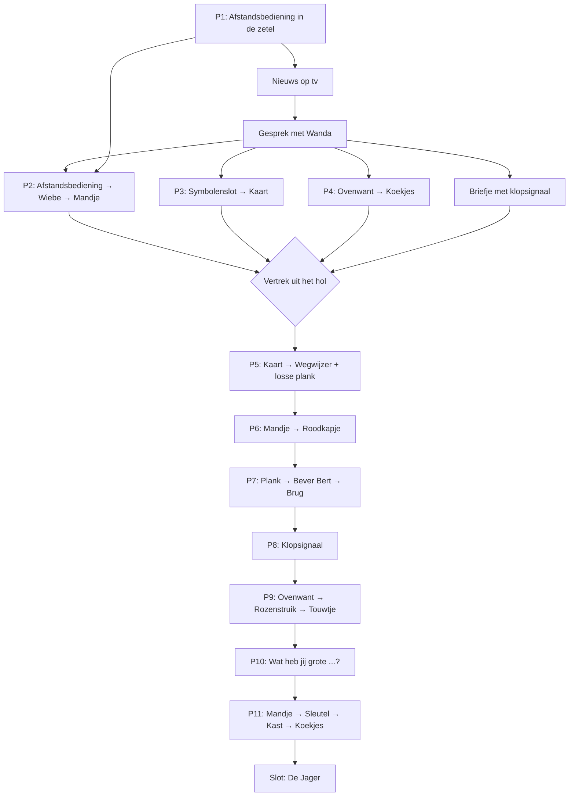

# Fairly Odd Tales

**Fairly Odd Tales** is een point & click avonturenspel in de stijl van de klassiekers zoals *Return to Monkey Island*. Je speelt bekende sprookjes, maar dan net een beetje anders dan je ze kent: de "slechterik" is de held, de "held" heeft een eigen plannetje, en niets is wat het lijkt.

- **Doelgroep:** kinderen vanaf 8 jaar
- **Speelduur:** maximaal 15 minuten per sprookje
- **Toon:** grappig en spannend, nooit eng of bloederig. Alles wat "gevaarlijk" is gebeurt buiten beeld en wordt met humor gebracht.

---

## Spelmechaniek

Een eenvoudige besturing, zoals in *Return to Monkey Island*: geen lijst met werkwoorden, maar slimme klikken.

| Actie | Wat gebeurt er |
|---|---|
| **Linksklik** op de grond | De wolf wandelt erheen |
| **Linksklik** op een object of personage | De logische actie: oppakken, gebruiken, praten |
| **Rechtsklik** (of lang tikken) | Bekijken: de wolf zegt er iets grappigs over |
| **Muis over een object** | De naam van het object verschijnt |
| **Voorwerp uit inventaris slepen** naar een object | Voorwerp gebruiken op dat object |
| **Voorwerp op een ander voorwerp slepen** | Voorwerpen combineren |

**Extra's voor jonge spelers:**
- **Spatiebalk / vergrootglas-knop:** laat alle klikbare plekken in de kamer even oplichten.
- **Detectiveboekje (hintboek):** de wolf noteert automatisch wat hij moet doen. Klik op het boekje voor een hint. Er zijn drie niveaus: eerst een vage tip, dan een duidelijke tip, en tot slot de oplossing.
- Je kan niet doodgaan en niet vastlopen. Belangrijke voorwerpen kunnen nooit kwijtraken.
- Alle tekst wordt ook ingesproken, zodat kinderen die nog niet vlot lezen ook mee kunnen.

---

# Sprookje 1: Roodkapje
## *De Zaak van de Rode Zakdoek*

### Het verhaal in het kort

Er gebeurt iets vreselijks in het Donkere Woud: wolven verdwijnen. Op elke plaats delict vindt de politie maar één spoor: **een rode zakdoek**. Niemand weet wie of wat erachter zit.

Walter Wolf, een rustige wolf met pantoffels en een leesbril, hoort het nieuws op tv. Zijn vrouw Wanda vertelt hem een geheim: diep in het bos woont **Grootmoeder**, een geheime informante. Zij weet wie de dader is. Walter moet de informatie bij haar gaan halen.

Onderweg komt hij een klein meisje met een rode kap tegen dat ontzettend veel vragen stelt. Per ongeluk vertelt hij haar dat hij naar Grootmoeder gaat. *Haar* grootmoeder. Wat moet een wolf nu bij haar grootmoeder? Er begint een race door het bos, en Roodkapje is er als eerste...

> **De twist:** Roodkapje is een amateur-detective die de zaak zelf wil oplossen. Grootmoeder weigerde haar iets te vertellen ("Te gevaarlijk voor kinderen!"). Dus heeft Roodkapje oma vastgebonden, in de kast gestoken en zich als oma verkleed. Zo hoopt ze de informatie uit de wolf te krijgen. Maar de wolf komt juist informatie *halen*... Twee detectives die elkaar proberen uit te horen, en geen van beiden weet iets!

### Personages

| Personage | Beschrijving |
|---|---|
| **Walter Wolf** | De speler. Groot, harig, lief en een beetje onhandig. Draagt pantoffels en een cardigan. Wil vooral snel terug naar zijn zetel. |
| **Wanda Wolf** | Walters vrouw. Slim en kordaat, de echte baas in huis. Weet meer over het "wolvennetwerk" dan Walter denkt. |
| **Wiebe** | Hun welpje. Speelt de hele tijd en wil tekenfilms kijken. |
| **Uil Ursula** | Nieuwslezeres op Wolf-TV. Heel serieus, maar knippert met één oog tegelijk. |
| **Inspecteur Das** | Komt even in beeld in het nieuws. Heeft geen idee wat hij doet. |
| **Roodkapje** | Klein, slim en nieuwsgierig. Stelt aan één stuk door vragen. Heeft een notitieboekje en een vergrootglas. |
| **Bever Bert** | Bouwt een dam in de beek en spreekt als een bouwvakker ("Dat gaat 'm niet worden, maat"). |
| **Grootmoeder** | Geheime informante. Gepensioneerd spionne, breit nog steeds geheime codes in sjaals. Zit het grootste deel van het spel in de kast. |

### Overzicht van de scènes

| # | Scène | Speeltijd (ongeveer) | Puzzels |
|---|---|---|---|
| 1 | Het Wolvenhol (woonkamer + keuken) | 4 min | 1, 2, 3, 4 |
| 2 | Het Kruispunt in het bos | 3 min | 5, 6 |
| 3 | De Beek | 2 min | 7 |
| 4 | Voor het huisje van Grootmoeder | 2 min | 8, 9 |
| 5 | Binnen bij Grootmoeder (finale) | 4 min | 10, 11 |
| | **Totaal** | **± 15 min** | **11 puzzels** |

---

## Scène 1: Het Wolvenhol

**Decor:** Een gezellige woonkamer met houten balken. Een versleten groene **zetel**, een ouderwetse **tv** op een kastje, een **bureau** met een lade, een **familiefoto** aan de muur, een **open keuken** met een **oven** en een **ovenwant** aan een haakje. Welpje **Wiebe** speelt op het tapijt. **Wanda** zit te breien bij het raam.

**Openingsscène (filmpje):** Walter ploft neer in de zetel met een kop thee. *"Aaah, eindelijk rust."* Hij wil tv kijken, maar de afstandsbediening is weg. De speler krijgt de controle.

### Puzzel 1: Waar is de afstandsbediening? *(tutorial)*
- **Doel:** de speler leert klikken, bekijken en oppakken.
- **Oplossing:** klik op de **zetel**. Walter graaft tussen de kussens en vindt een oude sok, een kruimel en de **afstandsbediening**.
- Gebruik de **afstandsbediening** op de **tv**.

**Nieuwsuitzending (filmpje):**
> **Uil Ursula:** "Goedenavond. Opnieuw is er een wolf verdwenen in het Donkere Woud. Het is al de vijfde deze maand. De politie staat voor een raadsel."
> **Inspecteur Das:** "We hebben maar één spoor: deze rode zakdoek. We weten niet van wie die is. We weten ook niet wat een zakdoek is. We zoeken verder."
> **Uil Ursula:** "Wolven wordt aangeraden binnen te blijven. En nu het weer: het wordt mistig, met kans op... rode zakdoeken."

Walter laat zijn thee vallen. Wanda staat op.

### Gesprek met Wanda (verplicht)
> **Wanda:** "Walter. Het is tijd dat je het weet. Diep in het bos woont een oude dame. Grootmoeder. Ze is een informante, ze weet alles wat er in het bos gebeurt. Als iemand weet wie dit doet, is zij het."
> **Walter:** "Een oma? Een *mensen*-oma? Die eten toch geen wolven?"
> **Wanda:** "Deze niet. Ze helpt ons al jaren. Maar je moet goed voorbereid zijn."

Wanda zegt wat Walter nodig heeft (dit komt meteen in het **detectiveboekje**):
1. De **kaart van het bos** (in de lade van het bureau)
2. Een **mandje** ("Je kan niet met lege poten bij oma aankomen.")
3. **Koekjes** voor Grootmoeder ("Ze praat alleen met wie koekjes meebrengt.")
4. Het **geheime klopsignaal**: *klop, klop, BONK* (twee keer zacht, één keer hard). Walter schrijft het op een **briefje** dat in zijn inventaris komt.

### Puzzel 2: Het mandje van Wiebe
- Wiebe zit met het **mandje** op zijn hoofd en speelt ridder.
- Praat met Wiebe: *"Mijn helm! Die krijg je niet! Behalve... als ik tekenfilms mag kijken."*
- **Oplossing:** geef de **afstandsbediening** aan Wiebe. Hij zet de tekenfilms op en geeft het **mandje**.

### Puzzel 3: De lade met het symbolenslot
- De lade van het bureau zit op slot met een **slot met drie draaischijven**. Op elke schijf staan symbolen: 🌙 maan, 🦴 bot, 🌲 boom, 🧀 kaas, ⭐ ster, 🐾 pootafdruk.
- Bekijk het bureau: *"Wanda kiest altijd een code die met de familie te maken heeft."*
- **Hint:** op de **familiefoto** staan drie wolven op een rij. Opa huilt naar de **maan**, Wanda houdt een **ster** vast (de ster van "beste kok"), en baby Wiebe kauwt op een **bot**.
- **Oplossing:** 🌙 ⭐ 🦴 → de lade gaat open, je krijgt de **kaart van het bos**.
- *Kindvriendelijk:* een fout antwoord geeft alleen een grappig geluidje ("tsjoeng!") en Walter zegt: *"Hmm, misschien moet ik eens naar de familie kijken."*

### Puzzel 4: Koekjes uit de oven
- Klik op de **oven**: er zitten vers gebakken koekjes in. Walter wil ze pakken: *"AU AU AU! Heet heet heet!"*
- **Oplossing:** pak de **ovenwant** van het haakje en gebruik die op de oven. Je krijgt de **koekjes** (3 stuks) en houdt de **ovenwant** (die is later nog nodig!).

**Einde van de scène:** als Walter de kaart, het mandje, de koekjes en het briefje heeft, kan hij via de voordeur vertrekken. Wanda: *"Wees voorzichtig. En praat met niemand onderweg!"* Walter: *"Natuurlijk niet. Ik praat nooit met vreemden."* (Dit gaat dus helemaal mislopen.)

---

## Scène 2: Het Kruispunt

**Decor:** Een open plek in het bos met een scheve **wegwijzer**, een **boomstronk**, een **bloemenveld** in de verte en een paar **paddenstoelen**. Naast de wegwijzer ligt een **losse plank**.

### Puzzel 5: De gedraaide wegwijzer
- De wind heeft de pijlen van de wegwijzer helemaal verdraaid. Er staan drie pijlen op: **"Molen"**, **"Beek"** en **"Grootmoeder"**.
- Bekijk de wegwijzer: *"Als ik hier de verkeerde kant op ga, kom ik in de Molen terecht. En daar woont een kat met laarzen. Nee dank je."*
- **Oplossing:** gebruik de **kaart** op de wegwijzer. Er opent een **mini-puzzel**: de kaart staat links in beeld, rechts staat de wegwijzer. Klik op elke pijl om hem te draaien tot de richtingen kloppen met de kaart.
  - Molen → links
  - Beek → rechts
  - Grootmoeder → rechtdoor (over de beek)
- Neem ook de **losse plank** mee: *"Een stukje van de oude wegwijzer. Dat kan altijd van pas komen."*

### Puzzel 6: Roodkapje en haar vragen
Zodra de wegwijzer klopt, springt **Roodkapje** achter de boomstronk vandaan.

**Het omgekeerde vragenspel.** In het originele sprookje stelt de wolf de vragen. Hier is het andersom: Roodkapje vuurt de ene vraag na de andere af. De speler kiest telkens een antwoord, maar *elk antwoord leidt tot een nieuwe vraag*:

> **Roodkapje:** "Hallo! Wie ben jij? Waarom heb je pantoffels aan? Waar ga je naartoe? Wat zit er in je mandje? Waarom is het leeg?"
>
> Antwoorden voor de speler:
> 1. *"Ik ben gewoon een wandelende wolf."* → "Waarom wandel je? Wolven rennen toch?"
> 2. *"Mijn pantoffels zijn heel comfortabel."* → "Waarom heb je comfort nodig? Heb je iets te verbergen?"
> 3. *"Ik ga... nergens naartoe."* → "Niemand gaat nergens naartoe. Dat is een feit. Ik heb het opgeschreven."
> 4. *"Mag ik ook eens een vraag stellen?"* → "Nee. Waarom wil je een vraag stellen?"

Roodkapje schrijft alles op in haar notitieboekje. Daarna zegt ze: *"Ik ga met je mee!"* Walter wil dat **absoluut niet**, hij moet snel zijn en het is geheim.

- **Doel:** Roodkapje ergens anders mee bezighouden.
- Praat nog eens met haar en kies: *"Waarom ga je geen bloemen plukken? Daar in dat mooie veld?"*
  → Roodkapje: *"Ik zou wel willen, maar ik heb niks om ze in te doen."*
- **Oplossing:** geef het **mandje** aan Roodkapje. (Ja, de wolf geeft het mandje aan Roodkapje, en niet omgekeerd!)

**De vergissing (filmpje):**
> **Roodkapje:** "Dankjewel! Voor wie zal ik de bloemen plukken?"
> **Walter** *(zonder nadenken)*: "Voor Grootmoeder natuurlijk, in het huisje midden in het bos!"
> *Stilte. Een krekel tjirpt.*
> **Roodkapje** *(kijkt heel streng)*: "...*Mijn* grootmoeder?"
> **Walter:** "Euh. Nee. Een andere. Er zijn heel veel grootmoeders."
> **Roodkapje:** "Wat moet een **wolf** bij **mijn** grootmoeder?!"
>
> Roodkapje sprint weg via een geheim sluippaadje door de struiken, met het mandje nog in haar hand. Walter: *"Oh nee. Oh nee nee nee. Wanda gaat me vermoorden."*

**De race begint!** Vanaf nu staat er bovenaan het scherm een klein, grappig **race-icoontje**: een rode kap en een wolvenkop op een bospad. Het is puur sfeer: Roodkapje komt hoe dan ook eerst aan, er is geen tijdslimiet. Het icoontje van Roodkapje rent vooruit, dat van de wolf loopt mee als de speler een puzzel oplost.

---

## Scène 3: De Beek

**Decor:** Een snelstromende beek. De **brug** heeft geen planken meer, alleen de palen staan er nog. Aan de overkant zie je in de verte een rode kap tussen de bomen verdwijnen. **Bever Bert** bouwt een **dam** met... de planken van de brug.

### Puzzel 7: De brug van Bever Bert
- Praat met Bert:
  > **Bert:** "Sorry maat, die planken heb ik nodig voor m'n dam. Plus: ik moet ergens op knagen, anders worden m'n tanden te lang. Ik heb al dagen niks lekkers gehad. Alleen maar brug. Brug smaakt naar voeten."
- Probeer je de **koekjes** te geven: *"Koekjes? Ik ben een bever, geen kabouter. Ik wil HOUT."*
- **Oplossing:** geef de **losse plank** (van de wegwijzer) aan Bert.
  > **Bert:** "Ooooh! Wegwijzerhout! Daar zitten letters in! Dat is het lekkerste hout dat er bestaat! Deal, maat."
- Bert legt in een snel, grappig filmpje drie planken terug op de brug. Walter steekt over.

*(Optioneel grapje: als je Bert de ovenwant probeert te geven, zet hij die op als hoedje.)*

---

## Scène 4: Voor het huisje van Grootmoeder

**Decor:** Een schattig huisje met een rieten dak, een **voordeur** met een klein luikje, een groot **rozenstruik** naast de deur, een **raam** met gesloten gordijnen en een **brievenbus**. Het **mandje** van Roodkapje (vol bloemen) staat zichtbaar door een kier in het gordijn op tafel. Roodkapje is hier dus al!

### Puzzel 8: Het geheime klopsignaal
- Klik op de deur: Walter klopt gewoon. Een héél hoge, gespeelde oma-stem: *"Wie is daar? Euh... ik bedoel... wie is daar, liefje?"* Daarna blijft het stil. *"Hmm. Wanda zei dat ik op een speciale manier moest kloppen."*
- **Oplossing:** gebruik het **briefje** met het klopsignaal op de deur (of klik op het briefje om het nog eens te lezen). Er verschijnt een **ritme-minipuzzel**: klik twee keer zacht en één keer hard op de deur (*klop, klop, BONK*).
  - *Kindvriendelijk:* de speler kan het ritme eerst laten voorspelen. Een fout ritme levert gewoon een grappige reactie op ("Wie klopt er als een specht?"), en je mag het opnieuw proberen.
- Na het juiste ritme:
  > **"Grootmoeder"** *(achter de deur, met een rare stem)*: "Trek maar aan het touwtje, dan gaat de deur vanzelf open!"

### Puzzel 9: Het touwtje in de rozenstruik
- Het touwtje van de deur is helemaal vastgegroeid in de **rozenstruik** vol doornen.
- Klik op het touwtje: *"Auw! Doornen! Mijn arme poten. Eerst al de oven en nu dit."*
- **Oplossing:** gebruik de **ovenwant** op de rozenstruik. Walter trekt het touwtje los en de deur gaat krakend open.

---

## Scène 5: Binnen bij Grootmoeder *(finale)*

**Decor:** Een knusse kamer. Een groot **bed** met daarin "Grootmoeder": Roodkapje met een veel te grote nachtmuts, oma's dikke bril, een grijze pruik die scheef staat en een nachtjapon tot over haar handen. Een grote **houten kast** in de hoek. Op tafel staat het **mandje met bloemen**. Onder het bed staan **kleine rode schoentjes**. Uit de nachtmuts piept een **plukje rood haar** (van de kap eronder).

### Puzzel 10: "Grootmoeder, wat heb jij grote...!"
Dit is het omgekeerde van de beroemde scène. Deze keer stelt de **wolf** de vragen aan de "grootmoeder", en hij moet haar ontmaskeren met wat hij in de kamer **ziet**.

Ondertussen probeert de "grootmoeder" informatie uit Walter te krijgen:
> **"Grootmoeder":** "Kom maar dichterbij, lieve wolf. Vertel eens... wat weet jij over die verdwenen wolven? En die rode zakdoek? En, eh... heb jij een alibi?"
> **Walter:** "Ik? Ik kom juist bij u om informatie te halen!"
> **"Grootmoeder":** "...Oh. Dat is vervelend."

**Klik op de kast** (kan op elk moment): de kast **schudt en rommelt** (*BONK BONK, "Mmmmmf! Mmmf!"*).
> **"Grootmoeder":** "Dat is... de muizen. Hele grote muizen. Met een sjaal."

**De ontmaskering.** Walter moet drie dingen opmerken. Elke keer dat de speler een aanwijzing in de kamer bekijkt, komt er een nieuwe "Wat heb jij..."-vraag bij in de dialoog:

| Aanwijzing (bekijken) | Vraag die vrijkomt | Antwoord van de "grootmoeder" |
|---|---|---|
| Oma's **dikke bril** | *"Grootmoeder, wat heb jij grote ogen!"* | "Dat is om jou beter te kunnen zien! ...Al zie ik eigenlijk helemaal niks met deze bril." |
| De **nachtjapon** met veel te lange mouwen | *"Grootmoeder, wat heb jij kleine handjes!"* | "Dat is om... euh... om kleine koekjes beter vast te kunnen houden!" |
| De **rode schoentjes** onder het bed | *"Grootmoeder, wat heb jij kleine voetjes!"* | "Dat is om... sneller te kunnen... breien?" |
| Het **rode plukje** onder de nachtmuts | *"Grootmoeder, wat heb jij een RODE KAP!"* | *(zie hieronder)* |

**Elke** "Wat heb jij..."-vraag mag in elke volgorde gesteld worden. Na minstens twee vragen plus de laatste (de rode kap), valt de vermomming door de mand:
> **Roodkapje** *(trekt de pruik af)*: "Oké, oké! Ik ben het! Maar jij bent een wolf en er werd een **rode** zakdoek gevonden. Iedereen gaat denken dat ik het gedaan heb! Ik wilde de dader zelf vangen. Oma wou niks vertellen, dus..."
> **Walter:** "Dus heb je je oma in de kast gestoken?!"
> **Roodkapje:** "...Ze heeft een kussen. En een boek."
> **Walter:** "Waar is de sleutel van de kast?"
> **Roodkapje:** "Dat ga ik niet zeggen. Waarom wil je dat weten? Wie zegt dat er een sleutel is? Wat is een sleutel eigenlijk?"

### Puzzel 11: Grootmoeder bevrijden
- De **kast** zit op slot.
- Roodkapje kijkt de hele tijd "toevallig" naar het **mandje met bloemen** op tafel (de speler ziet haar ogen ernaartoe schieten).
- **Oplossing, stap 1:** klik op het **mandje** → Walter haalt de bloemen eruit en vindt de **sleutel** tussen de stelen. *"Dat is MIJN mandje trouwens."*
- **Stap 2:** gebruik de **sleutel** op de **kast**. Grootmoeder rolt eruit, vastgebonden met haar eigen breiwol. Klik op haar om haar los te maken.
- **Stap 3:** Grootmoeder is boos en zwijgt als het graf. *"Ik praat met niemand. Ik ben net drie uur in een kast gestoken."* Geef haar de **koekjes**.
  > **Grootmoeder:** "...Zijn die van Wanda? *Smak.* Oké. Ik praat."

### Slot (filmpje)
> **Grootmoeder:** "Die rode zakdoek is niet van Roodkapje. Het is een **jagerszakdoek**. Elke jager in het bos draagt er zo een. Er is maar één jager die al jaren achter de wolven aanzit..."
> **Roodkapje** *(schrijft razendsnel in haar boekje)*: "Wie? Hoe heet hij? Waar woont hij? Wat eet hij als ontbijt?"
> **Grootmoeder:** "Hij noemt zich **De Jager**. Hij woont aan de andere kant van het bos, voorbij het **peperkoekhuisje**."
> *Een schaduw schuift voorbij het raam. Er valt een rode zakdoek op de vensterbank. Iedereen kijkt naar elkaar.*
> **Walter:** "...Ik wil terug naar mijn zetel."
> **Roodkapje:** "Partners?"
> **Walter:** "Absoluut niet."
> **Roodkapje:** "Waarom niet?"
>
> **WORDT VERVOLGD...** *(link naar het volgende sprookje: het peperkoekhuisje → Hans en Grietje)*

> *Opmerking: het einde (De Jager als dader en het peperkoekhuisje als volgende stap) is een voorstel. Zo komen er meer sprookjes samen in één doorlopend verhaal. Dit kan nog aangepast worden.*

---

## Overzicht: inventaris

| Voorwerp | Waar gevonden | Gebruikt bij |
|---|---|---|
| Afstandsbediening | Tussen de zetelkussens (P1) | TV aanzetten (P1), aan Wiebe geven (P2) |
| Mandje | Van Wiebe (P2) | Aan Roodkapje geven (P6), komt terug met de sleutel (P11) |
| Kaart van het bos | Lade van het bureau (P3) | Wegwijzer (P5) |
| Ovenwant | Keuken (P4) | Koekjes uit de oven (P4), rozenstruik (P9) |
| Koekjes | Oven (P4) | Grootmoeder laten praten (P11) |
| Briefje met klopsignaal | Gesprek met Wanda | Voordeur (P8) |
| Losse plank | Bij de wegwijzer (P5) | Bever Bert (P7) |
| Sleutel | In het mandje met bloemen (P11) | Kast (P11) |

## Puzzelafhankelijkheden

In scène 1 kunnen puzzel 2, 3 en 4 in **elke volgorde** opgelost worden. Zo voelt het spel vrij aan, maar blijft het overzichtelijk voor jonge spelers.

## Ontwerpregels voor de puzzels (8 jaar)

- **Eén stap tegelijk:** geen enkele puzzel heeft meer dan twee stappen nodig.
- **Alles staat in beeld:** voorwerpen die nodig zijn, liggen in dezelfde scène of werden kort daarvoor gevonden. Er is nooit iets nodig van twee scènes terug, behalve de ovenwant, en daar zegt Walter een hint over ("Eerst al de oven en nu dit").
- **Logisch in de wereld:** elke oplossing heeft een (grappige) reden die een kind kan volgen.
- **Fouten zijn grappig, niet straffend:** een verkeerd voorwerp gebruiken levert altijd een grappige zin op.
- **Lezen is geen voorwaarde:** symbolen in plaats van cijfers (P3), ritme in plaats van tekst (P8), en alles wordt voorgelezen.
- **Hergebruik van voorwerpen** (afstandsbediening, ovenwant, mandje) beloont spelers die opletten.
