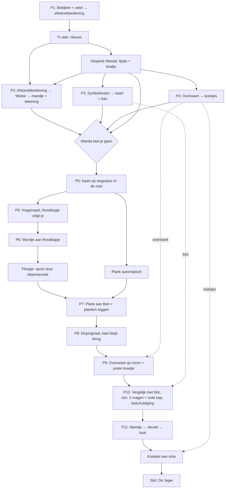

# Fairly Odd Tales

**Fairly Odd Tales** is een point & click avonturenspel in de stijl van de klassiekers zoals *Return to Monkey Island*. Je speelt bekende sprookjes, maar dan net een beetje anders dan je ze kent: de "slechterik" is de held, de "held" heeft een eigen plannetje, en niets is wat het lijkt.

- **Doelgroep:** kinderen vanaf 8 jaar
- **Speelduur:** maximaal 15 minuten per sprookje
- **Toon:** grappig en spannend, nooit eng of bloederig. Niemand raakt gewond, niemand wordt vastgebonden. Alles wat "gevaarlijk" is, gebeurt buiten beeld en wordt met humor gebracht.

---

## Spelmechaniek

Een eenvoudige besturing, zoals in *Return to Monkey Island*: geen lijst met werkwoorden, maar slimme klikken.

| Actie (muis) | Actie (tablet) | Wat gebeurt er |
|---|---|---|
| **Linksklik** op de grond | Tik | De wolf wandelt erheen |
| **Linksklik** op een object of personage | Tik | De logische actie: oppakken, gebruiken, praten |
| **Rechtsklik** | Lang tikken | Bekijken: de wolf zegt er iets grappigs over |
| **Muis over een object** | (vergrootglasknop) | De naam van het object verschijnt |
| **Voorwerp slepen** naar een object | Tik voorwerp, tik doel | Voorwerp gebruiken op dat object |
| **Voorwerp op een ander voorwerp slepen** | Tik voorwerp, tik voorwerp | Voorwerpen combineren |

**Extra's voor jonge spelers:**
- **Spatiebalk / vergrootglasknop:** alle klikbare plekken lichten even op, mét hun naam (want op tablet bestaat "muis erover" niet).
- **Detectiveboekje (hintboek):** een **plaatjes-checklist** van wat Walter moet doen, die zichzelf afvinkt. Klik op een doel voor een hint op drie niveaus: vage tip → duidelijke tip (met de plek gemarkeerd op een plaatje) → de oplossing. Hints zijn ingesproken. Na 60 seconden zonder vooruitgang wiebelt het boekje even, maar het gaat nooit vanzelf open: het kind beslist.
- Het boekje onthoudt alles wat je moet weten (klopsignaal, foto van Grootmoeder). Een kind hoeft nooit iets uit het hoofd te kennen.
- Je kan niet doodgaan en niet vastlopen. Belangrijke voorwerpen kunnen nooit kwijtraken (zie *Softlock-preventie*).
- Alle tekst wordt ingesproken. Ondertitels staan altijd aan; het woord dat gesproken wordt, licht op.

---

# Sprookje 1: Roodkapje
## *De Zaak van de Rode Zakdoek*

### Het verhaal in het kort

Er is iets raars aan de hand in het Donkere Woud: wolven verdwijnen. Op elke plek vindt de politie maar één spoor: **een rode zakdoek**. En getuigen hoorden... heel hard niezen.

Walter Wolf, een rustige wolf met pantoffels en een leesbril, hoort het nieuws op tv. Zijn vrouw Wanda vertelt hem een geheim: diep in het bos woont **Grootmoeder**, een gepensioneerde spionne. Zij weet alles wat er in het bos gebeurt. Walter moet de informatie bij haar gaan halen.

Onderweg komt hij een klein meisje met een rode kap tegen dat ontzettend veel vragen stelt. Per ongeluk vertelt hij haar dat hij naar Grootmoeder gaat. *Haar* grootmoeder. Wat moet een wolf nu bij haar grootmoeder? Er begint een race door het bos, en Roodkapje is er als eerste...

> **De twist:** Roodkapje is een amateur-detective. Sinds die rode zakdoek kijkt iedereen raar naar háár kap. Ze wil de zaak zelf oplossen, maar oma wou haar niks vertellen ("Te gevaarlijk voor kinderen!"). Als ze hoort dat er een wolf naar oma komt, rent ze vooruit, zegt oma dat ze zich in de kast moet verstoppen en draait de sleutel om, "voor haar eigen veiligheid". Dan verkleedt ze zich als oma om de wolf uit te horen. Maar de wolf komt juist informatie *halen*... Twee detectives die elkaar proberen uit te horen, en geen van beiden weet iets!

> **De dader (onthuld op het einde, nooit eng):** De Jager vangt geen wolven om ze kwaad te doen. Hij **verzamelt** ze voor zijn "Griezelmuseum". Daar zitten ze veilig achter een fluwelen koord, maar ze moeten de hele dag grommen voor de toeristen en vervelen zich suf. De Jager is **allergisch voor wolvenhaar**: hij niest en verliest overal zijn rode zakdoek. *"HATSJOE!"*

### Personages

| Personage | Wie | Wil | Grappige eigenschap / running gag |
|---|---|---|---|
| **Walter Wolf** | De speler. Groot, harig, lief, beetje onhandig. Pantoffels en cardigan. | Terug naar zijn zetel (en, zonder het te weten, een held zijn) | Geeft alles een **zetelscore**: *"Twee op tien. Er zit een mier in."* |
| **Wanda Wolf** | Walters vrouw. Slim en kordaat, de echte baas in huis. | Het wolvennetwerk beschermen | Weet alles, zegt het nooit meteen: *"Dat vertel ik je later, Walter."* |
| **Wiebe** | Hun welpje. | Tekenfilms kijken | Speelt ridder met het mandje als helm. Vraagt of papa een held is. |
| **Uil Ursula** | Nieuwslezeres op Wolf-TV. Heel serieus. | Serieus nieuws brengen | Knipoogt met één oog; het weerbericht loopt altijd mis. |
| **Inspecteur Das** | Politie, in het nieuws. | Iets ontdekken | Snapt niets, verdenkt steeds de verkeerde. |
| **Roodkapje** | Klein, slim, nieuwsgierig. Notitieboekje en vergrootglas. | De zaak oplossen, en niet zelf verdacht zijn | Stelt alleen vragen: *"Waarom?"* en schrijft alles op. |
| **Bever Bert** | Bouwt een dam en praat als een bouwvakker. | Zijn dam afwerken, iets lekkers knagen | Proeft alles als een chef: *"Dat smaakt naar..."* |
| **Grootmoeder** | Gepensioneerde spionne. Zit het grootste deel van het spel in de kast. | Haar geheimen bewaren | Breit geheime boodschappen in sjaals (in de kast: H… HE… HELP). |
| **De Jager** *(alleen buiten beeld)* | De dader. | Zijn Griezelmuseum vullen | *"HATSJOE!"* + een rode zakdoek |
| **De sok** *(optioneel)* | Een oude sok van Walter. | ? | Duikt overal op: zetel, brievenbus, onder oma's bed. *"Volgt die sok mij?"* |

**Walters boog:** begin: *"Ik ben een zetel-expert"* → midden (de beek): twijfel, en Wiebes tekening "Papa de held" → einde: hij kiest zelf om verder te gaan.

**Woordkeuze:** "informante" wordt **spionne** (*"Een spion? Met een rollator?"*). "Alibi" blijft als grap. "Plaats delict" alleen in documenten, niet in ingesproken tekst. Ingesproken zinnen: maximaal ± 12 woorden, één idee per zin.

### Overzicht van de scènes

| # | Scène | Speeltijd | Puzzels | Moeilijkheid (1–4) |
|---|---|---|---|---|
| 1 | Het Wolvenhol (woonkamer + keuken) | 5 min | 1, 2, 3, 4 | 1 · 1 · 2 · 1 |
| 2 | Het Kruispunt in de mist | 3 min | 5, 6 | 3 · 2 |
| 3 | De Beek | 1,5 min | 7 | 2 |
| 4 | Voor het huisje van Grootmoeder | 2 min | 8, 9 | 2 · 2 |
| 5 | Binnen bij Grootmoeder (finale) | 3,5 min | 10, 11 | **4** · 2 |
| | **Totaal** | **± 15 min** | **11 puzzels** | |

Eén denkpiek per scène, de finale (P10) als hoogtepunt en P11 als ontspannen afronding.

---

## Scène 1: Het Wolvenhol

**Decor:** Een gezellige woonkamer met houten balken. Een versleten groene **zetel**, een ouderwetse **tv** op een kastje, een **bureau** met een lade, een **familiefoto** in een houten kader aan de muur, een **open keuken** met een **oven** en vlak ernaast een **ovenwant** aan een haakje. Op tafel ligt een stuk **kaas**. Welpje **Wiebe** speelt op het tapijt met het **mandje** op zijn hoofd. **Wanda** zit te breien bij het raam.

**Openingsscène (filmpje, 0:15):** Walter ploft neer in de zetel met een kop thee. *"Aaah, eindelijk rust."* Hij wil tv kijken, maar de afstandsbediening is weg.

### Puzzel 1: Waar is de afstandsbediening? *(tutorial)*
- **Doel:** de speler leert bekijken, klikken en gebruiken.
- Klik op de **zetel**: *"Hier zit iets in mijn rug. Ik moet eerst eens goed kijken."* Op het scherm verschijnt een korte uitleg met een oog-icoon (rechtsklik / lang tikken).
- **Bekijk** de zetel: *"Die zetel ziet er... bobbelig uit."* Pas nu kan Walter graven. Hij vindt een oude **sok** (*"Die zoek ik al sinds Kerstmis"*), een kruimel en de **afstandsbediening**.
- Gebruik de **afstandsbediening** op de **tv** (leert: voorwerp op object).

**Nieuwsuitzending (filmpje, 0:30):**
> **Ursula:** "Goedenavond. Weer is er een wolf verdwenen. Al de vijfde deze maand."
> **Das:** "We hebben één spoor. Deze rode zakdoek. En getuigen hoorden... niezen."
> **Ursula:** "Niezen, inspecteur?"
> **Das:** "Heel hard niezen. We verdenken iedereen met een neus."
> **Ursula:** "Wolven, blijf binnen. En nu het weer: mistig, met kans op zakdoeken." *(knipoogt met één oog)*

Walter laat zijn thee vallen. Wanda staat op.

### Gesprek met Wanda (verplicht, start automatisch, 0:35)
> **Wanda:** "Walter. Ik moet je iets vertellen."
> **Walter:** "Is de thee op?"
> **Wanda:** "Erger. Diep in het bos woont Grootmoeder. Een geheime spionne. Ze weet alles."
> **Walter:** "Een mensen-oma? Die zijn toch bang van wolven?"
> **Wanda:** "Deze niet. Ze is bang van niks. Behalve van mensen zonder koekjes."
> **Walter:** "En wie gaat er naar haar toe?"
> *(Wanda kijkt hem aan. Wiebe kijkt hem aan. Zelfs de familiefoto lijkt te kijken.)*
> **Walter:** "...Ik dus."

Wanda noemt kort vier dingen. Ze verschijnen meteen als **plaatjes** in het detectiveboekje. Wie opnieuw met Wanda praat, kan per voorwerp doorvragen (elke zin is wegklikbaar):
1. 🗺️ De **kaart van het bos**: *"In de lade. Je weet wel welke code."* (Walter weet het niet.)
2. 🧺 Een **mandje**: *"Je kan niet met lege poten bij oma aankomen."*
3. 🍪 **Koekjes**: *"Ze praat alleen met wie koekjes meebrengt."*
4. ✉️ Het **geheime klopsignaal**. Walter krijgt een **briefje**. Erop staat geen tekst, maar een patroon:
   **Jij klopt: ● ● ⬤** (twee keer klein, één keer groot) · **Zij klopt terug: ⬤ ● ●**
   Wanda: *"Een echte Grootmoeder klopt altijd terug."*

### Puzzel 2: Het mandje van Wiebe
- Wiebe zit met het **mandje** op zijn hoofd en speelt ridder. Praat met hem: *"Mijn helm! Die krijg je niet! Behalve... als ik tekenfilms mag kijken."* Hij wijst naar de afstandsbediening in Walters inventaris; het icoon wiebelt even.
- **Oplossing:** geef de **afstandsbediening** aan Wiebe. Hij zet de tekenfilms op en geeft het mandje.
  > **Wiebe:** "Papa, ga je op avontuur? Ben jij een held?"
  > **Walter:** "Nee jongen. Ik ben een zetel-expert."
  > **Wiebe** *(geeft een tekening)*: "Voor als je het vergeet."
- Walter krijgt het **mandje** en de **tekening van Wiebe** ("Papa de held", met cape). Hij steekt de tekening in zijn cardigan.
- De tv blijft aan met tekenfilms. Bekijken: *"Een kat die een muis achterna zit. Altijd hetzelfde verhaal."* Klikken: Wiebe roept *"NIET AANKOMEN!"*
- *Regel:* vóór het nieuws weigert Walter: *"Straks, Wiebe. Papa kijkt eerst naar het nieuws."*

### Puzzel 3: De lade met het symbolenslot
- De lade zit op slot met **drie draaischijven in een houten kadertje**, hetzelfde kader als de familiefoto. Op elke schijf: 🌙 maan, 🦴 bot, 🌲 boom, 🧀 kaas, ⭐ ster, 🪶 veer. Boven de schijven staan **1, 2 en 3 pootafdrukjes**.
- Bekijk het slot: *"Hé, dat kadertje lijkt op dat van onze familiefoto. Wanda kiest altijd iets met de familie."*
- **De familiefoto:** drie wolven op een rij, onder elke wolf een bordje met 1, 2 of 3 pootjes (tellen, geen cijfers lezen). Elke wolf houdt zijn symbool groot en duidelijk vast: opa (1 pootje) huilt met de **maan** achter zich, Wanda (2) draagt een **ster**-medaille op haar schort ("beste kok"), baby Wiebe (3) kauwt op een **bot**.
- De **kaas** op tafel is een afleider: wie kaas kiest, kijkt niet naar *wie* iets vasthoudt.
- **Oplossing:** 🌙 ⭐ 🦴. Tik op een schijf om hem te draaien. Staat een schijf juist, dan gloeit dat stukje kader op (feedback per schijf, geen gokfrustratie).
- Een fout antwoord geeft alleen een grappig "tsjoeng!" en: *"Hmm, misschien moet ik eens naar de familie kijken."*
- De lade gaat open. Je krijgt de **kaart van het bos** én een **foto van Grootmoeder**. Wanda: *"Voor als je twijfelt."* De foto komt in het detectiveboekje: grijze krullen, **geen** bril, **grote** handen met breinaalden, **grote** voeten in sloffen.

### Puzzel 4: Koekjes uit de oven
- Klik op de **oven**: vers gebakken koekjes. *"AU AU AU! Heet heet heet!"*
- **Oplossing:** pak de **ovenwant** van het haakje en gebruik die op de oven. Je krijgt de **koekjes** (3 stuks) en houdt de **ovenwant**: *"Die neem ik mee. Je weet maar nooit."*

**Einde van de scène:** heeft Walter de vier dingen, dan kan hij via de voordeur vertrekken. Mist er iets, dan houdt Wanda hem tegen en zegt *wat*: *"En de koekjes, Walter?"* (Vóór het nieuws: *"Ik ga nergens heen. Ik zit net."*)
> **Wanda:** "Wees voorzichtig. En praat met niemand onderweg!"
> **Walter:** "Natuurlijk niet. Ik praat nooit met vreemden."

*(Dit gaat dus helemaal mislopen.)* Na het vertrek is het hol niet meer bereikbaar; dat kan geen kwaad, want er blijft daar niets nodig.

**Optionele bekijk-grappen:** Wanda's breiwerk (*"Weer een sjaal met rare patroontjes"*), de zetel na P1 (*"Negen op tien. Mijn beste werk."*), het raam, de kruimel, het tv-kastje.

---

## Scène 2: Het Kruispunt in de mist

**Decor:** Een open plek in het bos, gehuld in dikke mist (het weerbericht had gelijk). Een scheve **wegwijzer**, een **boomstronk**, een paar **paddenstoelen** en een **losse plank** (een afgebroken arm van de wegwijzer). Drie paden verdwijnen in de mist; in de verte zie je heel vaag drie silhouetten: links een molenwiek, rechts bloemen, rechtdoor een rookpluim uit een schoorsteen.

Klik je op een pad vóór de wegwijzer klopt: *"Ik zie geen poot voor mijn ogen. Straks kom ik nog bij die kat met laarzen."*

### Puzzel 5: De gedraaide wegwijzer
- De wind heeft de drie pijlen verdraaid. Elke pijl heeft een **pictogram** en een woord: 🌾 **Molen**, 🌸 **Bloemenveld**, 🏠 **Grootmoeder**.
- Bekijk de wegwijzer: *"In de mist lijken alle paden op elkaar. Als die wegwijzer klopt, weet ik welk pad welk is."*
- **Oplossing:** gebruik de **kaart** op de wegwijzer. Er opent een close-up: **Walter staat met zijn rug naar de speler** voor de wegwijzer, zodat links voor iedereen links is. De kaart ligt ernaast en is getekend **in de looprichting**: onderaan een pootafdruk "jij bent hier", recht omhoog is recht voor je.
  - 🌾 Molen → links
  - 🌸 Bloemenveld → rechts
  - 🏠 Grootmoeder → rechtdoor (op de kaart loopt dat pad over de beek)
- Tik op een pijl om hem te draaien (vier standen). Staat een pijl juist, dan trekt de mist op dat pad op en wordt het silhouet scherp. Wie de kaart niet snapt, kan zo ook het decor lezen.
- Als alles klopt, trekt de mist helemaal op. Walter pakt **automatisch** de **losse plank** op: *"Een stukje oude wegwijzer. Dat kan altijd van pas komen."*

### Puzzel 6: Roodkapje en haar vragen
Zodra de mist weg is, springt **Roodkapje** achter de boomstronk vandaan.

**Het omgekeerde vragenspel.** In het originele sprookje stelt de wolf de vragen. Hier is het andersom: Roodkapje vuurt de ene vraag na de andere af. De speler kiest telkens een antwoord, maar *elk antwoord leidt tot een nieuwe vraag*:

> **Roodkapje:** "Hallo! Wie ben jij? Waarom heb je pantoffels aan? Waar ga je naartoe? Waarom is je mandje leeg?"
>
> 1. *"Ik ben gewoon een wandelende wolf."* → "Waarom wandel je? Wolven rennen toch?"
> 2. *"Mijn pantoffels zijn heel comfortabel."* → "Waarom heb je comfort nodig? Heb je iets te verbergen?"
> 3. *"Ik ga... nergens naartoe."* → "Niemand gaat nergens naartoe. Dat is een feit. Ik heb het opgeschreven."
> 4. *"De koekjes zitten in mijn cardigan. Daar zijn ze veilig."* → "Welke koekjes? Voor wie? Waarom veilig?"
> 5. *"Mag ik ook eens een vraag stellen?"* → "Nee. Waarom wil je een vraag stellen?"

Tussendoor plant ze haar motief: *"Sinds die rode zakdoek kijkt iedereen raar naar mijn kap."* Dan: *"Ik ga met je mee!"* Walter wil dat **absoluut niet**: het is geheim. Roodkapje loopt nu mee en gaat voor elk pad staan: *"Waar gaan we naartoe? Waarom loop je zo snel?"*

- **Doel:** Roodkapje ergens anders mee bezighouden. Ze kijkt steeds verlangend naar het (nu zichtbare) bloemenveld.
- Praat nog eens met haar en kies: *"Waarom ga je geen bloemen plukken? Daar in dat mooie veld?"*
  → *"Ik zou wel willen, maar ik heb niks om ze in te doen."*
- **Oplossing:** geef het **mandje** aan Roodkapje. (Ja, de wolf geeft het mandje aan Roodkapje, en niet omgekeerd!) Walter twijfelt eerst hardop: *"Wanda zei een mandje... Maar ik krijg het vast terug."*
- Geef je het mandje vóór de bloemen-vraag: *"Waarom geef je me een mandje? Is dit omkoperij? Ik schrijf het op."* De bloemen-vraag komt dan vanzelf vrij.

**De vergissing (filmpje, 0:30):**
> **Roodkapje:** "Dankjewel! Voor wie pluk ik de bloemen?"
> **Walter** *(zonder nadenken)*: "Voor Grootmoeder, in het huisje midden in het bos!"
> *(Een krekel tjirpt. De krekel stopt. Zelfs de krekel weet dat dit fout is.)*
> **Roodkapje:** "...MIJN grootmoeder?"
> **Walter:** "Nee. Een andere. Er zijn heel veel grootmoeders. Het bos ligt er vol mee."
> **Roodkapje:** "Een wolf. Bij mijn oma. Niet als ik het kan tegenhouden!"
> *(Ze zoeft via een sluippaadje dwars door het bloemenveld en grist al rennend bloemen mee: "Bloemen! Voor! Oma!")*
> **Walter:** "Oh nee. Oh nee nee nee. Wanda laat me een maand de afwas doen."

**De race begint!** Bovenaan het scherm verschijnt een klein **race-icoontje**: een rode kap en een wolvenkop op een bospad. Het is puur sfeer: Roodkapje komt hoe dan ook eerst aan, er is geen tijdslimiet. Het wolvenkopje schuift op als de speler een puzzel oplost.

Na de vergissing: het Molenpad (*"Kat met laarzen. Nee dank je."*) en het Bloemenpad (*"Daar is zij langs. Ik moet naar Grootmoeder."*) zijn dicht; het pad rechtdoor is open.

**Optionele bekijk-grappen:** paddenstoelen (*"Rood met witte stippen. Die zien er eng gezond uit."*), boomstronk (*"Twee op tien. Er zit een mier in."*), Walters pantoffels (*"Nat. Mist is ook gewoon regen die lui is."*).

---

## Scène 3: De Beek

**Decor:** Een snelstromende beek. De **brug** heeft geen planken meer, alleen drie open gaten tussen de palen. **Bever Bert** bouwt een **dam** met... de planken van de brug. Ver stroomopwaarts hupt een rode kap over piepkleine **stapstenen** en verdwijnt tussen de bomen. Een **vis** kijkt Walter aan.

**Bij aankomst (in het spel, 0:10):**
> **Walter:** "Ik kan nog terug. Mijn zetel is nog warm."
> *(Hij haalt Wiebes tekening uit zijn cardigan. "Papa de held". Met cape.)*
> **Walter:** "...Ach. Die cape staat me eigenlijk wel."

### Puzzel 7: De brug van Bever Bert
- Praat met Bert:
  > **Bert:** "Sorry maat, die planken zijn voor m'n dam. En ik moet knagen, anders worden m'n tanden te lang. Al dagen alleen maar brug. Brug smaakt naar voeten."
- **Stap 1:** geef de **losse plank** aan Bert.
  > **Bert:** "Ooooh! Wegwijzerhout! Daar zitten letters in! Het lekkerste hout dat er bestaat! Deal, maat."
  > Bert duwt vier planken naar de oever. "Maar leggen doe je zelf. Ik ben bever, geen timmerman."
- **Stap 2 (legpuzzel):** vier planken van verschillende lengte, drie gaten die steeds breder worden. Tik een plank, tik een gat. Past hij precies, dan klikt hij vast. Te kort of te lang: de plank schuift terug (*"Bijna. Net niet."*). Eén plank is te kort voor alles; daar gaat Bert uit protest op knagen. Duurt minder dan een minuut.
- Walter steekt over.

**Optionele bekijk-grappen:** de dam (*"Is dat... een brugleuning?"*), de stapstenen (*"Voor kinderpootjes. Niet voor wolvenpantoffels."*), de vis (*"Hij oordeelt. Ik voel het."*).

---

## Scène 4: Voor het huisje van Grootmoeder

**Decor:** Een schattig huisje met een rieten dak, een **voordeur** met een klinkje, een groot **rozenstruik** naast de deur, een **raam** met gesloten gordijnen, een **brievenbus** en een hekje opzij met een bordje *"Achterom: alleen familie"*. Door een kier in het gordijn zie je een **mandje vol bloemen** op tafel staan. Roodkapje is hier dus al!

Bekijk het mandje door de kier: *"Hé... dat lijkt op MIJN mandje."*

### Puzzel 8: Het geheime klopsignaal
- Klik op de deur: Walter klopt gewoon. Een héél hoge oma-stem: *"Er is niemand thuis! ...Behalve oma. Dat ben ik. Ga weg, liefje."* Walter: *"Hmm. Wanda zei dat ik op een speciale manier moest kloppen."*
- **Oplossing:** gebruik het **briefje** op de deur (of klik op de deur nadat je het briefje hebt bekeken). Er verschijnen twee grote knoppen op de deur: een **kleine poot** (klop) en een **grote vuist** (BONK). Bovenaan staat het patroon van het briefje: **● ● ⬤**. Het gaat om de **volgorde**, niet om het tempo of hoe hard je drukt.
  - Elke klop geeft een visuele golf (en een trilling op tablet).
  - Fout patroon: *"Wie klopt er als een specht?"* Opnieuw proberen kan altijd. Op het briefje tikken speelt het patroon voor.
- **Na het juiste signaal (in het spel, 0:10):** stilte. Dan, gedempt en van dieper in het huis: **⬤ ● ●** (*BONK, klop, klop*). Dat is de echte oma, vanuit de kast. Walter: *"Dat klopje kwam niet van achter de deur. Raar."*
  > **"Grootmoeder"** *(heel gretig)*: "Een geheim klopje...! Kom maar binnen, liefje! Trek maar aan het touwtje!"

  Roodkapje doet open omdat ze nu weet dat de wolf een geheim met oma deelt, en dat wil ze uithoren.

### Puzzel 9: Welk touwtje?
- Uit de **rozenstruik** komen **drie in elkaar verstrikte touwtjes**: één naar een emmer op het dak, één naar een vogelhuisje en één naar het klinkje van de deur. Het touwtje is al jaren overgroeid (iedereen gebruikt de achterdeur).
- Klik op de touwtjes zonder want: *"Auw! Doornen! Mijn arme poten. Eerst al de oven en nu dit."* (Dat is meteen de hint.)
- **Stap 1:** gebruik de **ovenwant** op de rozenstruik. Walter kan nu bij de touwtjes.
- **Stap 2:** volg met je vinger het juiste touwtje (een eenvoudig lijntjesdoolhof, elk touwtje met een eigen patroon: gestreept, gestippeld, effen) en tik op het uiteinde.
  - Emmer: de emmer valt op Walters hoofd. *"Ik zie niks. Wel gezellig."*
  - Vogelhuisje: een vogel kijkt boos naar buiten. *"Sorry. Verkeerde bel."*
  - Klinkje: de deur gaat krakend open.

**Optionele bekijk-grappen:** brievenbus (*"Er zit een sok in. MIJN sok. Hoe?!"* plus een folder: *"Kastenverkoop. Nu met slot!"*), het hekje (*"Alleen familie. Ik ben eerder... een collega."*), het rieten dak, de rozen (*"Rozen zijn mooi. Maar ze hebben het humeur van een egel."*).

---

## Scène 5: Binnen bij Grootmoeder *(finale)*

**Decor:** Een knusse kamer. Een groot **bed** met daarin "Grootmoeder": Roodkapje met een veel te grote nachtmuts, een dikke **bril**, een grijze pruik die scheef staat en een **nachtjapon** met mouwen tot over haar handen. Onder de nachtmuts piept een **plukje rood haar**. Onder het bed staan **kleine rode schoentjes** (met een strikje) en naast het bed oma's echte **sloffen**. Op een stoel ligt een **breiwerk**. Op tafel het **mandje met bloemen**. In de hoek een grote **houten kast**. Een boekenkast vol spionagethrillers en een kleine **tv**.

Bij binnenkomst haalt Walter vanzelf de **foto van Grootmoeder** boven: *"Even kijken of ze op de foto lijkt."* De foto blijft de hele puzzel als klein kadertje in een hoek van het scherm staan.

### Puzzel 10: "Grootmoeder, wat heb jij...!"
Het omgekeerde van de beroemde scène. Deze keer stelt de **wolf** de vragen, en hij moet de "grootmoeder" ontmaskeren door de kamer te vergelijken met de foto.

Ondertussen probeert de "grootmoeder" informatie uit Walter te krijgen:
> **"Grootmoeder":** "Kom maar dichterbij, lieve wolf. Wat weet jij over die verdwenen wolven? En die rode zakdoek? Heb jij een alibi?"
> **Walter:** "Een ali-wat?"
> **"Grootmoeder":** "Waar je was! Dat weet toch iedereen!"
> **Walter:** "Ik kom juist bij u om informatie te halen!"
> **"Grootmoeder":** "...Oh. Dat is vervelend."

**Klik op de kast** (kan altijd): de kast rommelt (*BONK BONK, "Mmmf!"*). "Grootmoeder": *"Dat zijn de muizen. Hele grote muizen. Met een sjaal."* Bij elke volgende keer komt er een langer stuk sjaal onder de deur uit: H… HE… HEL… **HELP**. Walter: *"Hij breit. De kast breit."*

**De vergelijking.** Bekijk een detail in de kamer. Verschilt het met de foto, dan komt er een vraag vrij. Klopt het wél met de foto, dan zegt Walter: *"Nee, dat klopt met de foto."* (Zo leert het kind dat niet elk detail bewijs is.)

| Detail (bekijken) | Op de foto | Vraag die vrijkomt | Antwoord van de "grootmoeder" |
|---|---|---|---|
| De dikke **bril** | geen bril | *"Grootmoeder, wat heb jij grote ogen!"* | "Om jou beter te zien! ...Al zie ik eigenlijk alleen maar mist." |
| De **lange mouwen** | grote handen | *"Grootmoeder, wat heb jij kleine handjes!"* | "Om... euh... kleine koekjes beter vast te houden!" |
| De **rode schoentjes** | grote voeten | *"Grootmoeder, wat heb jij kleine voetjes!"* | "Om... sneller te kunnen... breien?" |
| Het **mandje** | — | *"Grootmoeder, wat heb jij een bekend mandje!"* | "Een heel gewoon mandje. Er zijn heel veel mandjes." *(Walters eigen smoes!)* |
| Breiwerk, sloffen | klopt | *(geen vraag)* | Walter: "Nee, dat klopt met de foto." |
| Het **rode plukje** | grijze krullen | *"Grootmoeder, wat heb jij een RODE KAP!"* | *(opent de beschuldiging)* |

- De vier eerste vragen mogen in elke volgorde.
- De **rode-kap-vraag** komt pas vrij na **minstens twee** andere vragen. Bekijk je het plukje eerder: *"Hm. Rood. Waar heb ik dat nog gezien?"* De vraag wordt klaargezet en verschijnt zodra er twee andere gesteld zijn.
- **De beschuldiging:** na de rode-kap-vraag opent een scherm *"Wie ben jij echt?"* met vier portretten: Roodkapje, Bever Bert, Inspecteur Das en een muis. Fout kiezen is een grap (*"Bert? Die heeft geen nachtmuts. Denk ik."* / *"Das? Die weet niet eens wat een zakdoek is."* / *"Een muis? ...Met een sjaal?"*) en je mag opnieuw kiezen.

**De ontmaskering (filmpje, 0:35):**
> **Walter:** "Jij bent Roodkapje!"
> **Roodkapje** *(trekt de pruik af)*: "Oké! Ik ben het!"
> **Walter:** "Waar is je oma?"
> **Roodkapje:** "In veiligheid. In de kast."
> **Walter:** "IN DE KAST?!"
> **Roodkapje:** "Er kwam een wolf! Ik dacht dat jij de dader was. En iedereen denkt dat ik het ben, door die rode zakdoek. Oma wou niks vertellen. Ik wou het gewoon oplossen."
> **Walter:** "Ik ben de dader niet. Ik ben gewoon Walter. Ik heb pantoffels aan."
> **Roodkapje:** "...Dat is eigenlijk een heel goed alibi."
> *(Uit de kast: BONK! "Mmmf! Ik zei toch dat die wolf oké is!")*
> **Roodkapje** *(klein stemmetje)*: "Dat zou een ontvoerde oma ook zeggen."
> **Walter:** "Waar is de sleutel?"
> **Roodkapje:** "Wie zegt dat er een sleutel is? Wat is een sleutel eigenlijk?"

### Puzzel 11: Grootmoeder bevrijden
- Roodkapje kijkt de hele tijd "toevallig" naar het **mandje** (haar ogen schieten er telkens naartoe, met een klein *ting*-geluidje).
- **Stap 1:** klik op het **mandje**. Walter haalt de bloemen eruit en vindt de **sleutel** tussen de stelen. *"Dat is MIJN mandje trouwens."* (Walter neemt het terug.) Roodkapje: *"Ik moest hem toch ergens verstoppen? Mijn kap heeft geen zakken."* (Vóór de ontmaskering zegt ze bij het mandje: *"Afblijven! Dat zijn... oma-bloemen."*)
- **Stap 2:** gebruik de **sleutel** op de **kast**. Filmpje (0:15): de deur zwaait open, Grootmoeder stapt eruit met een sjaal van drie meter waar HELP in gebreid staat.
  > **Grootmoeder:** "Een kwartier. Ik zit al een KWARTIER in een kast."
  > **Roodkapje:** "Sorry oma. Sorry wolf. Ik was te snel."
- **Afsluiter:** Grootmoeder zwijgt als een kussen. *"Ik praat met niemand."* Geef haar de **koekjes**.
  > **Grootmoeder:** "...Zijn die van Wanda? *Smak.* Sorry is goed. Koekjes zijn beter. Oké, ik praat."

### Slot (filmpje, 0:45)
> **Grootmoeder:** "Die zakdoek is niet van jou, kind. Het is een jagerszakdoek."
> **Roodkapje:** "Ik wist het! ...Ik wist het niet. Maar nu wel!"
> **Grootmoeder:** "Er is één jager die gek is op wolven. Hij noemt zich De Jager. Hij wil een Griezelmuseum. Vol echte, enge wolven."
> **Walter:** "Maar wolven zijn niet eng! Ik heb een cardigan aan!"
> **Grootmoeder:** "Daarom moeten ze daar de hele dag grommen. Ze zijn veilig. Maar ze vervelen zich suf. En hij is allergisch voor wolven. Vandaar al die zakdoeken."
> **Roodkapje:** "Waar woont hij? Wat eet hij? Hoeveel zakdoeken heeft hij?"
> **Grootmoeder:** "Voorbij het peperkoekhuisje."
> *(Buiten, heel luid: "HATSJOE!" Een rode zakdoek dwarrelt op de vensterbank. Stilte.)*
> **Walter:** "...Ik wil naar mijn zetel."
> *(Hij haalt Wiebes tekening uit zijn cardigan. "Papa de held".)*
> **Walter:** "Maar mijn zetel loopt niet weg. Die vijf wolven wel."
> **Roodkapje:** "Partners?" **Walter:** "Absoluut niet." **Roodkapje:** "Waarom niet?" **Walter:** "...Oké. Eén sprookje."
> *(Op oma's tv:)* **Das:** "Doorbraak! We hebben een verdachte. Een bever met hout in zijn mond."
>
> **WORDT VERVOLGD...** *(naar het volgende sprookje: het peperkoekhuisje → Hans en Grietje)*

Er is iets gewonnen vóór de cliffhanger: oma is vrij (en heeft koekjes), Roodkapje is vrijgepleit, en Walter weet **wie** het is en dat de wolven **veilig** zijn. Alleen *waar* en *hoe* blijft open.

*(Optioneel na de aftiteling: de sok ligt op de vensterbank van De Jager.)*

---

## Overzicht: inventaris

| Voorwerp | Waar gevonden | Gebruikt bij | Verlaat inventaris? |
|---|---|---|---|
| Afstandsbediening | Zetel (P1) | Tv (P1), Wiebe (P2) | Ja, bij Wiebe (blijft in het hol) |
| Mandje | Van Wiebe (P2) | Roodkapje (P6), terug met sleutel (P11) | Ja bij P6; Walter neemt het terug in P11 |
| Tekening van Wiebe | Van Wiebe (P2) | Verhaal: beek en slot (geen puzzel) | Nooit |
| Kaart van het bos | Lade (P3) | Wegwijzer (P5) | Nooit |
| Foto van Grootmoeder | Lade (P3), in het boekje | Vergelijken (P10) | Nooit |
| Ovenwant | Keuken (P4) | Oven (P4), rozenstruik (P9) | Nooit |
| Koekjes (3) | Oven (P4) | Grootmoeder (P11) | Pas bij Grootmoeder; er blijft altijd ≥ 1 |
| Briefje met klopsignaal | Wanda | Voordeur (P8) | Nooit |
| Losse plank | Kruispunt, automatisch (P5) | Bert (P7) | Ja, bij Bert |
| Sleutel | Mandje met bloemen (P11) | Kast (P11) | Ja, in het slot |

## Puzzelafhankelijkheden



In scène 1 kunnen P2, P3 en P4 in **elke volgorde** opgelost worden (P2 pas na het nieuws). In scène 5 mogen de vragen van P10 in elke volgorde. Zo voelt het spel vrij aan, maar blijft het overzichtelijk.

## Flags en state (compact)

Het detectiveboekje leest rechtstreeks van deze flags: elk open doel = een `goal` met een conditie en drie hintteksten. Zo raken hints nooit uit sync met het spel.

```
# Scène 1
LOOKED_SOFA → HAS_REMOTE → SEEN_NEWS → TALKED_WANDA (zet HAS_NOTE)
REMOTE_GIVEN_WIEBE (vereist SEEN_NEWS) → HAS_BASKET, HAS_DRAWING
DRAWER_OPEN → HAS_MAP, HAS_PHOTO
HAS_MITT → HAS_COOKIES   (teller cookies = 3, minimum 1)
CAN_LEAVE_DEN = TALKED_WANDA & HAS_BASKET & HAS_MAP & HAS_COOKIES

# Scène 2
ARROW_MILL / ARROW_FIELD / ARROW_GRANNY → SIGNPOST_SOLVED → MIST_GONE, HAS_PLANK, RK_FOLLOWING
RK_FLOWER_OPTION → BASKET_GIVEN_RK → RK_GONE, RACE_ON, PATH_GRANNY_OPEN

# Scène 3
PLANK_GIVEN_BERT → PLANKS_PLACED (0–3) → BRIDGE_FIXED

# Scène 4
KNOCK_SOLVED → CLOSET_KNOCKED_BACK
ROSES_OPEN (ovenwant) → ROPE_CORRECT → DOOR_OPEN

# Scène 5
CLUE_GLASSES / CLUE_HANDS / CLUE_FEET / CLUE_BASKET → Q_ASKED (teller)
CLUE_REDHAIR (klaargezet); Q_REDCAP_UNLOCKED = Q_ASKED >= 2 & CLUE_REDHAIR
ACCUSED_RK → UNMASKED → BASKET_SEARCHABLE → HAS_KEY → CLOSET_OPEN
COOKIES_GIVEN_GRANNY → FINALE
CLOSET_LOOKS (teller 0–4, voor de HELP-sjaal)
```

## Softlock-preventie

| Situatie | Risico | Regel |
|---|---|---|
| Afstandsbediening aan Wiebe vóór het nieuws | nieuws komt nooit | Geblokkeerd tot `SEEN_NEWS`: *"Straks, Wiebe. Papa kijkt eerst naar het nieuws."* |
| Vertrekken uit het hol met iets te weinig | vast in het bos | Wanda houdt Walter tegen en noemt wat ontbreekt. |
| Ovenwant aan Bert of Wiebe gegeven | geen want voor P9 | Ze geven hem meteen terug. De want verlaat de inventaris nooit. |
| Plank vergeten | vast aan de beek | Plank wordt automatisch opgepakt na P5. |
| Wegwandelen terwijl Roodkapje meeloopt | P6 overgeslagen | Roodkapje gaat voor elk pad staan. |
| Mandje geven vóór de bloemen-vraag | verwarring | Grap + bloemen-optie komt vanzelf vrij; de oplossing telt. |
| Koekjes weggeven | geen koekjes voor oma | Iedereen weigert; Wiebe eet er één keer één (3 → 2). Er blijft altijd ≥ 1. |
| Rode plukje als eerste bekeken | finale te vroeg voorbij | De vraag wordt alleen klaargezet; verschijnt na ≥ 2 andere vragen. |
| Mandje aanklikken vóór de ontmaskering | sleutel te vroeg | *"Afblijven! Oma-bloemen."* Bekijken telt wel als aanwijzing. |
| Fout portret bij de beschuldiging | vast | Grap, opnieuw kiezen. |
| Fout klopje, fout touwtje, foute schijf, foute plank | frustratie | Grap, onbeperkt opnieuw, geen straf. |

Tussen kruispunt, beek en huisje mag je altijd vrij heen en weer wandelen. Het hol is na vertrek niet meer bereikbaar (er is daar niets meer nodig).

## Verplichte verkeerde-voorwerp-reacties

Elk voorwerp en elk personage heeft een standaardzin (*"Dat gaat 'm niet worden."*). Deze combinaties proberen kinderen gegarandeerd, dus die krijgen een eigen reactie:

| Voorwerp → doel | Reactie |
|---|---|
| Afstandsbediening → oven / Wanda / deur | *"Volgende zender... Nee, nog altijd een oven."* |
| Koekjes → Wiebe | Hij pakt er één. *"Nog twee. Niet aan mama zeggen."* (één keer) |
| Koekjes → Roodkapje | *"Van een vreemde wolf? Mama zegt: nooit. ...Wat voor koekjes?"* |
| Koekjes → Bert | *"Ik ben een bever, geen kabouter. Ik wil HOUT."* |
| Koekjes → "grootmoeder" (vóór ontmaskering) | *"Mmm! ...Dank je, liefje. Waar zijn de wolven?"* De koekjes blijven. |
| Ovenwant → Bert | Hoedje, proeft hem: *"Smaakt naar koekjes. Staat me niet, maat."* Geeft terug. |
| Ovenwant → Wiebe | *"Ik ben de want-ridder!"* Geeft terug. |
| Ovenwant → kast | *"Die is niet heet. Alleen boos."* |
| Kaart → Roodkapje | *"Een kaart! Waar is de schat? Waarom is er geen schat?"* |
| Kaart → Bert | *"Ik heb geen kaart nodig, maat. Ik ben de kaart."* |
| Plank → beek / brug | *"Eén plank. Ik ben een wolf, geen koorddanser."* |
| Plank → Roodkapje | *"Wil je me slaan? Ik schrijf het op."* |
| Briefje → Roodkapje | Walter verstopt het: *"Euh. Boodschappenlijstje."* |
| Briefje → Bert | Bert klopt het op de dam: *"Lekkere beat, maat."* |
| Tekening → iemand | *"Die geef ik aan niemand."* |
| Sleutel → Roodkapje | *"Nooit gezien. Wat is een sleutel?"* |
| Touwtjes zonder want | *"Auw! Eerst al de oven en nu dit."* (hint) |
| Combineren: koekjes + ovenwant | *"Ze zijn al afgekoeld, Walter."* |

## Hints op drie niveaus (moeilijkste puzzels)

Elk doel heeft drie hints; hier de moeilijkste. Niveau 2 toont in het boekje een plaatje met de plek gemarkeerd. Niveau 3 laat het juiste antwoord in beeld oplichten.

| Puzzel | 1. Vaag | 2. Duidelijk | 3. Oplossing |
|---|---|---|---|
| **P3** slot | *"Wanda kiest altijd iets met de familie. Waar zie ik de hele familie samen?"* | *"De familiefoto! Elke wolf houdt iets vast. En die pootjes staan ook op het slot."* | *"Eén pootje: opa met de maan. Twee: Wanda met de ster. Drie: Wiebe met het bot."* |
| **P5** wegwijzer | *"Mijn kaart weet de weg. Ik hou ze eens naast de wegwijzer."* | *"Op de kaart sta ik onderaan bij het pootje. Wat links ligt op de kaart, ligt links van mij. Kijk ook naar de verte!"* | *"Molen naar links, bloemenveld naar rechts, Grootmoeder rechtdoor."* (pijlen pinken) |
| **P6** Roodkapje | *"Ze moet iets anders te doen hebben. Waar kijkt ze steeds naar?"* | *"Dat bloemenveld! Misschien wil ze bloemen plukken. Waar moet ze ze in doen?"* | *"Ik stel voor dat ze bloemen plukt, en ik geef haar mijn mandje."* |
| **P8** klopsignaal | *"Wanda gaf me een briefje. Wat stond daar ook weer op?"* | *"Twee kleine bollen en één grote. Kleine poot, grote vuist."* | *"Klein, klein, GROOT."* (de knoppen lichten in volgorde op) |
| **P10** ontmaskering | *"Deze grootmoeder ziet er... anders uit. Had ik geen foto van haar?"* | *"Wat is anders dan op de foto? Kijk naar haar ogen, handen, voeten... en wat staat er op tafel?"* | *"Bril, kleine schoentjes, rood haar, MIJN mandje. Dat is geen oma. Dat is Roodkapje!"* (portret licht op) |

## Toegankelijkheid

| Voor wie | Maatregel |
|---|---|
| **Niet-lezers / dyslexie** | Alles ingesproken; tekst licht op tijdens het voorlezen. Dyslexievriendelijk lettertype, korte zinnen. Boekje als plaatjes-checklist. Wegwijzer met pictogrammen (P5), symbolen en pootjes tellen (P3), klopsignaal als patroon ● ● ⬤ (P8). Nooit een oplossing die alleen in tekst staat. |
| **Kleurenblindheid** | Rood is de rode draad, en rood/groen (zetel, rozen, bos) is de vaakste verwarring. Elk rood bewijsstuk krijgt een eigen vorm of patroon: zakdoek met witte stippen, kap met een puntje, schoentjes met een strikje. Het rode plukje steekt ook in helderheid af tegen de grijze pruik. Walter noemt de kleur altijd hardop. P3-symbolen en P9-touwtjes zijn herkenbaar zonder kleur (silhouet, patroon). Testen met een daltonisme-simulator. |
| **Motoriek / tablet** | Tik-tik als alternatief voor slepen. Tikzones minstens ± 1,5 cm. P8 zonder timing of drukkracht. Pijlen (P5), schijven (P3) en planken (P7) werken met tikken, niet met draaien of precies slepen. P9-doolhof: tik op het uiteinde volstaat, met de vinger volgen is optioneel. |
| **Gehoor** | Ondertitels altijd aan. Klop- en kastgeluiden krijgen een visuele golf; trilling op tablet. Het terugklopje van oma (P8) verschijnt ook als patroon op het scherm. |
| **Werkgeheugen** | Het boekje bewaart het klopsignaal, de foto en alle open doelen. De foto staat in P10 permanent in beeld. |

## Filmpjesbudget

Doel: **maximaal 3,5 minuten** aan filmpjes, zodat er ruim 11 minuten echt gespeeld wordt. Elke zin is wegklikbaar.

| Filmpje | Duur |
|---|---|
| Opening | 0:15 |
| Nieuws | 0:30 |
| Wanda (daarna interactief doorvragen) | 0:35 |
| Vergissing + sprint | 0:30 |
| Ontmaskering | 0:35 |
| Kast open + sorry | 0:15 |
| Slot | 0:45 |
| **Totaal filmpjes** | **3:25** |
| *Korte momenten in het spel* (Wiebe en de tekening, twijfel aan de beek, kast klopt terug): de speler kijkt mee, de besturing blijft actief | *± 0:30* |

*Gaat een filmpje bij de eerste speeltest over zijn tijd, dan schrappen we eerst de Das-grap op oma's tv en korten we de museum-uitleg van Grootmoeder in tot één zin.*

## Ontwerpregels voor de puzzels (8 jaar)

- **Eén denkpiek per scène, de grootste op het einde.** P10 is de climax; P11 is een rustige afronding.
- **Klein houden:** een puzzel heeft hoogstens twee stappen. De enige uitzondering is P10, en die geeft na elke stap meteen feedback (een nieuwe vraag).
- **Niets vergeten:** alles wat in het hol gevonden wordt, staat op Wanda's lijstje of wordt bij gebruik hardop vermeld ("Eerst al de oven en nu dit"). Het boekje onthoudt de rest.
- **Logisch in de wereld:** elke oplossing heeft een (grappige) reden die een kind kan volgen, en elke reden klopt met de tijdlijn van het verhaal.
- **Fouten zijn grappig, niet straffend:** een verkeerd voorwerp of antwoord levert altijd een grap op, en opnieuw proberen kan altijd.
- **Feedback per stap:** schijven, pijlen en planken laten meteen zien of ze juist staan.
- **Lezen is geen voorwaarde:** symbolen, pootjes tellen, pictogrammen, patronen, en alles wordt voorgelezen.
- **Bekijken wordt aangeleerd** in P1, omdat P3 en P10 erop steunen.
- **Hergebruik beloont opletten:** afstandsbediening, ovenwant en mandje komen telkens terug.
- **Optioneel = plezier:** elke scène heeft minstens vier bekijk-grappen die niet nodig zijn om verder te raken.

---

## Wijzigingslog ronde 1

**Verhaal en toon**
- De verdwenen wolven zijn **veilig**: De Jager verzamelt ze voor een Griezelmuseum en verliest zijn zakdoeken door een wolvenallergie (niezen al geplant in het nieuws).
- Roodkapje **bindt oma niet vast**: ze laat oma zich verstoppen in de kast en draait de sleutel om, uit bezorgdheid én detective-ijver. Ze zegt sorry. "Drie uur" werd "een kwartier", "vermoorden" werd "een maand de afwas", "zwijgt als het graf" werd "zwijgt als een kussen".
- Walter krijgt een **boog** via Wiebes tekening (gekregen bij P2, in zijn cardigan, zodat ze niet met het mandje meegaat).
- Het einde **sluit eerst iets af** (oma vrij, Roodkapje vrijgepleit, wolven veilig) vóór de cliffhanger.
- Tijdlijngaten gedicht: Roodkapje plukt de bloemen al rennend door het bloemenveld, steekt de beek over via stapstenen voor kinderen, gaat binnen via de achterdeur, en verstopt de sleutel in het mandje omdat haar kap geen zakken heeft.

**Puzzels**
- **P5 (Beek vs Bloemenveld):** gekozen voor **Bloemenveld** op de wegwijzer. "Beek → rechts" en "Grootmoeder rechtdoor over de beek" spraken elkaar tegen; nu ligt de beek gewoon op het pad naar Grootmoeder en bereidt de wegwijzer P6 voor. De **mist** uit het weerbericht verklaart waarom de kaart alleen niet volstaat; vage silhouetten in de verte bieden een tweede manier om het op te lossen. Perspectief vastgelegd (rug naar de speler, kaart in looprichting).
- **P8 (klopsignaal-logica):** combinatie van de drie voorstellen. Roodkapje kent het signaal niet; ze doet open omdat **de echte oma vanuit de kast terugklopt** en Roodkapje zo merkt dat de wolf een geheim met oma deelt. Het terugklopje komt van dieper in huis en wijst zo al naar de kast. Twee knoppen (kleine poot / grote vuist) zonder timing, patroon ● ● ⬤.
- **P10 (foto vs mandje):** **beide**. De foto van Grootmoeder (uit de lade bij P3) maakt er een echte vergelijkingspuzzel van, met details die wél kloppen als afleiders. Het mandje is een van de verschillen, met Walters eigen smoes als grap. De rode-kap-vraag na ≥ 2 vragen opent een korte beschuldigingskeuze. De foto staat permanent in beeld, zodat er geen gesplitst scherm of extra boekjesbediening nodig is.
- P3 eerlijker gemaakt (zelfde kader, pootjes tellen voor de volgorde, één afleider, feedback per schijf; het pootafdruk-symbool werd een veer om verwarring met de pootjes te vermijden).
- P7 en P9 kregen een kleine denkstap (planken leggen, juiste touwtje volgen) zodat ze geen pure "geef X aan Y" meer zijn. Bert legt de brug niet meer in een filmpje: dat bespaart tijd.
- P1 leert verplicht **bekijken**. P11 heeft geen losmaken meer (oma is niet vastgebonden).

**Spel en systemen**
- Toegevoegd: personagetabel met doel en running gag, flagmodel, softlock-tabel, verplichte verkeerde-voorwerp-reacties, hints op 3 niveaus, toegankelijkheid (incl. kleurenblindheid en tik-tik), filmpjesbudget. Wanda's uitleg is korter en interactief. De ontwerpregels zijn herschreven zodat ze kloppen met het spel zelf.
- Scène 1 kreeg 5 minuten, de beek 1,5 minuut.

**Bewust NIET overgenomen**
- **Wiebe op de walkie-talkie** na elke scène: leuk, maar het kost filmpjestijd en de tekening draagt Walters boog al.
- **"Niemand klopt terug" als aanwijzing** (puzzelvoorstel): botst met de reden waarom Roodkapje opendoet; vervangen door het terugklopje uit de kast.
- **Gesplitst scherm met het boekje** in P10: te veel bediening voor 8-jarigen; de foto staat gewoon in een hoekje.
- **Beschuldiging pas na drie vragen + los rode plukje:** samengevoegd tot "twee vragen + rode kap", zodat de originele grap ("wat heb jij een RODE KAP!") de trigger blijft.
- **Vijf optionele grappen per scène:** we vragen er minstens vier, om script- en inspreektijd te bewaken.
- **Bert houdt de ovenwant als hoedje:** alleen als grap mét teruggave, want de want is nodig voor P9.
- **De sok op de vensterbank van De Jager** blijft optioneel (na de aftiteling), niet verplicht in de hoofdlijn.
