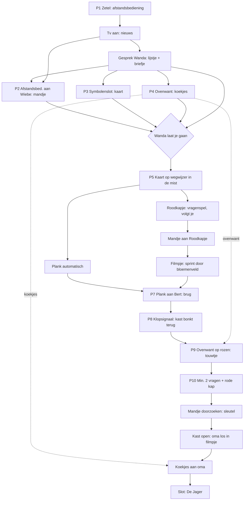

# Ronde 1: Game design-review *De Zaak van de Rode Zakdoek*

Prioriteiten: **MUST** = logisch gat of mogelijke softlock. **SHOULD** = duidelijkheid of pacing. **NICE** = extra plezier.

---

## 1. Logische gaten en tegenstrijdigheden

### 1.1 Afstandsbediening: tv én Wiebe (MUST)
Op zich klopt het: eerst het nieuws, dan krijgt Wiebe de afstandsbediening en zet hij tekenfilms op. Het probleem zit in de **volgorde**. Wiebe bestaat vanaf de eerste seconde. Als de speler de afstandsbediening meteen aan hem geeft, komt het nieuws nooit en loopt het spel vast.
- **Voorstel:** `remote → Wiebe` mag pas na `SEEN_NEWS`. Doet de speler het eerder, dan zegt Walter: *"Straks, Wiebe. Papa kijkt eerst naar het nieuws."*
- Na P2 blijft de **tv aan met tekenfilms**. Als je de tv bekijkt: *"Een kat die een muis achterna zit. Altijd hetzelfde verhaal."* Klik je op de tv, dan zegt Wiebe: *"NIET AANKOMEN!"* Zo is de afstandsbediening echt verbruikt en is dat ook logisch.

### 1.2 Mandje, bloemen en sleutel: de tijdlijn (MUST)
De speler ziet het verhaal nu zo: Roodkapje sprint weg → ze is eerst bij oma → oma weigert iets te vertellen → Roodkapje bindt oma vast, sluit de kast af en verkleedt zich. Daar zitten drie gaten in:
1. **Wanneer plukte ze de bloemen?** Ze sprint meteen weg. → Het sluippaadje loopt **dwars door het bloemenveld**. In het filmpje grist ze al rennend bloemen mee (*"Bloemen! Voor! Oma!"*). Dat is één shot extra en het gat is dicht.
2. **Waarom zit de sleutel in het mandje?** Dat is logisch, want het mandje is het enige wat ze bij zich had. Laat het haar ook zelf zeggen bij de ontmaskering: *"Ik moest hem toch ergens verstoppen? Mijn kap heeft geen zakken."*
3. **"Drie uur in een kast"** kan niet: de race duurt een paar minuten. → *"Ik zit al een kwartier in een kast. Een KWARTIER!"*
4. **Hoe kwam Roodkapje binnen** als het touwtje vastzit in de rozen? Zij heeft een eigen sleutel ("ik kom elke zondag"), of ze gebruikt de **achterdeur**. Toon dat in het filmpje of laat het haar zeggen.

### 1.3 Het klopsignaal heeft geen effect op Roodkapje (MUST)
Roodkapje kent het geheime klopsignaal niet. Voor haar is het dus niets anders dan gewoon kloppen. Waarom doet ze dan wel open na *klop klop BONK*?
- **Herschreven P8:** bij gewoon kloppen antwoordt de oma-stem: *"Ik doe niet open voor vreemden, liefje."* Na het geheime signaal **antwoordt de kast van binnenuit**: *bonk bonk BONK!* (de echte oma herkent het signaal). Stilte. Dan zegt Roodkapje heel gretig: *"Een geheim klopje... Kom maar binnen! Trek maar aan het touwtje!"* Nu heeft het ritme een reden: het verraadt dat Walter de contactpersoon is, en dat wil Roodkapje uithoren.

### 1.4 Waarom een wegwijzer als je een kaart hebt? (SHOULD)
Als Walter de kaart heeft, kan hij gewoon de weg zoeken en heb je de wegwijzer niet nodig. → Gebruik de **mist** uit het weerbericht. Op het kruispunt hangt dikke mist en de drie paden zien er hetzelfde uit. De kaart toont **icoontjes** (molen, golfjes, huisje), en de speler draait de pijlen tot ze overeenkomen met de kaart. Zodra het klopt, trekt de mist op en springt Roodkapje tevoorschijn. Zo hangen nieuws en puzzel ook mooi aan elkaar.

### 1.5 De eigen ontwerpregels kloppen niet (SHOULD)
- "Nooit iets van twee scènes terug": de koekjes (scène 1→5), het briefje (1→4) en de ovenwant (1→4) breken die regel allemaal. → Herschrijf de regel: *"Alles wat in het hol gevonden wordt, staat op Wanda's lijstje of wordt tijdens het gebruik vermeld."*
- "Max twee stappen": P11 heeft er nu vier (mandje, sleutel, losmaken, koekjes). → Laat het **losmaken in het filmpje** gebeuren, zodat P11 = sleutel vinden → kast openen, en de koekjes een korte afsluiter zijn.

### 1.6 Kleine dingen (NICE)
- Roodkapje vraagt *"Waarom is het mandje leeg?"*. Laat Walter antwoorden: *"De koekjes zitten in mijn cardigan. Daar zijn ze veilig."* Dan is het ook duidelijk waarom de koekjes niet mee weggaan met het mandje.
- Het mandje door de kier in het gordijn werkt goed als vooruitwijzing. Bekijk-reactie: *"Hé... dat lijkt op MIJN mandje."*

---

## 2. Softlocks en volgorde

| # | Situatie | Risico | Regel | Prio |
|---|---|---|---|---|
| S1 | Afstandsbediening aan Wiebe vóór het nieuws | nieuws komt nooit | blokkeren tot `SEEN_NEWS` (1.1) | MUST |
| S2 | Vertrekken uit het hol met iets te weinig | vast in het bos | Wanda houdt Walter tegen en **noemt wat er ontbreekt**: *"En de koekjes, Walter?"* Vóór het nieuws zegt Walter zelf: *"Ik ga nergens heen. Ik zit net."* | MUST |
| S3 | Ovenwant aan Bert gegeven (hoedje) | geen ovenwant voor P9 | Bert geeft hem meteen terug: *"Staat me niet, maat."* De want verlaat de inventaris **nooit**. | MUST |
| S4 | Plank laten liggen en naar de beek lopen | speler zit vast aan de beek | terugwandelen naar het kruispunt mag altijd. Beter nog: Walter pakt de plank **automatisch** op na de wegwijzerpuzzel (*"Die kan van pas komen"*). | MUST |
| S5 | Na het "Ik ga mee" naar de beek lopen | P6 wordt overgeslagen | Roodkapje loopt mee en blijft voor het pad staan: *"Waar gaan we naartoe? Waarom loop je zo snel?"* | MUST |
| S6 | Koekjes aan Wiebe/Roodkapje/Bert geven | koekjes kwijt | weigeren met een grap. Wiebe eet er hoogstens één (3→2), maar er blijft **altijd ≥1** over. | MUST |
| S7 | Vraag over de rode kap als eerste stellen | onduidelijke trigger | de kap-vraag verschijnt pas na ≥2 andere vragen. Bekijk je het plukje eerder: *"Hm. Rood. Waar heb ik dat nog gezien?"* De vraag wordt dan klaargezet. | MUST |
| S8 | Mandje aanklikken vóór de ontmaskering | sleutel te vroeg | vóór de ontmaskering is het mandje een **aanwijzing** (zie 4), en de sleutel ligt er nog niet "vrij". Roodkapje: *"Afblijven! Dat zijn... oma-bloemen."* | SHOULD |
| S9 | Mandje geven vóór de suggestie om bloemen te plukken | geen probleem, wel verwarrend | *"Waarom geef je me een mandje? Is dit omkoperij? Ik schrijf het op."* Daarna komt de bloemen-optie vanzelf vrij. | SHOULD |

Het hol hoeft na het vertrek niet meer bereikbaar te zijn. Tussen kruispunt, beek en huisje mag je vrij heen en weer wandelen.

---

## 3. Pacing (15 minuten)

Een ruwe schatting van de filmpjes: opening 0:20, nieuws 0:45, Wanda 1:00, vergissing 0:40, Bert 0:20, ontmaskering 1:00, slot 1:00. Samen is dat **±5 minuten**, een derde van de speeltijd. Voor 8-jarigen is dat te veel praten.

- **SHOULD:** zet een budget van **max 3,5 min** voor filmpjes. Zet Wanda's uitleg om in een **interactief lijstje**: ze noemt kort de vier dingen, en de details komen pas als je bij elk voorwerp opnieuw met haar praat. Elke zin kan je wegklikken.
- **SHOULD:** scène 3 (Bert) en scène 4 hebben maar één puzzel en een korte weg. Dat is prima als rustpunt, maar dan moeten er **optionele dingen** zijn (zie hieronder). Scène 1 heeft juist te veel: 4 puzzels + 2 filmpjes in 4 minuten is krap. Reken 5 minuten voor scène 1 en neem die minuut van scène 2.
- **NICE:** elke scène krijgt minstens **5 optionele bekijk- of klik-grappen**:
  - *Hol:* sok uit de zetel (bekijken: *"Die zoek ik al sinds Kerstmis"*), Wanda's breiwerk (*"Weer een sjaal met rare patroontjes"*, wat vooruitwijst naar oma's codes), raam, kruimel, tv-kastje.
  - *Kruispunt:* paddenstoelen (*"Rode met witte stippen. Die eet ik niet, die zien er eng gezond uit"*), boomstronk, bloemenveld, Walters pantoffels.
  - *Beek:* vis die naar Walter kijkt, de dam (*"Is dat... een brugleuning?"*), de rode kap aan de overkant.
  - *Huisje:* **brievenbus** (staat er nu zonder functie: een folder *"Kastenverkoop. Nu met slot!"*), raam, rieten dak.
  - *Binnen:* een boekenkast vol spionagethrillers, een breimand.

---

## 4. Herschreven P10: de ontmaskering (SHOULD)

Voeg **het mandje** toe als vijfde aanwijzing: *"Grootmoeder, wat heb jij een bekend mandje!"* → *"Dat is... een heel gewoon mandje. Er zijn heel veel mandjes."* (Dat is dezelfde smoes die Walter zelf gebruikte op het kruispunt.) Zo wijst het mandje al voor de ontmaskering naar P11.

Duidelijke regel: **vragen gesteld ≥ 2 → de vraag over de rode kap komt vrij → stel die vraag → ontmaskering.** Het rode plukje bekijken mag altijd, maar zet de vraag alleen klaar.

---

## 5. State-/flagmodel

```
# Scène 1
HAS_REMOTE, SEEN_NEWS, TALKED_WANDA
REMOTE_GIVEN_WIEBE  → HAS_BASKET
DRAWER_OPEN         → HAS_MAP
HAS_MITT, HAS_COOKIES (teller cookies=3, min 1)
HAS_NOTE            (gezet door TALKED_WANDA)
CAN_LEAVE_DEN = SEEN_NEWS & HAS_BASKET & HAS_MAP & HAS_COOKIES & HAS_NOTE

# Scène 2
SIGNPOST_SOLVED     → mist weg, HAS_PLANK, RK_APPEARED
RK_FOLLOWING        (blokkeert paden)
RK_FLOWER_OPTION    (dialoogoptie vrij)
BASKET_GIVEN_RK     → RK_GONE, RACE_ON

# Scène 3
PLANK_GIVEN_BERT    → BRIDGE_FIXED

# Scène 4
KNOCK_SOLVED        → kast bonkt terug, ROPE_HINT
ROPE_FREED          → DOOR_OPEN

# Scène 5
CLUE_GLASSES/HANDS/FEET/BASKET  (bekeken)
Q_ASKED (teller), Q_REDCAP_UNLOCKED = Q_ASKED>=2 & CLUE_REDHAIR
UNMASKED            → mandje doorzoekbaar
HAS_KEY → CLOSET_OPEN → GRANNY_FREE
COOKIES_GIVEN_GRANNY → FINALE
```

Het **detectiveboekje** leest rechtstreeks van deze flags. Elke open doelstelling = een `goal` met een conditie en drie hintteksten. Zo raken de hints nooit uit sync met de toestand van het spel.

---

## 6. Herziene afhankelijkheidsgraaf



---

## 7. Verkeerde-voorwerp-reacties

**MUST:** elk voorwerp heeft een standaardzin (*"Dat gaat 'm niet worden"*), en elk personage ook. Daarnaast moeten deze combinaties zeker een eigen grap krijgen, omdat kinderen ze gegarandeerd proberen:

| Voorwerp → doel | Reactie |
|---|---|
| Koekjes → Wiebe | Wiebe pakt er één. *"Nog twee. Niet aan mama zeggen."* (3→2, één keer) |
| Koekjes → Roodkapje | *"Van een vreemde wolf? Mama zegt: nooit. ...Wat voor koekjes?"* |
| Koekjes → Bert | (bestaat al) *"Ik ben een bever, geen kabouter."* |
| Ovenwant → Bert | hoedje, en hij geeft hem terug (S3) |
| Ovenwant → Wiebe | Wiebe gebruikt hem als handpop: *"Ik ben de want-ridder!"* en geeft hem terug |
| Ovenwant → kast (scène 5) | *"Die is niet heet. Alleen boos."* |
| Kaart → Roodkapje | *"Een kaart! Waar is de schat? Waarom is er geen schat?"* |
| Kaart → Bert | *"Ik heb geen kaart nodig, maat. Ik ben de kaart."* |
| Plank → beek of brug | *"Eén plank. Ik ben een wolf, geen koorddanser."* |
| Plank → Roodkapje | *"Wil je me slaan? Ik schrijf het op."* |
| Briefje → Roodkapje | Walter verstopt het meteen: *"Euh. Boodschappenlijstje."* |
| Briefje → Bert | Bert klopt het ritme op de dam: *"Lekker beat, maat."* |
| Afstandsbediening → oven / Wanda / voordeur | *"Volgende zender... Nee, nog altijd een oven."* (de afstandsbediening verlaat het hol nooit, dus alleen daar nodig) |
| Koekjes → "grootmoeder" (vóór de ontmaskering) | *"Mmm! ...Ik bedoel: dank je wel, liefje. Waar zijn de wolven?"* De koekjes gaan niet weg. |
| Sleutel → Roodkapje | *"Nooit gezien. Wat is een sleutel?"* |
| Klikken op de rozen zonder want | (bestaat al) *"Eerst al de oven en nu dit."* Dat is meteen een hint. |

**NICE:** combineer-grappen in de inventaris: koekjes + ovenwant (*"Ze zijn al afgekoeld, Walter"*), kaart + briefje (*"Een schattenkaart met muziek!"*).
